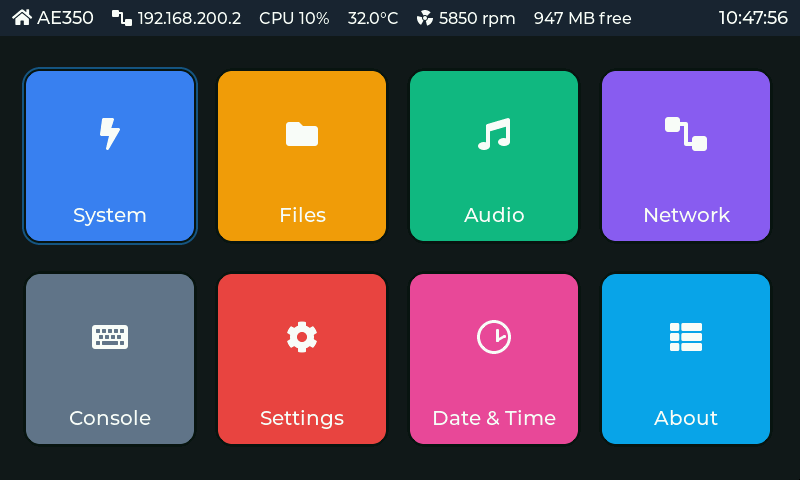
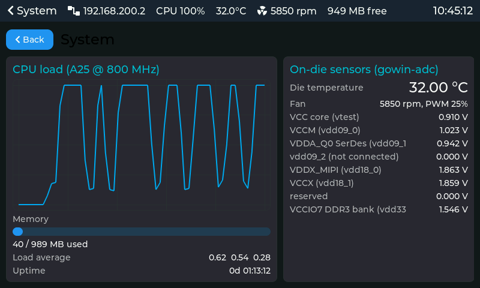
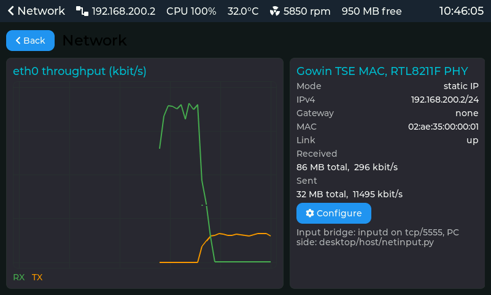
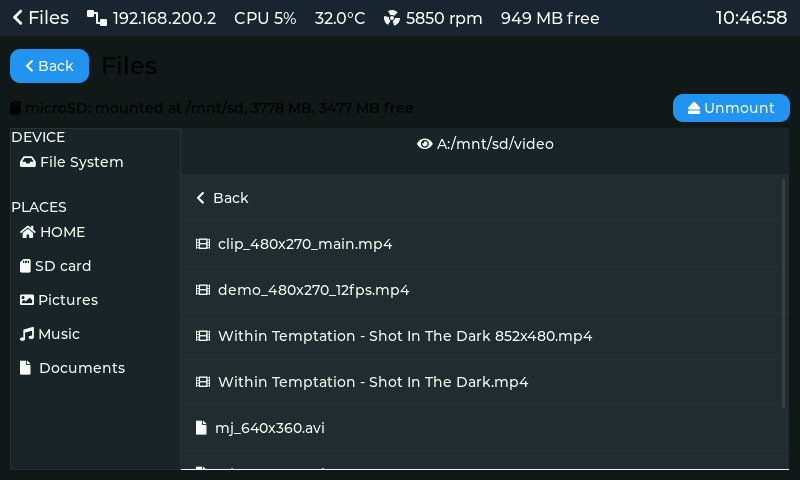
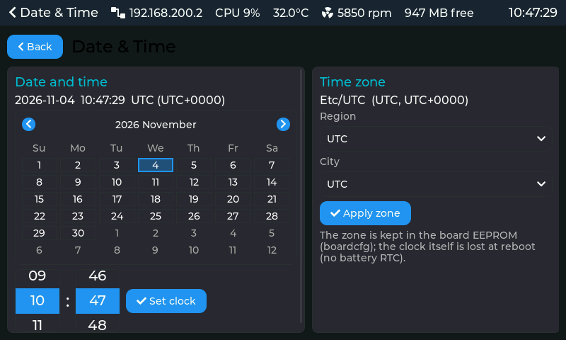

# Tang Mega 138K Pro — RISC-V Linux on the Gowin AE350

A Gowin EDA FPGA project for the **Sipeed Tang Mega 138K Pro Dock** (GW5AST-138B,
Arora V) that brings up the FPGA's hard **Andes AE350 SoC** (A25 core, rv32imafdc,
800 MHz), surrounds it with custom fabric peripherals, and boots **Linux 6.12** to a
busybox userspace with gigabit Ethernet, an 800×480 LCD desktop, audio, microSD,
sensors and fan control.

The defining constraint: this SoC has **no coherence manager**, so hardware atomics
(`amo*`, `lr/sc`) hang on a DRAM cache miss. The whole stack is therefore built
**single-hart "soft-atomic"**: OpenSBI, the kernel and the musl libc all replace
atomic read-modify-write with interrupt-disabled plain loads and stores. See
[doc/06-key-findings.md](doc/06-key-findings.md) and [CACHE_ISSUES.md](CACHE_ISSUES.md).

## What works

| Feature | Fabric block (`src/rtl/`) | Linux side | Notes |
|---|---|---|---|
| 1 GB DDR3-800, 32-bit bus | `ddr_bridge/` + Gowin DDR3 PHY | — | line-buffered AHB→DDR3 bridge, ~23× the stock bridge; video read port; perf counters in `ddr_perf.v` |
| Gigabit Ethernet | `eth_dma/` + Gowin TSE MAC | `gw_tse` (PATCHES / kernel fork) | descriptor-ring DMA with 64-bit INCR bursts; TCP ≈65 Mbit/s RX, ≈40 TX; ssh/scp/sftp via dropbear |
| 5" 800×480 RGB LCD | `video/` | `gowin-lcdfb` fbdev | scans the framebuffer straight from DDR3; fbcon + LVGL 9.6 desktop (`src/apps/desktop/`: system monitor, files, audio, network with an EEPROM-backed configuration dialog, console, date & time with tzdata, settings) |
| Audio (PT8211 DAC) | `audio/` | ALSA `gowin-pt8211` | own DMA fetch engine, 2048-frame FIFO |
| microSD (4-bit SD host) | `sdhost/` | `gowin-sdhost` mmc_host | `/dev/mmcblk0`, ~6 MB/s read / 3 MB/s write, mounted at `/mnt/sd` |
| Die temperature, supply rails | `sensor/` | hwmon `gowin-adc` | the GW5AST's two hard ADC cores |
| 4-pin fan | `fan/` | hwmon `gowin-fan` + `S80fan` curve | PWM + tacho on header M1 |
| Board EEPROM (1 KB, I2C) | `gpio/` | `gpio-mmio` + `i2c-gpio` + `i2c-mux-gpio` + `at24`; `boardcfg` daemon (`src/apps/boardcfg/`) | the Dock's `SYS_TWI` bus and 8-way mux; persistent MAC (read by the kernel at boot), hostname, time zone, serial, network (static IP/gateway/DNS or DHCP): `boardcfg set KEY VALUE` |
| Keyboard / mouse | — | `inputd` → `/dev/uinput` | sent from the PC over TCP (`src/apps/desktop/host/netinput.py`) |
| Console | — | UART2, 115200 | header pin B19; `scripts/uart_console.py` |
| Video playback | `video/` YUV 4:2:0 scan-out, `idct/` JPEG decoder | `vidplay` (`src/apps/vidplay/`, trimmed static FFmpeg 7.1.1), gowin-lcdfb YUV buffers, `gowin-idct` | MJPEG + AAC/MP3 from the Files panel at 25 fps with ~1 ms of CPU per 800×480 frame: the gateware decodes the JPEG straight into a scan-out buffer that the LCD core converts, scales and overlays with the playback bar. H.264 was dropped: memory-latency bound on this SoC (no L2, ~1.4 µs per cache miss), ~12 fps at 480×270. See [doc/07-cores.md](doc/07-cores.md) |
| Video scaler + OSD | `video/` (CTRL[4]/[5]) | gowin-lcdfb `SCALE` / `OSD` ioctls (`PATCHES/0006`), `vidplay` | nearest-neighbour scaling of the picture into a window, ARGB8888 overlay blended in hardware; vidplay fits videos to the panel and shows an info bar (Build 71 / kernel #84) |
| Hardware JPEG decoder | `idct/` @0xE8040000, EXTM master 4 | `gowin-idct` misc driver (`PATCHES/0013`), `vidplay` `jpeg_hw.c` / `idct_hw.c` | MJPEG frames decoded by the gateware: Huffman decoding, dequantisation, IDCT, frame assembly into the YUV planes (Build 70); the CPU only parses headers, ~1 ms per 800×480 frame. Build 69 had the IDCT only |
| Boot splash | `video/` | U-Boot `gowin_lcd` driver (fork) | `src/splash/splash.bmp` on the LCD from U-Boot until the kernel's fbdev driver starts |

Current state in flash: gateware **Build 71**, kernel **#87**, keyed-autoboot U-Boot (2026-11-04).

## The desktop

`lvdesk` (LVGL 9.6, static musl, `src/apps/desktop/`) runs on the 5" panel; keyboard and
mouse come from a PC over TCP. The status bar shows link state, CPU, die temperature, fan
rpm, free memory and the clock. Screens captured from the board's framebuffer:



| System: CPU load, memory, on-die sensors, fan | Network: throughput and eth0, static/DHCP settings in the EEPROM |
|---|---|
|  |  |
| **Files: browse, play video and audio, mount the SD card** | **Date & Time: clock and tzdata time zone** |
|  |  |

`vidplay` with the playback bar on the LCD core's OSD layer, an 852×480 video fitted to the
panel by the core's scaler (computed from the hardware's arithmetic; the scan-out of YUV
buffers cannot be grabbed from the board):


Every panel and the player are described in [doc/08-applications.md](doc/08-applications.md).

## Repository layout

```
mega_138K_test.gprj      Gowin project (file list; impl/ holds process settings + build output)
src/rtl/                 all HDL: ae350_demo.v top, constraints, one directory per fabric block
                         (each with rtl/, tb/ and a README), the encrypted AE350 + MAC netlists,
                         PLLs and the DDR3 PHY netlist
src/firmware/            bare-metal test firmware (XIP from flash, UART banner, DMA self-test)
src/apps/                Linux userspace built here: desktop/ (LVGL desktop, inputd, wavplay)
                         and tests/ (hardware probes: atomics, memory throughput, fb, ...)
linux/                   kernel device tree, busybox config, the prebuilt static rootfs that
                         the kernel bakes into its initramfs, initramfs node list
external/                git submodules: the board forks of U-Boot, OpenSBI and Linux
PATCHES/                 the same board changes as patch series against pristine upstream,
                         plus the musl soft-atomic patch (see PATCHES/README.md)
scripts/                 gw_run.sh / gw_program.sh (Gowin flow), build_uboot.sh,
                         build_linux_boot.sh, build_musl_toolchain.sh, rootfs/ (one
                         reproducible build script per rootfs binary), uart_console.py,
                         ddr_perf.py, timing_summary.py
doc/                     the curated documentation set (start at doc/README.md)
```

## Getting started

```sh
git clone --recursive git@github.com:phoenix367/tang-mega-138K-Pro-demo.git
cd tang-mega-138K-Pro-demo
```

Toolchains (all by absolute path; see [BUILD.md](BUILD.md) for why):

| Target | Toolchain |
|---|---|
| Gateware | Gowin EDA 1.9.12.02 SP2, `GOWIN_PATH=<install root>` |
| Bare-metal firmware | Andes `nds32le-elf-newlib-v5` (`riscv32-elf-`), from the [Andes-Development-Kit releases](https://github.com/andestech/Andes-Development-Kit/releases) |
| U-Boot, OpenSBI, kernel | Andes `nds32le-linux-glibc-v5d` (`riscv32-linux-`), same release: PIE-capable ld, ilp32d libgcc |
| Rootfs / userspace | Bootlin `riscv32-ilp32d--musl--stable-2025.08-1` with the soft-atomic `libc.a`: `scripts/build_musl_toolchain.sh` |

Both Andes toolchains unpack under `ANDES_ROOT` (default `/mnt/data/toolchains`), which the
Makefiles and scripts read. Or skip the installs and build everything in Docker:

```sh
docker/bootstrap.sh --gowin-path /path/to/Gowin   # builds the image (~3 GB), writes docker/.env
docker/run.sh make -C src/firmware                # any command runs in the container, repo at /work
docker/run.sh                                     # interactive shell
```

The image holds all three toolchains and the host tools; the Gowin install stays on the
host and is bind-mounted read-only, with USB passed through for the programmer and the
UART console.

Build and program the gateware:

```sh
GOWIN_PATH=/path/to/Gowin STAGE=all  scripts/gw_run.sh      # synthesis + PnR -> impl/pnr/mega_138K_test.fs
GOWIN_PATH=/path/to/Gowin MODE=flash scripts/gw_program.sh  # or MODE=sram for a volatile load
```

Build and flash the Linux boot stack (U-Boot at flash 0x600000, gzipped OpenSBI+kernel
payload at 0x800000):

```sh
export LGNU=/path/to/riscv32-amd-linux-gnu-
scripts/config_uboot.sh && scripts/build_uboot.sh                      # external/u-boot
make -C external/linux ARCH=riscv CROSS_COMPILE=$LGNU tang_mega_138k_defconfig Image
FW_PAYLOAD_OFFSET=0x400000 LINUX_CROSS=$LGNU scripts/build_linux_boot.sh   # external/opensbi
```

Then `scripts/flash.sh bitstream uboot kernel` programs the board (or `docker/run.sh --flash ...`
from the container); [BOOT.md](BOOT.md) has the flash layout and the boot sequence. The
rootfs binaries are rebuilt with `scripts/rootfs/build_all.sh`.

## Documentation

| Where | What |
|---|---|
| [doc/README.md](doc/README.md) | Entry point: architecture, build, boot, firmware, the eth_dma engine, key findings |
| [BUILD.md](BUILD.md) | Every build flow with the exact commands, toolchain traps, flash layout |
| [BOOT.md](BOOT.md) | Booting Linux: U-Boot → OpenSBI → kernel, flash procedure, console |
| [CACHE_ISSUES.md](CACHE_ISSUES.md) | The no-coherence-manager investigation that led to the soft-atomic stack |
| [ETH_DMA_DESIGN.md](ETH_DMA_DESIGN.md) | Original design notes for the Ethernet DMA engine |
| [PATCHES/README.md](PATCHES/README.md) | What each patch changes and why |
| `src/rtl/<block>/README.md` | Register maps, timing notes and test procedure for each fabric block |
| `src/apps/desktop/README.md`, `src/firmware/README.md` | The LVGL desktop and the bare-metal firmware |
| [CLAUDE.md](CLAUDE.md) | Dense project reference kept for AI-assisted work; accurate, if terse |

## Related repositories

- [tang-mega-138k-u-boot](https://github.com/phoenix367/tang-mega-138k-u-boot),
  [tang-mega-138k-opensbi](https://github.com/phoenix367/tang-mega-138k-opensbi),
  [tang-mega-138k-linux](https://github.com/phoenix367/tang-mega-138k-linux): the
  `external/` submodules, each upstream plus one board commit and a `README.tang-mega-138k.md`.
- busybox is unmodified [mirror/busybox](https://github.com/mirror/busybox) at
  `371fe9f`, built from `linux/busybox.config`; the other rootfs tools (dropbear, doas,
  htop, tcpdump, nstat, sftp-server) are unmodified upstream releases pinned by URL and
  checksum in `scripts/rootfs/`.

## License

MIT, see [LICENSE](LICENSE). The AE350 SoC, Triple-Speed Ethernet MAC and DDR3 PHY are
Gowin/Andes IP delivered as encrypted netlists through the Gowin IDE and are subject to
their own licences; this repository holds the generated netlists, not their sources.
