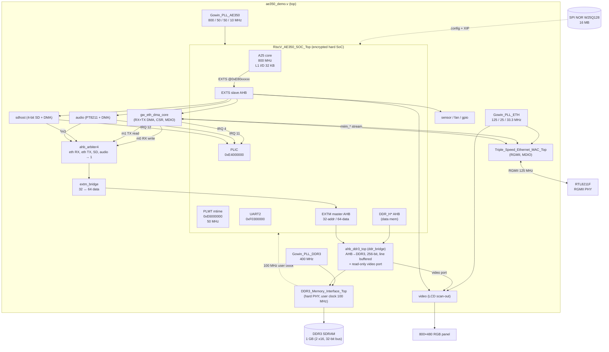
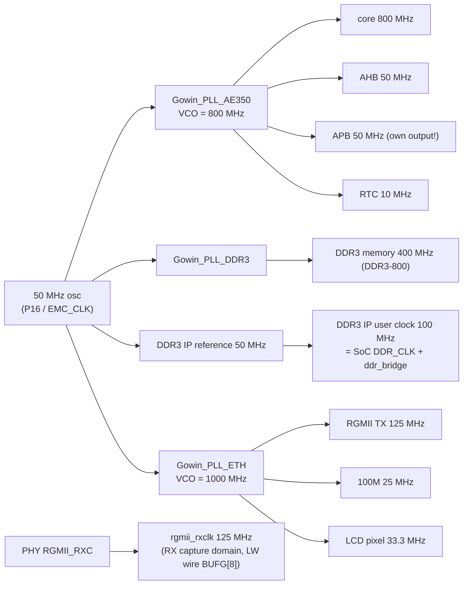

# Architecture

## 1. System overview

The active design (`ae350_demo_top`, top file `src/rtl/ae350_demo.v`) instantiates the
Gowin-provided **AE350 hard SoC** and surrounds it with fabric IP: the custom
`ddr_bridge` in front of the hard DDR3 PHY, the Triple-Speed Ethernet MAC with the
custom `eth_dma` engine, the LCD scan-out, audio, microSD, sensor, fan and board-GPIO
(Dock I2C bus + EEPROM) cores on the SoC's external AHB slave port, and three PLLs. The diagram shows the memory and
network paths; the other peripherals hang off the same EXTS/EXTM ports (section 2).



Key integration facts (`src/rtl/ae350_demo.v`):

- **`eth_dma` config** hangs off the SoC's **EXTS** external-AHB *slave* port — the
  CPU masters it; register window at **`0xE8000000`**.
- **`eth_dma` DMA** masters the SoC's **EXTM** external-AHB-*master-in* port (tied
  off in the stock reference) to reach DDR through the SoC interconnect — no
  custom DDR arbiter needed. EXTM is **32-bit address but 64-bit data**, so
  `extm_bridge.v` adapts the 32-bit DMA masters to 64-bit (write replicates to
  both lanes; read selects the lane by `HADDR[2]`).
- Four DMA masters merge onto EXTM through `src/rtl/audio/rtl/ahb_arbiter4.v`
  (fixed priority, registered grant = no mid-transfer preemption): eth RX-write
  `m0`, eth TX-read `m1`, the SD host's DMA `m2` and the audio fetch engine `m3`.
  It grew out of `eth_dma/rtl/eth_ahb_arbiter.v`, which replaced the Gowin
  AHBBusArbiter IP (that one only forwards a fixed 1 MB window at `0x80000000` and
  is unsuitable for DMA). The SoC's own DMAC cannot reach fabric cores at all.
- The LCD core does **not** use EXTM: it reads the framebuffer through a dedicated
  read-only **video port** on `ddr_bridge` (reading over EXTM cost the CPU ~37 % of
  its memory bandwidth).
- The **MDIO controller lives in the MAC** (`miim_*` + `mdc`/`mdio` pads are MAC
  ports), so `gw_eth_dma_core.miim_*` wires straight to it.
- MAC IRQ → SoC `EXT_INT[0]` → PLIC source 4.

## 2. Address map (CPU view)

| Region | Base | Size | Notes |
|---|---|---|---|
| DDR3 SDRAM (data) | `0x0000_0000` | 1 GB (all of it: 2 x16 chips, 32-bit bus) | DDR_H* AHB → `src/rtl/ddr_bridge/ahb_ddr3_top` → DDR3 PHY (x32, 256-bit user port) |
| Flash XIP (instr.) | `0x8000_0000` | 16 MB | maps to SPI-NOR offset `0x60_0000`; U-Boot runs here |
| PLIC | `0xE400_0000` | — | interrupt controller |
| PLMT (mtime) | `0xE600_0000` | — | machine timer, **50 MHz** tick |
| **eth_dma CSR (EXTS)** | `0xE800_0000` | 2 KB | DMA control/status, MDIO (see [05-eth-dma.md](05-eth-dma.md)); IRQ EXT_INT[0] = PLIC 4 |
| **LCD scan-out (EXTS)** | `0xE800_1000` | 256 B | `src/rtl/video/`, framebuffer address/timing; reads DDR via the bridge's video port |
| **Audio PT8211 (EXTS)** | `0xE800_2000` | 256 B | `src/rtl/audio/`, FIFO + DMA fetch engine; IRQ EXT_INT[1] = PLIC 11 |
| **ADC sensors (EXTS)** | `0xE800_4000` | 256 B | `src/rtl/sensor/`, die temperature + supply rails (`HADDR[14]`) |
| **Fan (EXTS)** | `0xE800_8000` | 256 B | `src/rtl/fan/`, PWM + tacho (`HADDR[15]`) |
| **Board GPIO (EXTS)** | `0xE801_0000` | 16 B | `src/rtl/gpio/`, data/direction pair for the Dock I2C bus, TWI mux, EEPROM WP (`HADDR[16]`) |
| **SD host (EXTS)** | `0xE802_0000` | 256 B | `src/rtl/sdhost/`, 4-bit SD + DMA (`HADDR[17]`); IRQ EXT_INT[2] = PLIC 12 |
| SMU | `0xF010_0000` | — | system management (HSM / reset) |
| UART2 | `0xF030_0000` | — | console (header pin B19 @ 115200) |
| WDT (atcwdt200) | `0xF050_0000` | — | watchdog (drives reset) |
| **DDR perf / bridge MODE (ext. APB)** | `0xF800_0000` | — | `src/rtl/ddr_perf.v`: bus event counters, trace, bridge MODE register (`scripts/ddr_perf.py`) |

EXTS register reads take one wait state (the read data is registered before the
SoC's pins for timing); writes are zero-wait. Every peripheral above has a README
next to its RTL with the full register map.

> The DMA engine's buffers live in **normal DRAM** (e.g. `0x0401_0000`); the custom
> arbiter forwards the full 32-bit address, so there is no low-1 MB / `0x80000000`
> aliasing constraint (that was a workaround for the old Gowin arbiter, now removed).

## 3. Dual-purpose configuration pins

The AE350 drives its SPI-flash on the FPGA's **dedicated MSPI/config pins** (the
SoC's instruction flash is the *same* SPI NOR that holds the bitstream). Those
pins are reserved by default, so PnR fails (`PR2017 … dedicated pin (MSPI)` /
`PR2028`) unless `impl/mega_138K_test_process_config.json` sets **`CPU`, `MSPI`,
and `SSPI` all = `true`**. Keep them `true` for any design reusing config pins.

## 4. Clock tree

Input is a single 50 MHz oscillator (`CLK`, pin P16). The Arora-V PLLA locks
`CLKOUT0` to `FCLKIN·(FBDIV+1)/(IDIV+1)` = 50 MHz, sets `VCO = CLKOUT0·ODIV0`,
then `CLKOUTn = VCO/ODIVn`.



Notes:

- All output frequencies are **verified on hardware** (clock-probe ÷256 +
  firmware `mcycle`/`mtime` calibration): core 800, AHB/APB/PLMT 50, RTC 10,
  DDR3 400, RGMII TX 125 MHz.
- The SoC's data-memory clock `DDR_CLK` (100 MHz) **is the DDR3 IP's user clock**
  (Build 64+), so `ddr_bridge` is single-clock; the AE350 PLL's 100 MHz output is
  unused. The DDR3 IP takes its 50 MHz reference straight from the board clock
  (Build 65+).
- `APB_CLK` must stay on its **own** PLL output even though it is 1:1 with `AHB_CLK`:
  fed from the AHB net, the SoC's PLIC drops interrupt completions (audio stalls).
  All 16 global clock wires are used and pinned with `CLOCK_LOC` in the `.cst`; the
  RGMII RX clock must stay on an LW wire or gigabit RX breaks. See
  [06-key-findings.md](06-key-findings.md).
- The **PLMT mtime runs at 50 MHz** — this is the `timebase-frequency` in the
  Linux/U-Boot DTs. The RTC (10 MHz raw, exposed as a 1 Hz calendar) is *not*
  used for fine timing.
- `rgmii_rxclk` is constrained at **125 MHz (8 ns)** in `src/rtl/ae350_demo.sdc` —
  see [06-key-findings.md](06-key-findings.md) for why the example's 50 ns value
  corrupted large RX frames.
- The A25 core (and the DDR3 controller) are **hard blocks** — 800 MHz is
  impossible in soft fabric, and the SDC therefore does not constrain `CLKOUT1`.

## 5. Source layout

```
src/rtl/
  ae350_demo.v            top: SoC + PLLs + DDR3 bridge + MAC + eth_dma + peripherals
  ae350_demo.cst / .sdc   pin, clock-wire and timing constraints
  riscv_ae350_soc/        encrypted Andes AE350 IP (.v synth netlist + .ipc config)
  gowin_pll_ae350/        core / AHB / APB / RTC PLL
  gowin_pll_ddr3/         DDR3 400 MHz PLL
  gowin_pll_eth/          Ethernet 125/25 MHz + LCD 33.3 MHz PLL
  ddr3_memory_interface_1g/  hard DDR3 PHY IP netlist (x32, 1 GB, DDR3-800) + regen recipe
  ddr_bridge/             AHB→DDR3 line-buffered bridge, video port (README, tb/run_all.sh)
  ddr_perf.v, pipe_counter.v  bus perf counters / MODE register on the external APB
  triple_speed_ethernet_mac/  Gowin TSE MAC (encrypted)
  gw_ahb_ethernet*.v      MAC wrapper
  eth_dma/                the custom DMA engine: rtl/, tb/, formal/, lib/ (see 05-eth-dma.md)
  video/                  LCD scan-out core (README)
  audio/                  PT8211 output core + DMA fetch engine, ahb_arbiter4 (README)
  sdhost/                 4-bit SD host + DMA (README)
  sensor/                 hard-ADC scan sequencer (README)
  fan/                    PWM + tacho (README)
  gpio/                   board control lines: Dock I2C bus + mux, EEPROM WP (README)
  key_debounce.v, pll_init.v  reset debounce, PLL bring-up
  led_blink.*             disabled sample design
src/firmware/             bare-metal AE350 test firmware + DMA self-test
src/apps/desktop/         LVGL desktop (lvdesk), inputd, wavplay; host/netinput.py
src/apps/tests/           userspace hardware probes (atomics, memory, fb, audio, ...)
linux/                    kernel DT, busybox config, rootfs, initramfs node list
external/                 U-Boot / OpenSBI / Linux board forks (submodules)
PATCHES/                  the board changes as patches; scripts/rootfs/ rebuilds the rootfs
```
