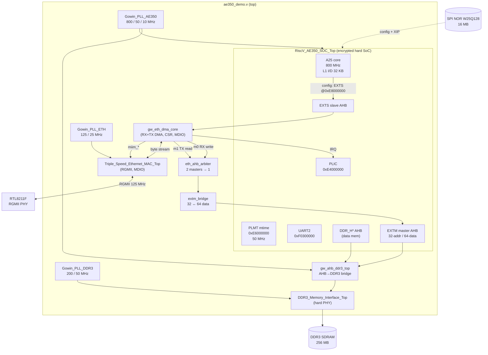
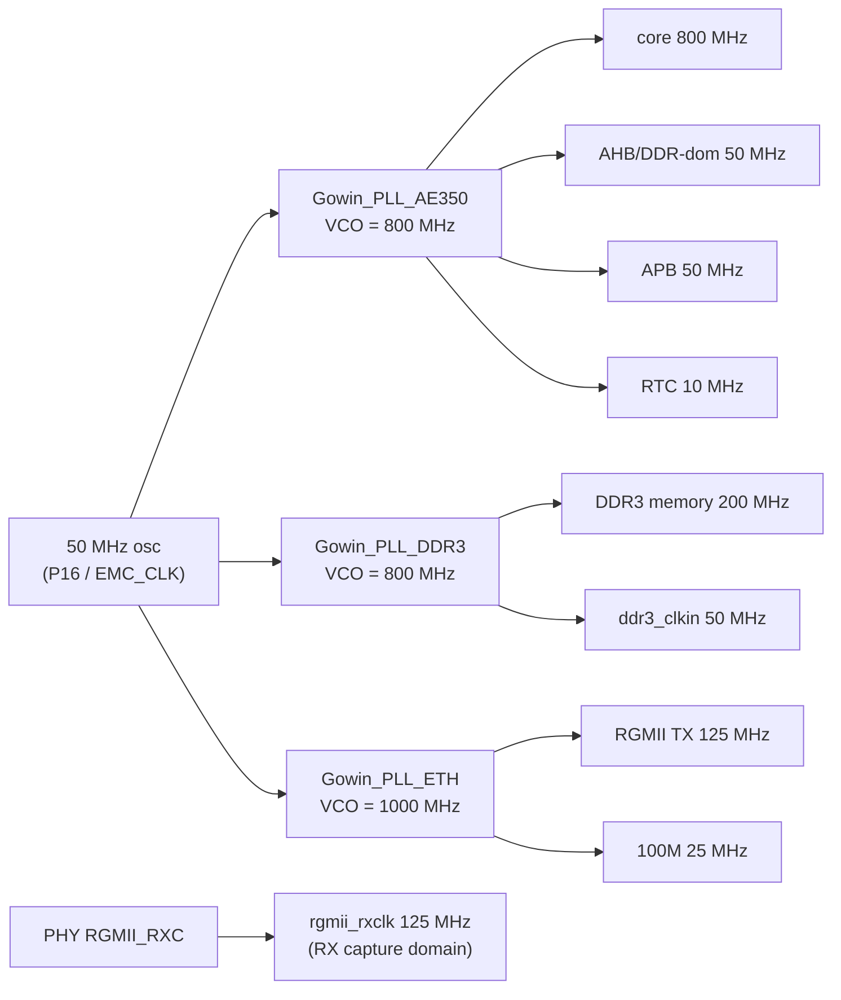

# Architecture

## 1. System overview

The active design (`ae350_demo_top`, top file `src/ae350_demo.v`) instantiates the
Gowin-provided **AE350 hard SoC** and surrounds it with fabric IP: an external
DDR3 controller bridge, the Triple-Speed Ethernet MAC, the custom `eth_dma`
engine, and three PLLs.



Key integration facts (`src/ae350_demo.v`):

- **`eth_dma` config** hangs off the SoC's **EXTS** external-AHB *slave* port — the
  CPU masters it; register window at **`0xE8000000`**.
- **`eth_dma` DMA** masters the SoC's **EXTM** external-AHB-*master-in* port (tied
  off in the stock reference) to reach DDR through the SoC interconnect — no
  custom DDR arbiter needed. EXTM is **32-bit address but 64-bit data**, so
  `extm_bridge.v` adapts the 32-bit DMA masters to 64-bit (write replicates to
  both lanes; read selects the lane by `HADDR[2]`).
- Two DMA masters (RX-write `m0`, TX-read `m1`) merge through
  `eth_ahb_arbiter.v` (fixed priority **RX > TX**, registered grant = no
  mid-transfer preemption). This replaced the Gowin AHBBusArbiter IP, which only
  forwards a fixed 1 MB window at `0x80000000` and is unsuitable for DMA.
- The **MDIO controller lives in the MAC** (`miim_*` + `mdc`/`mdio` pads are MAC
  ports), so `gw_eth_dma_core.miim_*` wires straight to it.
- MAC IRQ → SoC `EXT_INT[0]` → PLIC source 4.

## 2. Address map (CPU view)

| Region | Base | Size | Notes |
|---|---|---|---|
| DDR3 SDRAM (data) | `0x0000_0000` | 256 MB | DDR_H* AHB → `gw_ahb_ddr3_top` → DDR3 PHY |
| Flash XIP (instr.) | `0x8000_0000` | 16 MB | maps to SPI-NOR offset `0x60_0000`; U-Boot runs here |
| PLIC | `0xE400_0000` | — | interrupt controller |
| PLMT (mtime) | `0xE600_0000` | — | machine timer, **50 MHz** tick |
| **eth_dma CSR (EXTS)** | `0xE800_0000` | 4 KB | DMA control/status, MDIO (see [05-eth-dma.md](05-eth-dma.md)) |
| SMU | `0xF010_0000` | — | system management (HSM / reset) |
| UART2 | `0xF030_0000` | — | console (header pin B19 @ 115200) |
| WDT (atcwdt200) | `0xF050_0000` | — | watchdog (drives reset) |

> The DMA engine's buffers live in **normal DRAM** (e.g. `0x0401_0000`); the custom
> arbiter forwards the full 32-bit address, so there is no low-1 MB / `0x80000000`
> aliasing constraint (that was a workaround for the old Gowin arbiter, now removed).

## 3. Dual-purpose configuration pins

The AE350 drives its SPI-flash on the FPGA's **dedicated MSPI/config pins** (the
SoC's instruction flash is the *same* SPI NOR that holds the bitstream). Those
pins are reserved by default, so PnR fails (`PR2017 … dedicated pin (MSPI)` /
`PR2028`) unless `impl/mega_138K_test_process_config.json` sets **`CPU`, `MSPI`,
and `SSPI` all = `true`**. Keep them `true` for any design reusing config pins.

## 4. Clock tree

Input is a single 50 MHz oscillator (`CLK`, pin P16). The Arora-V PLLA locks
`CLKOUT0` to `FCLKIN·(FBDIV+1)/(IDIV+1)` = 50 MHz, sets `VCO = CLKOUT0·ODIV0`,
then `CLKOUTn = VCO/ODIVn`.



Notes:

- All output frequencies are **verified on hardware** (clock-probe ÷256 +
  firmware `mcycle`/`mtime` calibration): core 800, AHB/APB/PLMT 50, RTC 10,
  DDR3 200, RGMII TX 125 MHz.
- The **PLMT mtime runs at 50 MHz** — this is the `timebase-frequency` in the
  Linux/U-Boot DTs. The RTC (10 MHz raw, exposed as a 1 Hz calendar) is *not*
  used for fine timing.
- `rgmii_rxclk` is constrained at **125 MHz (8 ns)** in `src/ae350_demo.sdc` —
  see [06-key-findings.md](06-key-findings.md) for why the example's 50 ns value
  corrupted large RX frames.
- The A25 core (and the DDR3 controller) are **hard blocks** — 800 MHz is
  impossible in soft fabric, and the SDC therefore does not constrain `CLKOUT1`.

## 5. Source layout

```
src/
  ae350_demo.v            top: SoC + PLLs + DDR3 bridge + MAC + eth_dma
  ae350_demo.cst / .sdc   pin + timing constraints
  riscv_ae350_soc/        encrypted Andes AE350 IP (.v synth + .vo sim)
  gowin_pll_ae350/        core/AHB/RTC PLL
  gowin_pll_ddr3/         DDR3 PLL
  gowin_pll_eth/          Ethernet 125/25 MHz PLL
  ddr3_memory_interface/  hard DDR3 PHY IP
  gw_ahb_ddr3*.v          AHB→DDR3 bridge
  triple_speed_ethernet_mac/  Gowin TSE MAC (encrypted)
eth_dma/
  rtl/                    the custom DMA engine (see 05-eth-dma.md)
  tb/                     iverilog testbenches
  lib/                    vendored FPGADesignElements (CDC/FIFO primitives)
firmware/                 bare-metal AE350 test firmware + DMA self-test
linux/                    kernel DT, rootfs, initramfs node list, driver copy
```
