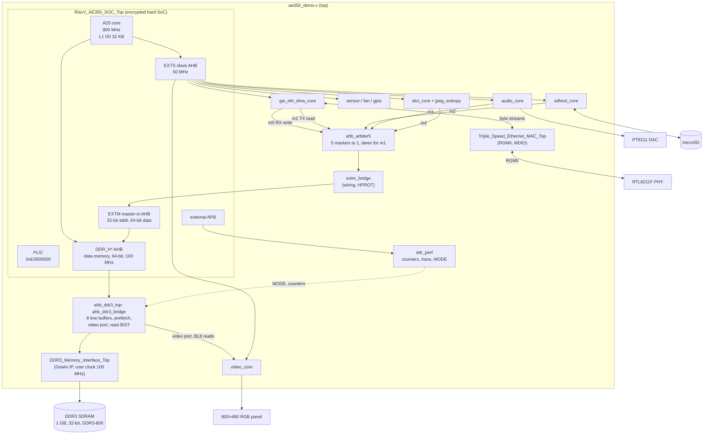
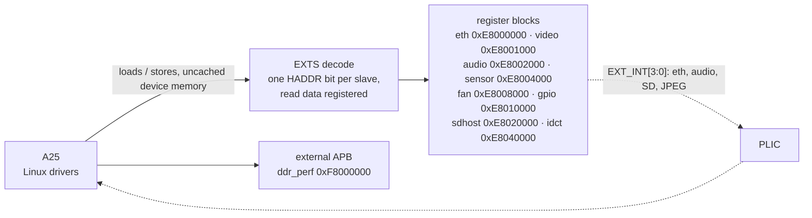
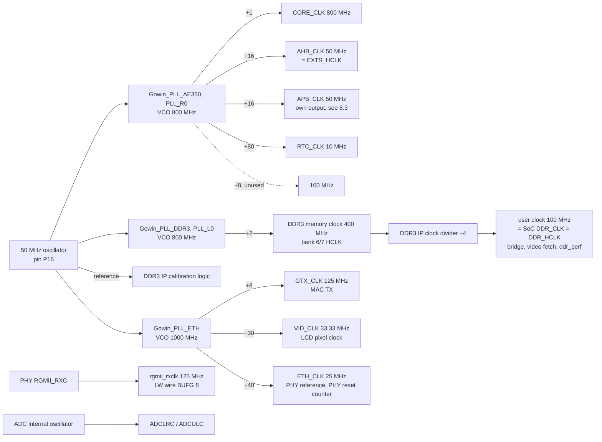
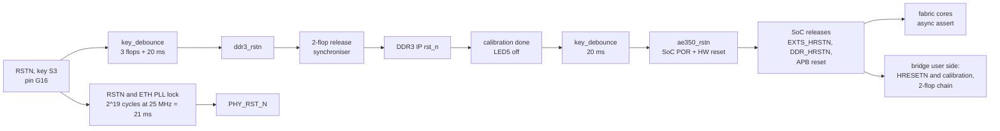
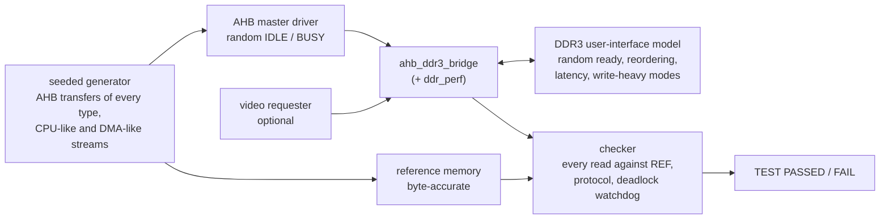
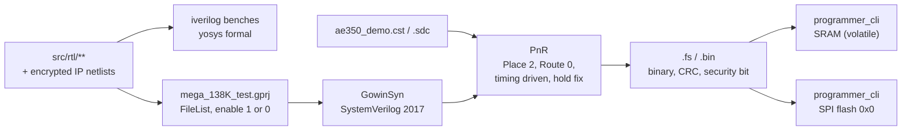

# mega_138K_test — hardware architecture

The gateware turns the Tang Mega 138K Pro Dock into a Linux computer. It sits around
the Andes AE350 hard SoC of a Gowin GW5AST-138B:
- a DDR3 bridge;
- an Ethernet DMA engine;
- an LCD core with YUV scan-out, scaler and OSD;
- a JPEG decoder;
- audio, microSD, sensor, fan and board-GPIO cores.

The A25 core of the SoC runs Linux 6.12 and drives all of them. This document
describes the hardware in the order of an FPGA architecture document: requirements,
top-level structure, clocks and reset, memory, datapath, interfaces, verification, and
implementation. The numbers are those of gateware **Build 72** (2026-11-05; the
implementation reports in `impl/` of 2026-11-05 00:43) and kernel #97/#98, unless a
section says otherwise.

| topic | document |
|---|---|
| each core's architecture, block diagram and registers; bus integration; the video path | [07-cores.md](07-cores.md) |
| each core's pins, testbench and measurements in detail | the README next to its RTL: `src/rtl/{ddr_bridge,video,idct,audio,sdhost,sensor,fan,gpio}/README.md` |
| the Ethernet DMA engine | [05-eth-dma.md](05-eth-dma.md), `ETH_DMA_DESIGN.md` |
| why things are the way they are (atomics, DDR speed, RGMII clock, timing closure) | [06-key-findings.md](06-key-findings.md) |
| build commands, toolchains, Docker | [02-build.md](02-build.md), `BUILD.md` |
| power-on to userspace, flash layout | [03-boot.md](03-boot.md), `BOOT.md` |
| the software that uses the cores | [08-applications.md](08-applications.md), `PATCHES/README.md` |
| board tests | `scripts/boardtest/README.md` |

---

## 1. Executive summary and system requirements

### 1.1 What the hardware does

The CPU is the hard **A25** core of the AE350 SoC:
- 800 MHz, RV32IMAFDC plus the Andes P (DSP), XAndesPerf and CoDense extensions;
- one hart;
- 32 KB I + 32 KB D L1 caches, no L2 and no coherence manager.

The fabric adds these blocks around it:

| block | does | rate |
|---|---|---|
| **ddr_bridge** (`src/rtl/ddr_bridge/`) | the SoC's data-memory AHB port to the Gowin DDR3 IP: 8 line buffers, stream prefetch, posted writes, overlapped reads; a read-only video port | 64-bit AHB at 100 MHz (800 MB/s raw); 152 MB/s sequential read, 74 MB/s memcpy measured |
| **DDR3 IP** (Gowin, encrypted) | 1 GB of DDR3-800 on a 32-bit bus, 256-bit user port | one BL8 = one 32-byte line |
| **eth_dma** + Gowin TSE MAC | descriptor-ring DMA for RX and TX, CSRs, MDIO pass-through; RGMII to the RTL8211F | 1 Gbit/s link; TCP 60–65 Mbit/s in, 40–45 out |
| **video** (`src/rtl/video/`) | LCD scan-out from DDR3: RGB565 or YUV 4:2:0 planes, BT.601 conversion, nearest-neighbour scaler, ARGB8888 OSD blend, frame CRC | 800 × 480 at 52.5 Hz, 33.3 MHz pixel clock |
| **idct** (`src/rtl/idct/`) | baseline JPEG decoding from a ring of records: Huffman, dequantisation, IDCT bit-exact with FFmpeg, whole bands written into YUV planes | ≈ 35 cycles per 8 × 8 block designed; an 800 × 480 frame in ~12 ms |
| **audio** (`src/rtl/audio/`) | PT8211 DAC output: 2048-frame FIFO, NCO sample clock, DMA fetch from an ALSA ring, frame CRC | 16-bit stereo, 48 / 44.1 kHz |
| **sdhost** (`src/rtl/sdhost/`) | native 4-bit SD host with CRC7/CRC16 engines and DMA | 25 MHz SD clock: 12.5 MB/s on the wire, 6.4 MB/s read measured |
| **sensor** (`src/rtl/sensor/`) | scan sequencer for the device's two hard ADCs: die temperature and six supply rails | one 9-slot scan every ~60 ms |
| **fan** (`src/rtl/fan/`) | PWM output and tacho input for the Dock's fan header | 25 kHz PWM, 2000 steps |
| **gpio** (`src/rtl/gpio/`) | six data/direction lines: the Dock's I²C bus, its 8-way mux select, the EEPROM write protect | bit-banged I²C at ~100 kHz |
| **ddr_perf** (`src/rtl/ddr_perf.v`) | data-memory bus event counters, a 1024-entry bus trace, the bridge's MODE register, the read BIST's results | 44 counters on DDR_HCLK |

The cores share no datapath. Each one reads and writes DDR3, and software on the A25
chains them. For example, vidplay parses a JPEG into records, the IDCT core writes
YUV planes, and the LCD core scans them out. The CPU programs every core through
registers on the SoC's external AHB slave port (EXTS). Four cores move data
themselves, on the SoC's external AHB master port (EXTM): Ethernet, SD, audio and
JPEG. The LCD core reads through its own port on the bridge.

### 1.2 Target applications, throughput and latency

The project has no external requirement specification. Its targets were set as it went:
- Linux on the A25 with a busybox userspace;
- a gigabit network link;
- a desktop on the 5" panel;
- video playback with sound: MJPEG at 25 fps, at 800 × 480 first and later at 720p.

The board test harness (`scripts/boardtest/`) measures these on every reflash. The
figures below are from the run of 2026-11-05 13:37 on Build 72 + kernel #97, which
passed all four groups (34 PASS, 2 WARN):

| workload | result |
|---|---|
| DDR sequential read / memset / memcpy (`ddr_memtest`) | 152.1 / 122.1 / 73.6 MB/s; dependent miss 1.54 µs; 2.99 wait states per read beat on the bus |
| TCP to / from the board (32 MB, md5 checked) | 60 / 45 Mbit/s (kernel #98: 60 / 42) |
| ping, 50 packets | 0 % loss, 1.36 ms average |
| microSD read / write (32 MB, md5 checked) | 6.4 / 4.7 MB/s |
| MJPEG playback, 852 × 480 and 1280 × 720 with audio | 250 of 250 frames on the panel at 25 fps; longest hold 57 ms; CPU 55 % / 59 % |
| JPEG decode per frame, gateware vs FFmpeg on the A25 (`vidplay -C`, bit-exact) | 852 × 480: 15.5 vs 42.1 ms; 1280 × 720: 29.1 vs 87.3 ms |
| audio, 4 WAV files at 48 and 44.1 kHz | bit-exact (frame count + CRC), 0 xruns |
| boot | U-Boot decompresses the 7.36 MB payload in ~9 s; Linux runs `/init` 7.2 s after the kernel starts; the Ethernet link is up at 10.4 s |

Every core's output is checked bit-exactly on the board through its CRC or against a
software model (§7.1), so these figures are measured on correct output.

### 1.3 Power envelope

There is no power budget beyond the Dock's own USB-C supply and its fan. The board has
no current-sense parts, so board power is not measured.
- **What is measured:** the sensor core reads the die temperature (32.75 °C on
  2026-11-05, with the fan running) and six supply rails: VCC 0.910, VCCM 1.020,
  VDDA_Q0 0.942, VDDX_MIPI 1.863, VCCX 1.859 and VCCIO7 1.546 V.
- **The fan:** the stock fan is 3-pin and runs at full speed (~5800 rpm). The fan core
  can read its tacho but cannot slow it.

Gowin's power analyser (`impl/pnr/mega_138K_test.power.html`) estimates **1.087 W** for
the FPGA:
- 98 mW quiescent and 989 mW dynamic;
- junction 38.3 °C at 25 °C ambient, no heat sink, no airflow;
- default toggle rates of 12.5 %, no VCD, so the confidence is low.

By hierarchy (mW):

| block | power |
|---|---|
| DDR3 IP | 376 |
| ddr_bridge | 280 |
| video | 241 |
| idct | 99 |
| eth_dma | 43 |
| ddr_perf | 18 |
| PLLs | 35 (13 + 12 + 10) |
| sdhost | 11 |
| audio | 11 |

By clock (dynamic, mW): ddr3_sysclk 646, ddr3_memory_clk 200, AHB 133, lcd_pclk 61.

### 1.4 External interfaces

| interface | pins | I/O | use |
|---|---:|---|---|
| board clock | 1 | P16, 50 MHz | all three PLLs and the DDR3 IP's reference |
| DDR3, 2 × H5TQ4G63EFR (x16) | 71 | SSTL15 / SSTL15D (CK, 4 DQS pairs), 1.5 V, banks 6 / 7 | the data memory (§4.4) |
| SPI NOR, W25Q128 16 MB | 6 | the FPGA's dedicated MSPI configuration pins | the bitstream, U-Boot (XIP), the splash, the kernel payload |
| RGMII to the RTL8211F PHY | 16 | LVCMOS33; RXC on C23 | Ethernet: TXC/TX_CTL/TXD[3:0], RXC/RX_CTL/RXD[3:0], MDC/MDIO, the PHY's 25 MHz clock and reset |
| LCD, Sipeed 5" 800 × 480 RGB | 20 | LVCMOS33; data DRIVE 24 | clock, DE, RGB666 |
| PT8211 DAC + amplifier enable | 4 | LVCMOS33 | audio: BCK, LRCK, DIN, PA_EN |
| microSD slot J19 | 7 | LVCMOS33, pull-ups on CMD, DAT and DET | 4-bit SD bus + card detect |
| Dock I²C, mux select, EEPROM WP | 6 | LVCMOS33 | the ZD24C08A EEPROM behind the 74HC4051 mux |
| fan header M1 | 2 | LVCMOS33, bank 2 | PWM, tacho |
| UART2 | 2 | B19 TX, A17 RX (pull-up) | the console, 115200 baud |
| JTAG | 5 | | the A25's debug module |
| keys, LEDs | 4 + 4 | | reset key S3, keys S0–S2 and LEDs on the SoC's GPIO, LED5 = DDR3 not calibrated |
| debug | 2 | U16 / U15 | EXTM handshake probe |

There are 150 ports on 145 pads: the 5 differential pairs are the DDR3 CK and DQS.
There is no PCIe, no USB, no HDMI and no camera in the design.

### 1.5 Device, board and toolchain

| item | value |
|---|---|
| board | Sipeed Tang Mega 138K Pro Dock |
| device | Gowin Arora V **GW5AST-LV138FPG676AC1/I0** (project part `gw5ast138b-007`), FCPBGA676, speed grade C1/I0 |
| fabric | 138 240 LUT4/ALU, 139 140 registers, 340 BSRAM (18 Kbit), 298 DSP, 12 PLL, 312 user I/O |
| hard blocks used | AE350 SoC, DDR3 PHY (DQS, DDRDLL, CLKDIV), ADCLRC + ADCULC |
| processor | Andes A25 (`marchid 0x80000a25`) at 800 MHz, sv32 MMU, CCTL cache-control CSRs, `mmsc_cfg 0x2007f039` |
| gateware tools | Gowin EDA V1.9.12.02 SP2 (`gw_sh`, GowinSyn, `programmer_cli`); a floating licence server |
| RTL simulation and formal | Icarus Verilog (`iverilog` / `vvp`); Yosys 0.33 + ABC for the bridge's proof |
| software | Linux 6.12, OpenSBI v1.8, U-Boot 2026.07-rc3 (board forks in `external/`); Andes GCC 14.2; Bootlin musl GCC 14.3 |

---

## 2. Top-level architecture

### 2.1 Block diagram

The datapath. The SoC has three AHB ports to the fabric:
- **DDR_H\*:** the data memory, 64-bit at 100 MHz, into the bridge.
- **EXTS:** a slave port for register access.
- **EXTM:** a master-in port through which the DMA masters reach the data memory.



The control path:



The top (`src/rtl/ae350_demo.v`) instantiates:

| instance | module | clocks | role |
|---|---|---|---|
| `u_Gowin_PLL_AE350`, `u_Gowin_PLL_DDR3`, `u_Gowin_PLL_ETH` | Gowin PLLs | board CLK | §3.1 |
| `u_key_debounce_ddr3`, `u_key_debounce_ae350` | `key_debounce` | CLK | the reset key → DDR3 reset; DDR3 calibration done → SoC reset (§3.4) |
| `u_RiscV_AE350_SOC_Top` | encrypted SoC | CORE 800, AHB 50, APB 50, RTC 10, DDR_CLK 100 | the CPU, PLIC, PLMT, UART2, WDT, SMU, GPIO; the fabric ports |
| `u_ahb_ddr3_top` | `ahb_ddr3_bridge` + `DDR3_Memory_Interface_Top` + `ddr_rd_bist` | DDR_HCLK = the IP's user clock | the data memory and the video port |
| `u_ddr_perf` | `ddr_perf` | DDR_HCLK, APB | counters, trace, MODE |
| `u_gw_eth_dma_core`, `u_Triple_Speed_Ethernet_MAC_Top` | eth_dma, encrypted MAC | EXTS_HCLK, RGMII RX 125, GTX 125 | Ethernet |
| `u_eth_ahb_arbiter` | `ahb_arbiter5` | EXTS_HCLK | the five DMA masters onto EXTM |
| `u_extm_bridge` | `extm_bridge` | none (wiring) | HPROT, HSEL and HREADY for EXTM |
| `u_video_core`, `u_lcd_clk_oddr` | video, ODDR | EXTS_HCLK, DDR clock, pixel clock | LCD |
| `u_audio_core`, `u_sdhost_core`, `u_idct_core`, `u_sensor_core`, `u_fan_core`, `u_gpio_core` | | EXTS_HCLK (the sensor's ADCs on their internal oscillator) | §1.1 |

### 2.2 Data flow

All data goes through DDR3. A core never hands data to another core directly:

1. **The CPU** reads and writes DDR3 through its L1 data cache and the DDR_H* port.
   The bridge serves a cached line fill as one WRAP4 burst of four 64-bit beats: one
   BL8 on the DDR3.
2. **DMA cores** read and write DDR3 through EXTM. The SoC routes EXTM traffic to its
   data-memory port, so the bridge sees it like CPU traffic. The masters are Ethernet
   RX and TX, SD, audio and JPEG.
3. **The LCD core** reads lines through the bridge's video port. That port is beside
   the AHB side and bypasses the line buffers. Reading over EXTM cost the CPU ~37 %
   of its memory bandwidth.
4. **Caches are not coherent with any of this.** The A25 has no coherence manager,
   and DMA traffic does not snoop the L1. Drivers write back the cache before a core
   reads and invalidate it after a core writes. They use streaming DMA mappings and
   the CCTL CSRs (`PATCHES/0004`). On rv32, `dma_alloc_coherent` memory is cached.

   The A25's page-table walker does not see dirty L1 lines either. The kernel
   therefore writes every page-table store back to DRAM (`PATCHES/0005`); the bridge's
   overlapped reads (MODE 0x10000) need this.

The video path shows the pattern end to end ([07-cores.md](07-cores.md) §5):
1. vidplay parses a JPEG's headers on the A25 and copies the entropy-coded bytes into
   a ring as records, then writes the ring's tail register.
2. The JPEG core reads the ring over EXTM, decodes, and writes whole 16-line bands
   into a YUV buffer over EXTM.
3. vidplay flips the LCD core to that buffer with one register write, latched at the
   frame boundary.
4. The LCD core reads the three planes through the video port, converts and scales
   them, blends the OSD layer and drives the panel.

The A25 spends 1.2 ms of CPU per 800 × 480 frame on this. That was 29.5 ms when the
A25 still did the entropy decoding, and 42.6 ms in pure software.

### 2.3 Control path and datapath

**System level.** Every core's registers are 32-bit words on EXTS:
- The top decodes one address bit per slave: HADDR[18] JPEG, [17] SD, [16] gpio,
  [15] fan, [14] sensor, [13] audio, [12] video, and none of them Ethernet.
- Each core decodes its own offset bits, so a 256-byte register block repeats through
  its window.
- The top registers the read-data mux before the SoC's pins, so reads take one wait
  state; writes take none (§8.3).
- `ddr_perf` sits on the SoC's external APB at `0xF8000000`, with one wait state.

**Inside a core**, a register block separates control from a datapath that runs on
its own:

| core | control path | datapath |
|---|---|---|
| ddr_bridge | MODE (from ddr_perf), BIST control; the AHB state machine, line allocation, the write queue | 256-bit line buffers, command FIFO (16 × 314) and return FIFO (16 × 288), the video port's issue slot |
| eth_dma | `csr` (ring bases, head / tail, IRQ, MDIO, mode); `rx_ring_writer`, `tx_ring_reader` | `rx_sf_buffer` (store-and-forward with rewind), the RX / TX CDC FIFOs, the 64-bit `ahb_master` |
| video | `video_csr`: timings, bases, strides, scaler, OSD, all latched at frame end | `video_fetch` (line requests through the video port), four dual-clock line RAMs, `video_out` (14-stage pixel pipeline) |
| idct | the ring reader (head / tail / mask), CTRL / STATUS, frame geometry | `jpeg_entropy` (Huffman, dequant, zigzag), `idct_1d` (row and column passes), the band RAMs, the flush writer |
| audio | `audio_csr`: rate, threshold, DMA ring, limit and period | 2048-frame FIFO, `audio_out` (NCO, serialiser, CRC), the DMA fetch |
| sdhost | CTRL / CMD / ARG / BLK / DMA registers, the command and data state machines | CRC7 / CRC16 engines, 128 × 64 FIFO, the DMA master |
| sensor, fan, gpio | registers and small sequencers | none worth the name: ADC requests, a PWM counter, pin latches |

Each core's register map lives in the README next to its RTL and in its Linux
driver; nothing generates either from the other. Every block carries an ID register:

| ID | value |
|---|---|
| video | `0x56494430` |
| idct | `0x49444354` |
| audio | `0x41554430` |
| sdhost | `0x53444843` |
| sensor | `SENS` |
| fan | `FAN ` |
| gpio | `GPIO` |
| ddr_perf | `0xDD3B` |

New features are announced by capability bits, so a driver works on older gateware:
- video CAPS `0x64`;
- idct STATUS[8] (JPEG records) and STATUS[9] (2048-pixel lines);
- the audio CAP register.

### 2.4 Who drives the cores

| core | Linux driver | device / interface | other users |
|---|---|---|---|
| eth_dma + MAC | `gw-tse` (kernel fork, `drivers/net/ethernet/gowin/`) | `eth0` | the bare-metal firmware's DMA self-test |
| video | `gowin-lcdfb` (`PATCHES/0006`) | `/dev/fb0` + YUV / scaler / OSD ioctls | U-Boot's `gowin_lcd` (boot splash) |
| idct | `gowin-idct` (`PATCHES/0013`) | `/dev/gowin-idct` (ring mmap, SUBMIT, WAIT) | |
| audio | `gowin-pt8211` (`PATCHES/0007`) | ALSA card 0 | |
| sdhost | `gowin-sdhost` (`PATCHES/0011`) | `/dev/mmcblk0` | |
| sensor | `gowin-adc` (`PATCHES/0008`) | hwmon: `temp1`, `in0..7` | |
| fan | `gowin-fan` (`PATCHES/0009`) | hwmon: `pwm1`, `fan1_input` | |
| gpio | mainline `gpio-mmio` + `i2c-gpio` + `i2c-mux-gpio` + `at24` | the EEPROM's nvmem | |
| ddr_perf | `gowin-ddr-perf` (`PATCHES/0016`) | `/sys/bus/platform/devices/f8000000.ddr-perf/` | `scripts/ddr_perf.py` |

The Linux device tree (`linux/ae350-linux.dts`) carries the cores' addresses,
interrupts and board settings.

### 2.5 Floorplan

There are no placement regions. Placement is constrained by the hard blocks and a
handful of location constraints:
- The AE350 SoC macro has fixed pins; routing to and from it dominates the fabric
  paths (§8.3).
- The two ADCs are at opposite corners: ADCLRC bottom right, ADCULC top left.
- `INS_LOC` puts the AE350 PLL at `PLL_R[0]`, the DDR3 PLL at `PLL_L[0]`, the DDR3
  DLL at `DDRDLLM_BL` and the DDR3 clock divider at `LEFTSIDE[4]`.
- The DDR3 pins fill banks 6 (44 of 50 I/O, 88 %) and 7.
- `CLOCK_LOC` pins the nine clock nets that need a global wire (§3.1).

---

## 3. Clocks, clock-domain crossings and reset

### 3.1 Clock tree



All three PLLs take the 50 MHz board clock with IDIV = FBDIV = 1. An output is
VCO / ODIV.

The global clock wires are full:
- **PRIMARY (8 of 8):** the board clock, EXTS_HCLK, the APB clock, RTC_CLK, the MAC's
  TX clock, the pixel clock, the PHY's 25 MHz and DDR_HCLK.
- **LW (8 of 8):** the RGMII RX clock and seven high-fanout reset and enable nets.
- **Bank HCLK wires:** the DDR3 memory clock.

The `.cst` pins every one of them with `CLOCK_LOC`. Left to PnR, the RX clock once
landed on a PRIMARY wire and gigabit receive broke (§8.3).

Clocks that are not PLL outputs, all derived from the bus clock:
- **The SD clock** is a register toggled on the bus clock, 50 / (2 (DIV + 1)) MHz:
  397 kHz at reset, 25 MHz in use.
- **The audio bit clock** is bit 31 of a 32-bit NCO on the bus clock.
- **The ADCs** run on the device's internal oscillator.

### 3.2 Clock domains and their maximum frequencies

The SDC (`src/rtl/ae350_demo.sdc`) defines 11 clocks. Fmax is Build 72's post-route
figure at the slow corner (0.873 V, 0 °C):

| domain (SDC) | frequency | source | logic | Fmax |
|---|---|---|---|---|
| `ae350_ahb_clk` | 50 MHz | AE350 PLL ÷16 | EXTS slaves, EXTM masters, arbiter, all register blocks, the JPEG core, top-level decode | 51.06 MHz |
| `ae350_apb_clk` | 50 MHz | AE350 PLL ÷16 | `ddr_perf`'s APB side | 52.80 MHz |
| `ddr3_sysclk` | 100 MHz | DDR3 IP clock divider | the SoC's data-memory port, the bridge, the video fetch, `ddr_perf` counters, the DDR3 IP's user side | 100.02 MHz |
| `ddr3_memory_clk` | 400 MHz | DDR3 PLL ÷2 | the DDR3 PHY | 2240 MHz (few paths) |
| `gtx_clk` | 125 MHz | ETH PLL ÷8 | MAC TX, eth_dma TX side | 128.29 MHz |
| `rgmii_rxclk` | 125 MHz | the PHY | MAC RX, eth_dma RX side | 143.13 MHz |
| `lcd_pclk` | 33.33 MHz | ETH PLL ÷30 | `video_out` | 104.03 MHz |
| `clk50m` | 50 MHz | pin | key debounce, DDR3 IP reset and calibration | 281 MHz |
| 25 MHz (derived) | 25 MHz | ETH PLL ÷40 | the PHY reset counter | 316 MHz |
| `flash_sysclk`, `flash_spi_clk(_i)` | 50 MHz | inside the SoC | the SPI flash interface | no fabric paths |
| CORE_CLK, RTC_CLK | 800 / 10 MHz | AE350 PLL | inside the SoC only | no fabric paths |

The A25 at 800 MHz and the DDR3 PHY are hard logic: 800 MHz is far beyond the fabric.
The two 100 MHz clocks that the old design had (the AE350 PLL's DDR_CLK and the IP's
user clock) became one in Build 64: the IP's user clock drives the SoC's `DDR_CLK`
pin, so the whole DDR path is one timed domain.

### 3.3 Clock-domain crossings

| crossing | signals | mechanism |
|---|---|---|
| DDR_HCLK ↔ DDR3 user clock | the bridge's command and return FIFOs | the same clock since Build 64: `ddr_async_fifo` with `SYNC_CLK=1`, plain timed paths (Gray pointers + 2 flops when 0) |
| APB → DDR_HCLK and user clock | ddr_perf EN / ARM; CLR; MODE[31:0] | 2-flop synchronisers; a toggle + 3 flops for CLR; MODE is quasi-static, 2 flops per bit |
| DDR_HCLK → APB | the counters | not synchronised: they are read consistently only while counting is stopped (the driver stops, reads, restarts) |
| DDR_HCLK → APB | the bus trace | a dual-clock RAM written on HCLK, read on PCLK |
| DDR3 IP → board clock | calibration done | the key debouncer's 3 flops + 20 ms |
| RGMII RX → bus clock | RX data (512 × 64) and metadata (8 × 17) | `CDC_FIFO_Buffer`: pointers cross through a word synchroniser (2-phase handshake), not Gray code |
| RGMII RX → bus clock | frame and bad-frame counts, drop count | 3-flop toggle edge detectors; word synchroniser |
| bus clock → GTX | TX data (512 × 32) and metadata (8 × 16) | `CDC_FIFO_Buffer` |
| GTX → bus clock | frame done | toggle + `CDC_Bit_Synchronizer` (2 flops, `ASYNC_REG`) |
| bus clock → MAC | speed, duplex | quasi-static CSR bits |
| pixel clock → DDR clock | line request | toggle + 3 flops, request fields held |
| DDR clock → pixel clock | line done; pixel data | toggle + 3 flops; four dual-clock line RAMs |
| bus clock → pixel clock | enable, test, YUV, full range; timings; bases, scaler, OSD | 2 flops; quasi-static (written only while disabled); copies latched at frame end |
| pixel clock → bus clock | frame count, CRC, underruns | frame toggle + 3 flops, values sampled on its edge |
| ADC oscillator → bus clock | ADC ready | 3 flops; the value is sampled 8 cycles later |
| pads → bus clock | fan tacho; GPIO; SD card detect | 3 flops + a 32-cycle glitch filter; 2 flops; 3 flops |
| pads → bus clock | SD CMD / DAT | none: the SD clock is made from the bus clock, so inputs are sampled at its edge or one bus clock later |

The SDC covers the crossings with `set_clock_groups`:
- the bus and Ethernet clocks are exclusive with each other;
- the pixel clock is exclusive with the AHB clock;
- both are asynchronous to `ddr3_sysclk`.

There is no `set_false_path`, `set_max_delay` or `set_multicycle_path` anywhere. The
audio, JPEG, fan, gpio and arbiter logic is single-clock.

### 3.4 Reset



- **Sources.**
  - The reset key S3 (active low).
  - The DDR3 IP's calibration-done.
  - The SoC's reset outputs.
  - The Ethernet PLL's lock, for the PHY only.
  - Software reboot arms the SoC's watchdog (`atcwdt200`) through OpenSBI. It resets
    the SoC; the DDR3 IP's reset depends only on the key.
- **Ordering.** The SoC leaves reset only after DDR3 calibration plus 20 ms. Its first
  instruction fetch therefore never meets an uncalibrated memory, and the DDR clock it
  takes from the IP is stable by then.
- **The PHY** is held in reset for 21 ms after the Ethernet PLL locks. Without that,
  a reloaded FPGA left the RTL8211F downshifted to 100 Mbit/s.
- **Inside the cores:**
  - **Assertion:** asynchronous (`posedge clk or negedge rstn`) on EXTS_HRSTN or
    DDR_HRSTN.
  - **Release:** the SoC's reset outputs are used directly. How the SoC sequences their
    release is inside the encrypted macro.
  - **Other domains:** eth_dma has its own synchroniser per domain (`cdc_fifo_reset`,
    64-cycle hold); `video_out` takes a synchronised reset in the pixel domain and
    uses it synchronously.
  - **Soft resets:** the JPEG core has one (CTRL[1]); its entropy decoder's is
    synchronous.
- **Datapath registers** (line RAMs, FIFOs, pixel pipeline) have no reset. Valid bits
  or tags qualify them: line-RAM halves carry {frame parity, line}.
- **The debouncers' own reset is tied off.** They rely on the flops' power-up values.

### 3.5 Power-on and configuration sequence

1. The FPGA loads the bitstream from SPI flash offset 0 in MSPI mode. That is
   5.2 MB, binary, CRC-checked, uncompressed and unencrypted.
2. The PLLs lock. The DDR3 IP leaves reset when the key debouncer has seen RSTN high
   for 20 ms, then calibrates; LED5 goes out.
3. 20 ms after calibration the SoC leaves reset. The A25 fetches from flash through
   the SoC's XIP window at `0x80000000` (flash `0x600000`): U-Boot.
4. U-Boot shows the boot splash about a second after power-on. It draws the BMP at
   flash `0x700000` into DRAM `0x0E000000` and starts the LCD core through its
   `gowin_lcd` driver.
5. After a 2 s keyed autoboot, U-Boot LZMA-decompresses the payload at flash
   `0x800000`: OpenSBI to DRAM 0, the kernel to `0x400000`, with the DTB. It then
   jumps to OpenSBI.
6. Linux probes the drivers. `gowin-lcdfb` comes first (0.9 s) and takes over the panel
   from the splash, whose DRAM is reserved until then. `gw-tse` comes last (7 s),
   because it waits for the EEPROM's MAC address through nvmem.

The rootfs is an initramfs in RAM, so nothing persists across a boot except the EEPROM.

Reprogramming the FPGA:
- **`MODE=sram`** loads a bitstream into configuration RAM only. The reset key keeps
  it; a power cycle goes back to flash.
- **Before reflashing the boot images,** the programmer takes the SPI flash through
  the FPGA. Afterwards `scripts/flash.sh load` reloads the bitstream to start the
  board.

---

## 4. Memory and storage

### 4.1 On-chip memory budget

The device has 340 BSRAM blocks of 18 Kbit; PnR reports 192 used:
- 142 SDPB and 50 SDPX9B;
- no shadow SRAM (LUT RAM), so every small array is flip-flops.

The per-instance counts below are GowinSyn's (`impl/gwsynthesis/`, the Build 72
netlist). They add up to 114 blocks; PnR's figure is higher, and the reports do not
break it down per instance.

| instance | REG | LUT | ALU | DSP | BSRAM (synthesis) |
|---|---:|---:|---:|---:|---:|
| `u_ahb_ddr3_top`: bridge | 8 054 | 6 394 | 2 514 | 0 | 25 |
| `u_ahb_ddr3_top`: DDR3 IP | 5 449 | 2 986 | 190 | 0 | 16 |
| `u_idct_core` | 8 381 | 10 815 | 1 091 | 24 | 26 |
| `u_video_core` | 2 407 | 1 756 | 680 | 11 | 32 |
| `u_RiscV_AE350_SOC_Top` (wrapper logic) | 4 323 | 2 793 | 55 | 0 | 0 |
| `u_gw_eth_dma_core` | 2 135 | 1 470 | 403 | 0 | 5 |
| `u_ddr_perf` | 1 459 | 2 993 | 78 | 0 | 4 |
| `u_sdhost_core` | 1 242 | 1 539 | 190 | 0 | 2 |
| `u_audio_core` | 935 | 1 106 | 348 | 0 | 4 |
| `u_Triple_Speed_Ethernet_MAC_Top` | 866 | 959 | 0 | 0 | 0 |
| `u_sensor_core` / `u_fan_core` / `u_gpio_core` | 296 / 170 / 25 | 282 / 208 / 5 | 62 / 67 / 0 | 0 | 0 |
| `u_eth_ahb_arbiter` (ahb_arbiter5) | 4 | 388 | 0 | 0 | 0 |
| top level | 60 | 1 504 | 19 | 0 | 0 |

Every RAM is inferred from RTL; there are no `syn_ramstyle` attributes. The rules
that follow from GowinSyn's behaviour:
- **Arrays that need a synchronous read and are deeper than a few dozen entries go
  in BSRAM.** The SD host's FIFO moved from flops to BSRAM in Build 63, where its
  128:1 read mux had been the domain's second-longest path.
- **Large RAMs are not initialised by loops.** GowinSyn refuses more than 2000 loop
  iterations, so the audio FIFO and the band RAMs start undefined; valid bits
  qualify them.
- **Shallow or wide-and-shallow stores are flip-flops**: the bridge's line buffers,
  the JPEG core's block and transpose buffers.

### 4.2 Buffers and tables per core

| core | structure | size | primitive | purpose |
|---|---|---|---|---|
| bridge | line buffers + tags, generation, age | 8 × 256 bit | flops | read cache, LRU |
| | current line | 256 bit | flops | predicted zero-wait beats |
| | write queue; merge block | 4 × 97; 256 bit + 32-bit mask | flops | posted writes; 32-byte write merge |
| | command FIFO; return FIFO | 16 × 314; 16 × 288 | BSRAM (9 + 8) | to and from the DDR3 IP, first-word fall-through |
| | tag queue; issue-order bits | 16 × 48; 32 × 1 | flops | reads in flight; video vs bridge returns |
| | read BIST arrays | 2 × 4 × 256 | BSRAM (8) | expected and received lines |
| ddr_perf | trace RAM | 1024 × 64 | BSRAM (4), dual-clock | bus transfer trace |
| eth_dma | RX staging RAM | 1024 × 32 | BSRAM (2) | store-and-forward: a frame commits only when complete |
| | RX CDC data FIFO; TX CDC data FIFO | 512 × 64; 512 × 32 | BSRAM (2; 1) | RX → bus clock; bus clock → TX (one MTU) |
| | metadata FIFOs | 16 × 17, 8 × 17, 8 × 16 | flops | {error, length} per frame |
| video | line RAMs Y/RGB, U, V, OSD | 128, 64, 64, 256 × 256 bit, two halves each | BSRAM (8 each, 32) | one line being shown, one being fetched |
| idct | band RAMs Y, U, V | 4096 × 64, 2 × 1024 × 64 | BSRAM (16 + 4 + 4) | a 16-line Y band and 8-line chroma bands of up to 2048 pixels |
| | Huffman symbols; quant tables | 1024 × 8; 256 × 8 | BSRAM (1 + 1) | 4 Huffman slots × 256; 4 quant tables |
| | ring FIFO, block, transpose, output, flush prefetch | 32 × 64; 64 × 16; 64 × 16; 64 × 8; 4 × 64 | flops | records in; the IDCT's working sets; band writes out |
| | Huffman limits / offsets, DC predictors, bit buffer | 64 × 17, 64 × 8; 3 × 32; 64 bit | flops | the entropy decoder |
| audio | sample FIFO | 2048 × 32 | BSRAM (4) | 42.7 ms at 48 kHz |
| sdhost | data FIFO | 128 × 64 | BSRAM (2) | two 512-byte blocks |

### 4.3 FIFO sizing and flow control

Six rules:

1. **DMA reads are credit-checked.** A core issues a read command only when its FIFO
   can take all of it, so it never back-pressures EXTM:
   - audio while level + in-flight < DMA_FILL;
   - JPEG ring reads only while its FIFO holds ≤ 16 words;
   - SD card writes while there is room for a block.
2. **DMA write bursts start only with their data buffered.**
   - The Ethernet ring writer starts a frame only when its whole frame and trailer
     are in the CDC FIFO.
   - The SD host writes a block to memory when the card has delivered all of it.
   - The JPEG flush primes its prefetch FIFO before the command.

   A burst therefore never stalls mid-way and never holds the arbiter.
3. **The MAC cannot be back-pressured.** RX frames go through a staging RAM with a
   speculative write pointer:
   - a frame commits only on a clean end of frame, with every word stored and an info
     slot free;
   - otherwise the pointer rewinds and a drop is counted.

   A full descriptor ring is drained and counted the same way, so no partial frame
   ever reaches memory.
4. **The bridge bounds what it has in flight.**
   - The command FIFO's almost-full is a registered level of 13 of 16.
   - At most 15 reads are in flight.
   - A write needs space in the 4-entry queue.
   - A read waits until earlier queued writes are on their way: the formal proof
     checks this ordering.
5. **The video port has no FIFO.** A returned line goes straight into a line-RAM half
   tagged with {frame parity, line}. If the tag is wrong at the line's first pixel,
   the core counts an underrun and shows the stale half. That count is 0 under every
   measured load since the bridge's aging rule (§4.5).
6. **Audio underruns are explicit.** An empty FIFO sends zeros and counts UNDERRUN, or
   stops when the stream's end is flagged. A full FIFO drops register writes and
   counts OVERRUN.

### 4.4 External memory

| property | value |
|---|---|
| devices | 2 × SK hynix H5TQ4G63EFR (4 Gbit, x16) on a 32-bit bus, no ECC |
| rate | DDR3-800: 400 MHz memory clock, 3.2 GB/s peak on the pins |
| controller | Gowin DDR3 Memory Interface IP (encrypted, `src/rtl/ddr3_memory_interface_1g/`), 256-bit user port at 100 MHz, BL8 |
| bridge view | 1 GB (`ADDR_BITS = 30`); a 32-byte line is one BL8; DRAM rows of 4 KB; addresses above 1 GB alias |
| CPU address map | DRAM `0x0000_0000`–`0x3FFF_FFFF`; OpenSBI `0x0`–`0x4_FFFF`; kernel at `0x40_0000`; the splash framebuffer `0x0E00_0000` (768 KB, reserved until `gowin-lcdfb` probes) |
| caching | the A25's L1 caches DRAM write-back; no coherence with DMA (§2.2) |
| DMA buffers | ordinary kernel memory with streaming mappings; the LCD and JPEG buffers are contiguous allocations of the drivers; Linux sees 989 MB |
| flash | W25Q128, 16 MB: bitstream at 0 (5.2 MB), U-Boot at `0x60_0000` (XIP `0x8000_0000`), splash at `0x70_0000`, LZMA payload at `0x80_0000` (must stay under 8 MB; 7.36 MB now) |

### 4.5 Arbitration and bandwidth

Arbitration happens at three points:

1. **EXTM.** `ahb_arbiter5` merges the five DMA masters with fixed priority: Ethernet
   RX (m0) > SD (m2) > audio (m3) > JPEG (m4) > Ethernet TX (m1).
   - The grant is registered and held for the master's whole command. A JPEG band
     line holds EXTM for its full length, but a burst is never preempted.
   - Ethernet TX is the only 32-bit master; the arbiter replicates its write data to
     both lanes and picks its read lane by HADDR[2].
   - The SoC's EXTM port charges about 16 bus cycles per burst start and splits
     undefined-length INCR bursts into single transfers. Masters therefore use
     fixed-length bursts.
2. **Inside the SoC.** EXTM traffic and the A25's own misses meet in the SoC's
   interconnect and reach the bridge as one AHB stream on DDR_H*. That arbitration is
   inside the encrypted macro.
3. **In the bridge,** between that AHB stream and the video port:
   - The video port issues when the bridge's issue slot is free.
   - A video request that has waited 8 user clocks goes ahead of the bridge's next
     command, with at most 8 video reads in flight.

   Without aging, a write stream starved scan-out: 1519 underrun lines in 2.9 s. With
   it, a saturated video port costs the CPU's random traffic about 3 % in simulation.

Bandwidth:
- **The data-memory bus** is 64 bits at 100 MHz: 800 MB/s raw. The DDR3 pins can
  move 3.2 GB/s.
- **The CPU** is latency-bound well below either: about 3 wait states per beat on
  average, and a DDR3 read round trip of about 28 user clocks. The measured figures are 152 MB/s sequential read and 1.5 µs per
  dependent miss (page walks included).
- **Scan-out** of an 800 × 480 RGB565 panel at 52.5 Hz is 40 MB/s. YUV at 1:1 is the
  same, because chroma is re-fetched on every panel line. The OSD layer adds
  ~11 MB/s.
- **Ethernet RX** at line rate needs ~125 MB/s of EXTM writes. With 64-bit INCR16
  beats the ring writer takes bursts of 8–64 line-rate frames without a drop.

The bridge's MODE register (`0xF800_0020`, reset `0x10000`) selects the read policy:
- **0x10000:** overlapped reads to different rows. It needs the page-table writeback
  of `PATCHES/0005`.
- **0x100:** one read in flight, the safe setting for kernels without that patch.
- **Other bits** turn off prefetch, merging and predicted beats, or start the read
  BIST.

### 4.6 Alignment and staging contract

| master | address and length rules |
|---|---|
| all `ahb_master` users | the command address is beat-aligned (8 bytes for 64-bit masters); write bursts are the longest INCR16 / 8 / 4 / SINGLE that fits and never cross a 1 KB boundary; **reads are single beats, 2 cycles each** |
| eth_dma | 2 KB buffers (`base + idx << 11`), ring lengths a power of two; RX writes `{err, len}` then the frame, little-endian |
| sdhost | DMA address 8-byte aligned; block size a multiple of 8 from 8 to 512; up to 65535 blocks |
| audio | ring address, size and period forced to 8-byte alignment by the hardware; limit in 4-byte units |
| idct | ring base, tail and plane bases 8-byte aligned; strides multiples of 8; width a multiple of 16, at most 2048; ring a power of two ≥ 64 bytes |
| video | bases and strides forced to 32 bytes by the hardware; line fetches are BL8 = 32-byte reads |

The cores hold no general cache. Each keeps exactly the reuse its algorithm has:
- one panel line per plane (video);
- one band of 16 or 8 lines (JPEG);
- 8 lines plus the current one (bridge);
- one frame (Ethernet RX staging);
- two blocks (SD).

---

## 5. Datapath and processing

### 5.1 Number formats

| format | where | encoding |
|---|---|---|
| RGB565 | the console framebuffer, the desktop | little-endian 16-bit; widened to RGB888 by repeating the top bits |
| YUV 4:2:0 planar, 8-bit | video frames | three planes, chroma at half resolution in both directions; BT.601 limited or full range |
| ARGB8888 | the OSD layer | little-endian `0xAARRGGBB` words |
| RGB666 | the panel pins | RGB565 with each 5-bit channel's top bit repeated |
| int16 DCT coefficients, 8-bit samples | JPEG / IDCT | records of a header word plus four int16 per 64-bit word |
| S16_LE stereo | audio | `{R[15:0], L[15:0]}` per 32-bit frame, passed through unchanged |
| 14-bit ADC codes | sensor | temperature signed, /4 = °C; voltage unsigned, /2048 V × the bus divider |
| 6.16 fixed point | the scaler's steps | 22-bit registers, STEP < 64.0 |

There is no floating-point arithmetic in the fabric.

### 5.2 Bit growth, rounding and saturation

Each media core's arithmetic is fixed by the software it must match. The JPEG and
IDCT path is bit-exact with FFmpeg's C decoder. The video conversion is checked
against a C model on the board.

| operation | growth | rounding | saturation |
|---|---|---|---|
| YUV → RGB (`video_out`) | `(ky·Y + ko + k·(U−128) + k·(V−128)) >> 8`, signed 20-bit products, 21-bit sums; limited range ky 298, krv 409, kgu 100, kgv 208, kbu 516; full range 256 / 359 / 88 / 183 / 454 | `ko` carries +128: round half up | clamp to 0..255 |
| OSD blend | `a' = A + A[7]`; `(osd·a' + pic·(256 − a')) >> 8` per channel | floor; A = 0 leaves the picture exact, A = 255 the OSD exact | none needed |
| RGB888 → RGB565 output | | truncation | |
| scaler | the source index is `floor((k·STEP + floor(STEP/2)) / 65536)` from the window origin (pixel-centre sampling); the driver sets `STEP = floor((src << 16) / dst)` | floor | clamped to the source size − 1 |
| IDCT row pass (`idct_1d`) | FFmpeg `simple_idct` constants W1..W7 = 22725, 21407, 19266, 16383, 12873, 8867, 4520 | +1024, >> 11 | kept as int16 (wraps, like FFmpeg); DC-only rows take `x0 << 3` |
| IDCT column pass | | + W4·32, >> 20 | clamp to 0..255 |
| JPEG DC | `diff·q0 + pred`, predictor 32-bit and unclipped, 1024 at scan start and after each RST | exact | the coefficient clipped to int16 |
| JPEG AC | `level·q` | exact | truncated to 16 bits, as FFmpeg |
| audio | none | none | none |
| sensor | the driver scales: m°C = raw·250; mV = raw·divider·1000/2048 | integer | |

The frame checksums are zlib's CRC-32 (reflected `0xEDB88320`, initial and final
inversion):
- video: over the active pixels as sent, RGB565 low byte first;
- audio: over the frames as serialised.

Software computes the same CRC to check a frame or a stream bit for bit.

### 5.3 DSP usage

PnR reports 32.5 DSP of 298 (11 %). GowinSyn places them as follows:

| core | blocks | use |
|---|---|---|
| idct | 24 × MULTALU27X18 | 22 in the two IDCT passes (`idct_1d`), 1 for dequantisation (18 × 9), 1 for the flush's line × stride |
| video | 3 × MULTALU27X18, 5 × MULT12X12, 3 × MULTADDALU12X12 | fetch addresses (line × stride for Y, chroma, OSD); the five YUV conversion products; the OSD blend, one per channel |
| all others | 0 | the bridge, eth_dma, audio, SD, sensor, fan and gpio are adders, comparators and muxes |

The 32.5 counts a MULT12X12 as half a DSP: 27 + 3 + 5 × 0.5.

### 5.4 Pipelines, latency and throughput

| core | throughput | latency / depth | measured |
|---|---|---|---|
| bridge | one 64-bit beat per HCLK on a predicted or buffered line | 0 waits for a predicted beat, 1 for a current-line hit, 2 for a line-buffer hit; a miss is a DDR3 round trip (~28 user clocks), a line fill 6 × 10 ns | 2.99 waits per read beat on average (boardtest); 152 MB/s sequential read |
| eth_dma RX | one 64-bit beat per cycle into EXTM, after a ~16-cycle burst start | CDC FIFO ≥ 7 cycles; a whole frame is staged before its DMA | no drops on line-rate bursts of 8–64 frames; TCP 60–65 Mbit/s |
| eth_dma TX | single 32-bit reads, 2 cycles each; one frame at a time | | TCP 40–45 Mbit/s |
| video | one pixel per pixel clock (33.3 MHz) | a 14-stage pixel pipeline (panel output at stage 12, CRC at 13); the next line is requested 11 pixels into the current one, ~1 µs of controller time per line | 0 underruns under memcpy, network and SD load |
| idct | `idct_1d`: one 8-point transform per clock, latency 4; the engine ≈ 35 clocks per block; Huffman one symbol per 4 clocks | the next block's entropy decoding overlaps the current block's IDCT | 49–53 clocks per block in simulation on an 800 × 450 JPEG; ~12 ms per 800 × 480 frame on the board; 720p: 23.4 ms + 0.083 ms per KB of JPEG data |
| audio | one frame per sample period | FIFO up to 2048 frames | 59 interrupts in 5 s at 48 kHz in DMA mode (232 in PIO mode), CPU ~4 % |
| sdhost | 4 bits per SD clock at 25 MHz | per block: command, data, CRC16, then DMA | read 6.0–6.6 MB/s, write 3–4.7 MB/s; the 64 KB bounce copy and the per-request overhead bind, not the wire |
| sensor | one 9-slot scan in ~60 ms | 82 µs settling + an ADC conversion of 128–2048 ADC clocks per slot | |

---

## 6. Interfaces and bus protocols

### 6.1 AHB masters (data)

| master | port | width | writes | reads | notes |
|---|---|---|---|---|---|
| eth_dma RX (m0) | EXTM | 64 | INCR16 / 8 / 4 / SINGLE, one command per frame | — | highest priority |
| eth_dma TX (m1) | EXTM | 32 | — | SINGLE, header then data | lowest priority; lanes in the arbiter |
| sdhost (m2) | EXTM | 64 | INCR16 bursts for card reads | SINGLE for card writes | one command per block |
| audio (m3) | EXTM | 64 | — | SINGLE, up to DMA_FILL[23:16] beats per command | two frames per beat |
| idct (m4) | EXTM | 64 | one command per plane line, INCR16 when aligned | SINGLE ring reads, ≤ 16 beats per command | a band flush holds the grant per line |
| video fetch | the bridge's video port | 256 | — | BL8 (32 bytes) per request, ≤ 8 in flight | bypasses the line buffers |

The four EXTM masters other than Ethernet TX share one `ahb_master` design
(`src/rtl/eth_dma/rtl/ahb_master.v`): HPROT `0011`, no BUSY transfers, aligned
addresses, no 1 KB crossing. `extm_bridge` adds HSEL and HREADY to EXTM and nothing
else. The SoC's own DMA controller (ATCDMAC300) hangs on any access to fabric
addresses, which is why every core has its own master
([06-key-findings.md](06-key-findings.md)).

### 6.2 AHB and APB slaves: the address map

| region | base | window / decode | notes |
|---|---|---|---|
| DRAM (DDR3) | `0x0000_0000` | 1 GB | DDR_H* → bridge → DDR3 IP |
| flash XIP | `0x8000_0000` | 16 MB, flash offset `0x60_0000` | U-Boot runs here |
| PLIC; PLIC software (IPI) | `0xE400_0000`; `0xE640_0000` | | interrupt controller |
| PLMT (mtime) | `0xE600_0000` | | 50 MHz timer, the DT's `timebase-frequency` |
| debug module | `0xE680_0000` | | JTAG |
| **eth_dma CSR (EXTS)** | `0xE800_0000` | HADDR[18:12] = 0, 2 KB in the DT | PLIC 4 |
| **video (EXTS)** | `0xE800_1000` | HADDR[12], 256 B | no interrupt |
| **audio (EXTS)** | `0xE800_2000` | HADDR[13] | PLIC 11 |
| **sensor (EXTS)** | `0xE800_4000` | HADDR[14] | no interrupt |
| **fan (EXTS)** | `0xE800_8000` | HADDR[15] | no interrupt |
| **gpio (EXTS)** | `0xE801_0000` | HADDR[16], 16 B | no interrupt |
| **sdhost (EXTS)** | `0xE802_0000` | HADDR[17] | PLIC 12 |
| **idct / JPEG (EXTS)** | `0xE804_0000` | HADDR[18] | PLIC 13 |
| SMU | `0xF010_0000` | | reset vector, HSM |
| UART2 | `0xF030_0000` | | console |
| PIT | `0xF040_0000` | | |
| WDT (atcwdt200) | `0xF050_0000` | | reboot |
| RTC | `0xF060_0000` | | 1 Hz calendar, not used for timing |
| SoC GPIO | `0xF070_0000` | | keys S0–S2, LEDs |
| SoC I2C; DMAC; SPI | `0xF0A0_0000`; `0xF0C0_0000`; `0xF0F0_0000` | | enabled in the SoC, not used by Linux |
| **ddr_perf (external APB)** | `0xF800_0000` | PADDR[11:0] | ID, CTRL, STATUS, trace, CONFIG `0x00020190`, MODE at `0x020`, counters from `0x100` |

The SoC is configured (`src/rtl/riscv_ae350_soc/*.ipc`) with:
- **Enabled:** the customised data memory port, DMAC, the external AHB master and
  slave, the external APB, GPIO, I2C, PLIC, RTC, SPI, SPI flash, UART2 and WDT.
- **Disabled:** the SoC's own DDR3 controller and UART1.

### 6.3 Interrupts

Each core's interrupt is a level: (pending & enabled), held until software clears the
source. The top concatenates them into the SoC's `EXT_INT`:

| core | `EXT_INT` bit | PLIC source | raised on |
|---|---:|---:|---|
| eth_dma | 0 | 4 | IRQ_STAT & IRQ_EN |
| audio | 1 | 11 | FIFO level below THRESH; DMA period or error |
| sdhost | 2 | 12 | sticky STATUS bits & INT_EN |
| idct | 3 | 13 | engine done after a tail write (CTRL[2]); band written (CTRL[3]) |

The rest of the PLIC map belongs to the SoC:
- RTC 1/2, PIT 3, SPI 5, I2C 6, GPIO 7;
- UART1 8, UART2 9, DMAC 10, SMU 26/27.

**Interrupt completions are fragile.** Fed from one net, the SoC's PLIC stopped
taking completion writes for the audio source after a few interrupts. This is why
`APB_CLK` keeps its own PLL output (§8.3).

### 6.4 SoC ports and the configuration pins

- **DDR_H\*** is AHB with 32-bit addresses and 64-bit data, on the DDR3 IP's user
  clock. The bridge answers OKAY to every transfer. It supports:
  - WRAP4 critical-word-first fills and line-aligned INCR4 with predicted zero-wait
    beats;
  - SINGLE of every size, with byte lanes;
  - undefined INCR and BUSY.

  It has no exclusive-access support. This is one reason the A25's atomic
  instructions cannot be used and the software stack is "soft-atomic"
  ([06-key-findings.md](06-key-findings.md) §1).
- **EXTS** reads take one wait state, writes none (§2.3). The data-phase select is
  registered on an accepted address phase.
- **EXTM** is 32-bit address, 64-bit data. HTRANS is IDLE while no master holds the
  grant.
- **The external APB** carries `ddr_perf`: one wait state, no errors.
- **The SPI flash** shares the FPGA's dedicated MSPI configuration pins, because the
  SoC's instruction flash is the same SPI NOR that holds the bitstream. PnR rejects
  those pins (`PR2017 … dedicated pin (MSPI)`, `PR2028`) unless
  `impl/mega_138K_test_process_config.json` sets `CPU`, `MSPI` and `SSPI` to `true`.
  Keep them `true` for any design that reuses configuration pins.

### 6.5 Streams

| stream | format |
|---|---|
| RGMII | 4-bit DDR data + control at 125 MHz; the MAC checks the FCS and passes an error bit; MDIO is in the MAC, driven from the eth_dma CSRs |
| LCD | DE mode, RGB666 parallel, clock from an ODDR on the pixel clock; reset timing 800 × 480, htotal 1192, vtotal 533, hstart 182, vstart 8: 52.5 Hz |
| PT8211 | LSB-justified, 32 bit clocks per frame, MSB first, word select low = left |
| SD bus | 4-bit, CRC7 on commands, CRC16 per data lane; 1-bit mode supported |
| Dock I²C | open drain, emulated by switching the gpio core's direction bits; Linux bit-bangs it |

### 6.6 Pins, I/O standards and termination

The `.cst` places 145 pads for 150 ports.

**I/O standards:**
- SSTL15 × 61 and SSTL15D × 5 pairs for the DDR3;
- LVCMOS33 for everything else.

**Drive and pull settings:**
- Bank VCCIO is 1.5 V for the DDR3 banks, 3.3 V for the rest.
- Drive 8 mA is the default; the 18 LCD data pins have 24 mA.
- Pull-ups:
  - UART2 RX, so an unplugged console adapter leaves the line idle;
  - SD CMD, DAT0–3 and card detect;
  - the I²C pair and EEPROM WP.

**Bank use:** b2 8, b3 17, b4 31, b5 22, b6 44, b7 27 (of 50 each), b10 1 (of 12).

**Timing exceptions on the pins:**
- **RGMII RX:** `set_input_delay` 1.2–2.8 ns on both edges. The MAC's input delay
  primitive centres the sample.
- **Everything else** is unconstrained I/O timing: slow buses (SD, I²C, PT8211, LCD
  at 33 MHz from an ODDR) or inside the hard blocks (DDR3, flash).

**RGMII RXC** enters on C23, which is not a clock-capable pin. It reaches its LW
clock wire through general routing; Gowin warns `PR1014` for it and four other clock
inputs.

---

## 7. Verification, simulation and debug

### 7.1 Strategy

Every core is checked bit-exactly against a model, first in simulation and again on
the board:

| level | device under test | checked against | tools |
|---|---|---|---|
| bridge RTL | `ahb_ddr3_bridge` + `ddr_perf` | a byte-accurate reference memory; protocol checkers | `src/rtl/ddr_bridge/tb/run_all.sh`: random regression, 36 directed cases, 13 mutants, formal proof |
| bridge formal | the AHB side, small configuration (12-bit, 4 buffers) | properties: no overflow, read-after-write order, OKAY / zero-wait IDLE, no duplicate tags, the LRU a permutation… | Yosys + ABC `pdr` (proved for all reachable states); the full configuration bounded to 12 cycles |
| eth_dma RTL | each module, and the core in loopback | self-checking benches | iverilog, one bench per module, run by hand (`doc/02-build.md`) |
| video RTL | `video_core` on the real bridge and a DDR3 user-interface model | a model of each frame, pixel-exact, and its CRC | `src/rtl/video/tb/run_tb.sh`, 15 configurations |
| idct RTL | `idct_core` | FFmpeg's integer IDCT (C model in the bench) | `src/rtl/idct/tb/run_tb.sh`, 8 configurations |
| JPEG RTL | `idct_core` + `jpeg_entropy` on real JPEG files | `jpeg_ref.py`: FFmpeg's unescape, restart handling, `decode_block` and `simple_idct_put` ported literally, itself checked against host `ffmpeg -idct simple` | `run_jpeg_tb.sh`, 10 files incl. restarts, q100, 2048 wide, corrupt data |
| audio, SD, sensor, fan, gpio RTL | each core | behavioural models: PT8211 receiver, SD card, ADC, I²C slave | each `tb/run_tb.sh` |
| board: cores | the gateware under Linux | software models and CRCs | `scripts/boardtest/` cores group (below) |
| board: system | the whole board | md5 of transfers; expected kernel state | boardtest kernel, net and ui groups |
| board: bare metal | eth_dma without Linux | the PHY ID, loopback frames, ring wrap, runts, drops | the firmware's seven-stage self-test (`doc/04-firmware.md`) |

The board-level bit-exact checks are:
- the LCD's frame CRC for 4 patterns;
- YUV full and limited range against a C model (`yuvtest`);
- scaler scenes by CRC (`scaletest`);
- the IDCT against a C model on random frames (`idcttest`);
- `vidplay -C` for 100 frames each of two clips, compared with FFmpeg's C decoder.
  Build 70 was checked on 1950 frames and 720p on 300.
- WAV playback by frame count and CRC;
- network, scp and SD transfers by md5;
- DDR patterns by `ddr_memtest`;
- the ddr_perf counter sums.

The benches simulate RTL. The encrypted SoC, MAC and DDR3 IP are replaced by
behavioural models or left out (the MAC benches need Gowin's simulator). No bench
runs on the synthesised netlist.

### 7.2 Testbench architecture

The bridge's regression is the most complete bench and the pattern the others
follow:



The regression covers:
- NBUF / prefetch configurations {8,1}, {4,1}, {2,0};
- five clock pairs (10/10 ns synchronous and asynchronous, 20/10, 20/20, 20/37 ns);
- 4 seeds × 20 000 operations each, plus a seed with the video port.

The directed cases cover every MODE bit, back-pressure, reordering, the BIST patterns,
video at 50 % and 100 % load and smaller address widths. Each of the 13 mutants must
fail at least one case, so the regression is shown to catch real bugs.

### 7.3 Stimulus and coverage

| core | stimulus | edge cases |
|---|---|---|
| bridge | random regression (above), 36 directed cases | every MODE; video starvation (`+vmaxwait`); write-heavy streams |
| video | 15 configurations, DDR back-pressure 0 / 50 / 98 % | 98 % must report underruns; buffer flips and OSD moves mid-frame must land on frame boundaries |
| idct | random DC-only, sparse, dense and clamp-stress blocks; 8 frame geometries up to 2048 × 32 | the done interrupt exactly once; ring wrap; unaligned plane offsets |
| JPEG | 10 real files | restart markers, quality 5 and 100, odd sizes (100 × 37), corrupt data |
| audio | rates within 0.1 % at 48 / 44.1 kHz | underrun, overrun, full ring, limit, wrap, end of stream, odd limits |
| sdhost | Linux's init sequence, 4-bit and 1-bit transfers, SCR | injected CRC error, response timeout, recovery |
| sensor, fan, gpio | registers and scan / PWM / pin behaviour | ADC timeout and recovery; tacho glitches; I²C ACK from a slave model |

Coverage is argued by construction (exhaustive formal properties where the state is
small, random streams under adversarial memory timing, real data for the media cores),
not measured. No functional or code coverage is collected.

### 7.4 On-chip debug and observability

The design has no embedded logic analyser (Gowin GAO) and no debug cores. What it
exposes:

| means | what it shows |
|---|---|
| `ddr_perf` (sysfs `counters`, `trace`) | data-memory bus transfers, beats, wait states, burst / size mix, bridge hits / prefetches / commands; a 1024-entry trace of address phases with time stamps and waits; the read BIST's results |
| frame / stream counters | the video core's FRAMES, UNDERRUN and CRC; audio's FRAMES, CRC, UNDERRUN, OVERRUN; the eth_dma RX_FRAMES / RX_BAD / RX_DROP |
| status and debug registers | idct STATUS; sdhost DBG; eth_dma TX / RX / EXTM debug words |
| pins | DBG U16 / U15 = EXTM HREADYOUT / HSEL; LED5 = DDR3 not calibrated |
| JTAG | the A25's debug module |
| simulation | VCD from every bench; the bridge's mutants and formal counterexamples |

---

## 8. Synthesis, implementation and timing

### 8.1 Flow



`scripts/gw_run.sh` runs `gw_sh` headless:
- `STAGE=syn|pnr|all`;
- `gw_run.tcl` opens the project and runs the stage;
- the script retries up to six times when the floating licence server refuses.

Every run is from scratch; incremental place and route is off. A full PnR takes about
10 minutes and 2.4 GB.

### 8.2 Constraints

| constraint | where | content |
|---|---|---|
| clocks | `ae350_demo.sdc` | 11 `create_clock`: AHB, APB (20 ns), DDR3 memory (2.5 ns), `ddr3_sysclk` (10 ns), board clock, three flash clocks (20 ns), GTX and RGMII RX (8 ns), pixel (30 ns); no generated clocks |
| clock groups | `ae350_demo.sdc` | 3 exclusive and 5 asynchronous `set_clock_groups` (§3.3) |
| uncertainty | `ae350_demo.sdc` | +0.3 ns setup on `ddr3_sysclk` to itself: margin asked for on purpose (§8.4) |
| I/O delays | `ae350_demo.sdc` | RGMII RXD / RX_CTL input delay 1.2–2.8 ns, both edges |
| reports | `ae350_demo.sdc` | 7 `report_timing` lines, so every build lists its worst paths per domain |
| pins | `ae350_demo.cst` | 145 `IO_LOC`, `IO_PORT` standards, drive and pulls (§6.6) |
| clock wires | `ae350_demo.cst` | 9 `CLOCK_LOC`: 8 nets `BUFG = CLK` (RTC_CLK `CLK|LOGIC`), `RGMII_RXC_d` `BUFG[8]` |
| placement | `ae350_demo.cst` | 4 `INS_LOC` (two PLLs, the DDR3 DLL and clock divider), 1 `SET_PARAM` (the DLL's clock input) |
| process | `impl/mega_138K_test_process_config.json` | `Place_Option 2`, `Route_Option 0`, `Route_Maxfan 23`, timing driven, `Correct_Hold_Violation`, `Convert_SDP32_36_to_SDP16_18`; `CPU`/`MSPI`/`SSPI` true; `Promote_Physical_Constraint_Warning_to_Error` true |

`Promote_Physical_Constraint_Warning_to_Error` makes any missing or invalid pin an
error (`CT1113`). Every port needs a valid `IO_LOC` before PnR.

### 8.3 RTL rules for timing closure

Each rule was learned from a failed or marginal closure
([06-key-findings.md](06-key-findings.md), Builds 63–65):

1. **Wide counters are pipelined.** GowinSyn builds `x <= x + 1` as a LUT chain, not
   an ALU carry chain: a 32-bit increment came out as 10–12 LUT levels. Statistics
   counters are `src/rtl/pipe_counter.v` instead: 8-bit slices with a registered
   carry. There are 40 of them, in `ddr_perf`, the bridge and the BIST. Additions of
   two variables do get the carry chain.
2. **Cones that are consumed once per transaction are staged.** The audio DMA's
   command sizing was 23 logic levels; it went to 9 with two register stages and a
   3-cycle hold, at no bandwidth cost.
3. **Paths into the SoC's pins are registered.** Routing to the hard macro dominates:
   the EXTS read return was 20.6 ns, 14 ns of it wire. Hence:
   - the read-data register and its wait state;
   - the SD FIFO in BSRAM instead of a 128:1 flop mux into `EXTM_HWDATA`.
4. **One clock for the DDR path.** The SoC's `DDR_CLK` is the DDR3 IP's user clock,
   so the bridge's FIFOs need no synchronisers (`SYNC_CLK=1`). This saves two cycles
   per crossing and is one timed domain.
5. **`APB_CLK` keeps its own PLL output.** It is 1:1 with `AHB_CLK`, but fed from the
   same net the PLIC drops completions (§6.3).
6. **Global clock wires are pinned.** All 16 are in use, and PnR's allocation is
   arbitrary. The RGMII RX clock must stay on an LW wire: on a PRIMARY wire its
   insertion delay grows by 1.8 ns and gigabit receive fails.
7. **"Met" means ≥ 0 ps, not margin.** Gowin's placer stops improving a path once its
   slack is positive, so a domain with every path near 0 ps has no room for the next
   change. Build 62 → 63 showed it: fixing one cone moved placement and broke three
   other domains. Hence the extra uncertainty on `ddr3_sysclk` and the per-domain
   `report_timing` lines.

### 8.4 Timing results

Build 72, post-route, slow corner for setup and fast corner (0.927 V, 85 °C) for hold:

| metric | value |
|---|---|
| failing setup / hold endpoints | 0 / 0 (TNS 0 in every domain) |
| endpoints analysed | 120 473 (84 431 paths) |
| `ae350_ahb_clk` | WNS +0.415 ns, Fmax 51.06 MHz |
| `ddr3_sysclk` | WNS +0.002 ns over the 0.3 ns extra uncertainty, Fmax 100.02 MHz |
| `gtx_clk` / `rgmii_rxclk` | Fmax 128.29 / 143.13 MHz; RGMII input setup 1.645 ns, hold 1.237 ns |
| `lcd_pclk` | Fmax 104.03 MHz |
| hold | worst 0.181 ns (`ddr3_sysclk`, into the command FIFO's BSRAM) |
| recovery / removal / pulse width | worst 2.239 / 0.362 / 1.008 ns |
| warnings | 5 × PR1014 (generic routing for the board, JTAG, flash, RGMII RX and RTC clock inputs); synthesis 145 warnings, 0 errors |

The worst paths:
- **`ddr3_sysclk`:** the bridge's read-return path from the address queue to
  `hrdata_q` (7 levels, 65 % routing), and the BIST's comparator.
- **`ae350_ahb_clk`:** the video core's register-read mux into the EXTS read-data
  register (10 levels, 79 % routing), then the JPEG decoder's Huffman code register.

The history of the two tight domains across builds:

| build (date) | change | AHB Fmax | DDR Fmax |
|---|---|---|---|
| 63 (10-31) | pipelined counters, staged audio DMA, registered EXTS reads | 58.0 | 101.0 |
| 64 (11-01) | the SoC's DDR_CLK from the DDR3 IP: one DDR clock | 53.5 | 100.12 |
| 65 (11-01) | the DDR3 reference from the board clock; clock wires pinned | 54.9 | 100.11 |
| 66 (11-02) | the gpio core (EEPROM) | 64.0 | 100.16 |
| 68 (11-04) | YUV scan-out | 62.1 | 100.10 |
| 69 (11-04) | the IDCT core | 52.4 | 100.03 |
| 70 (11-04) | the JPEG entropy decoder | 53.1 | — |
| 71 (11-04) | scaler and OSD (32 BSRAM of line RAM) | 51.5 | 100.08 |
| 72 (11-05) | 2048-pixel IDCT bands | 51.06 | 100.02 |

The AHB domain has carried the JPEG core since Build 69 and sits within 1 MHz of its
constraint. The next core on the bus clock will have to find its slack in the EXTS
read mux or in the JPEG core.

### 8.5 Utilization against the headroom guideline

The usual guideline keeps 20–30 % headroom for timing closure and later changes:

| resource | used | available | utilization | against 70–80 % |
|---|---:|---:|---:|---|
| logic (LUT + ALU) | 41 286 (35 184 LUT, 6 102 ALU) | 138 240 | 30 % | well within |
| registers | 35 856 | 139 140 | 26 % | well within |
| CLS (logic sites with something in them) | 36 792 | 69 120 | 54 % | within |
| BSRAM | 192 | 340 | 57 % | within |
| DSP | 32.5 | 298 | 11 % | well within |
| I/O ports | 150 | 312 | 49 % | within; bank 6 at 88 % |
| PRIMARY + LW clock wires | 16 | 16 | 100 % | **full** |
| PLL | 3 | 12 | 25 % | |
| AE350 SoC, ADCs | 1 + 2 | 1 + 2 | 100 % | single instances |

What this means for the next change:
- **Global clock wires are the binding resource.** A new clock domain must reuse an
  existing clock or free a wire. Freeing one by merging clocks has broken things
  twice (§8.3).
- **Area is not the limit; the AHB domain's slack is.** Logic, BSRAM and DSP have
  room. A new EXTS slave adds an input to the read mux that is already the domain's
  worst path.

### 8.6 Bitstream generation, version control and handoff

**Identity.** A gateware build is named by its number (Build 72), recorded with its
date, contents, timing and resources in the bitstream row of `BOOT.md`'s flash table.
The kernel+rootfs image has its own release number (`linux/RELEASE`, kernel #98). The
two are independent, and capability bits let a newer driver run on older gateware
(§2.3).

**Version control.**
- In git: the RTL, the constraints, the project file, the process configuration and
  the IP wizard configurations (`.ipc`).
- Encrypted IP is kept as delivered: the SoC's synthesis netlist, the MAC and the
  DDR3 IP. It is regenerated through the IDE's IP wizard, never edited.
- Build output under `impl/` is not tracked. A fresh clone must run PnR before
  `scripts/flash.sh load` can reload the FPGA.
- The boot-stack forks are submodules in `external/`. The Linux-side changes are also
  kept as patches in `PATCHES/`.

**Handoff artefacts:**

| artefact | made by | consumed by |
|---|---|---|
| `impl/pnr/mega_138K_test.fs` / `.bin` (5 206 528 bytes) | Gowin PnR | `programmer_cli`: SRAM, or SPI flash at 0 |
| `u-boot-ae350-xip.bin` (U-Boot + DTB at `+0xF0000` + splash at `+0x100000`) | `scripts/build_uboot.sh` | flash `0x60_0000` |
| `fw_payload_lzma.bin` (OpenSBI + kernel + initramfs + DTB) | `scripts/build_kernel.sh`, `scripts/flash.sh kernel` | flash `0x80_0000`, U-Boot's `lzmadec` |
| `linux/ae350-linux.dts` | by hand | the kernel: the cores' addresses, interrupts, the reserved splash memory |
| the register maps | each core's CSR module, documented in its README | the Linux drivers' own defines; no generator |

The board test harness runs after every reflash. A new build's timing and resource
numbers go into `BOOT.md`.

---

## 9. Known issues and open items

- **No timing headroom on the bus clock.** The AHB domain is at 51.06 MHz against 50.
  `ddr3_sysclk` meets 100 MHz by 2 ps beyond its deliberate 0.3 ns margin. All 16
  global clock wires are used (§8.4, §8.5).
- **DMA reads are single beats.** `ahb_master` reads at 2 cycles per 64-bit beat
  without pipelining: Ethernet TX, SD card writes, audio and JPEG ring reads. Only
  writes burst. Ethernet TX also fetches one frame at a time.
- **Residual RGMII receive errors.** About one frame in 10⁵–10⁶ fails the MAC's FCS
  under a receive flood; boardtest's `net.errors` warns about them. The line and the
  capture timing are clean; the cause is open
  ([06-key-findings.md](06-key-findings.md) §3).
- **No coherence, no exclusive access.** The A25 has no coherence manager, and the
  bridge does not support exclusive transfers. Atomic instructions hang on a DDR
  miss, so the kernel, OpenSBI and musl are built single-hart and "soft-atomic". Stock
  binaries that use atomics do not run.
- **The SoC's DMA controller is unusable for fabric cores.** It hangs on any fabric
  access, so every core carries its own DMA master.
- **Video reads bypass the bridge's line buffers.** A pixel can lag a posted CPU
  write by one frame; drivers write the cache back before a flip, which is enough
  for whole-buffer flips. The video timing registers are not synchronised and may
  only change while the core is disabled.
- **JPEG frame setup is not in the ring.** The 2–4 ms header parse on the A25 is not
  hidden. The densest 720p clip skips one frame in 130.
- **No power measurement and no fan control.** The board has no current sense. The
  stock fan is 3-pin, and on Dock rev 4071f the fan's P-MOSFET cannot be switched off
  from a 3.3 V pin.
- **No RTC battery.** The clock starts at 1970 until NTP sets it.
- **Dead files in the project.** `pll_init.v`, the `gw_ahb_ethernet*.v` wrapper and
  `eth_dma/rtl/eth_ahb_arbiter.v` are enabled in the `.gprj` but not instantiated.
- **Verification gaps.**
  - eth_dma's benches have no run-all script.
  - Its `ahb_master` formal run never completed.
  - No coverage is measured.
  - No bench runs on the netlist or with the encrypted SoC.
- **The floating licence server** is needed for synthesis and PnR. When it is down,
  only simulation and formal checks run.

---

## Appendix A. Source layout

```
src/rtl/
  ae350_demo.v            top: SoC, PLLs, DDR3 path, Ethernet, EXTS decode, cores
  ae350_demo.cst / .sdc   pins, clock wires, placement; clocks, clock groups, I/O delays
  riscv_ae350_soc/        encrypted Andes AE350 IP (.v synthesis netlist + .ipc wizard config)
  gowin_pll_ae350/        core / AHB / APB / RTC PLL
  gowin_pll_ddr3/         DDR3 400 MHz PLL
  gowin_pll_eth/          Ethernet 125 MHz, LCD 33.3 MHz, PHY 25 MHz PLL
  ddr3_memory_interface_1g/  Gowin DDR3 IP netlist (x32, 1 GB, DDR3-800) + regeneration notes
  ddr_bridge/             AHB → DDR3 line-buffered bridge, video port, read BIST (README, tb/, formal/)
  ddr_perf.v, pipe_counter.v  bus counters, trace, MODE register; pipelined counters
  triple_speed_ethernet_mac/  Gowin TSE MAC (encrypted)
  eth_dma/                Ethernet DMA engine and the shared ahb_master (rtl/, tb/, formal/, lib/)
  video/                  LCD core: scan-out, YUV, scaler, OSD (README, tb/)
  idct/                   JPEG decoder: entropy decoder, IDCT, band flushes (README, tb/)
  audio/                  PT8211 core with DMA; rtl/ahb_arbiter5.v (the EXTM arbiter) (README, tb/)
  sdhost/                 4-bit SD host with DMA (README, tb/)
  sensor/                 hard-ADC scan sequencer (README, tb/)
  fan/                    PWM + tacho (README, tb/)
  gpio/                   board control lines: Dock I²C bus + mux, EEPROM WP (README, tb/)
  key_debounce.v          reset key and DDR3-calibrated debouncers
  pll_init.v, gw_ahb_ethernet*.v   in the project file but not instantiated
  led_blink.*             the disabled sample design
src/firmware/             bare-metal AE350 test firmware + the eth_dma self-test
src/apps/                 desktop (lvdesk, inputd), vidplay, boardcfg, tests (fbtest, yuvtest, scaletest, idcttest, ...)
src/splash/               U-Boot boot splash
linux/                    the Linux DT, busybox config, rootfs, initramfs node list, linux/RELEASE
external/                 U-Boot / OpenSBI / Linux board forks (submodules)
PATCHES/                  the boot-stack changes as patches
scripts/                  gw_run / gw_program / flash, build_kernel / build_uboot, boardtest/, rootfs/
```
