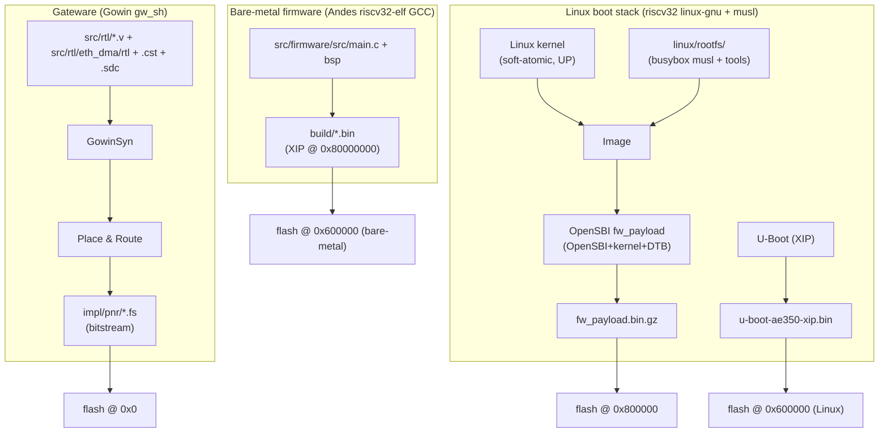

# Build

There are six independent build products. Only the gateware uses Gowin tools;
everything else is RISC-V cross-compilation.



## 0. Toolchains

| Purpose | Toolchain |
|---|---|
| Gowin gw_sh / programmer | `/mnt/data/Gowin_V1.9.12.02_SP2_linux` (`GOWIN_PATH`) |
| Bare-metal firmware | `$ANDES_ROOT/nds32le-elf-newlib-v5/bin/riscv32-elf-gcc` (Andes newlib GCC 14.2; rv32imac, `-DREF_TEST_CLK`) |
| U-Boot / OpenSBI / kernel | `$ANDES_ROOT/nds32le-linux-glibc-v5d/bin/riscv32-linux-` (`LGNU`; Andes Linux GCC 14.2, PIE-capable ld, ilp32d libgcc) |
| Userspace / rootfs (musl) | `~/projects/riscv32-ilp32d--musl--stable-2025.08-1/bin/riscv32-buildroot-linux-musl-…` |

> **Soft-atomic caveat:** the musl `libc.a` in the Bootlin toolchain's sysroot is
> rebuilt with `PATCHES/0012-musl-riscv32-soft-atomics.patch` (`a_cas` rewritten as a
> non-atomic single-hart RMW) so that userspace binaries contain **no `lr`/`sc`/`amo`**.
> A stock glibc/atomic binary SIGILLs/hangs on this SoC. All userspace must be linked
> statically against this libc. `scripts/build_musl_toolchain.sh [DEST]` reproduces the
> toolchain from the stock Bootlin tarball + musl 1.2.5 (checksummed downloads, ~1 min
> build); check a binary with `objdump -d x | grep -cE "amo|lr\.w|sc\.w"` (must be 0).
> See [06-key-findings.md](06-key-findings.md).

## 1. Gateware (bitstream)

```bash
GP=/mnt/data/Gowin_V1.9.12.02_SP2_linux
GOWIN_PATH=$GP STAGE=syn scripts/gw_run.sh      # synthesis only
GOWIN_PATH=$GP STAGE=pnr scripts/gw_run.sh      # place-and-route + bitstream
GOWIN_PATH=$GP STAGE=all scripts/gw_run.sh      # both → impl/pnr/mega_138K_test.fs
```

- `gw_run.sh` drives `gw_sh` (`open_project` → `run syn|pnr|all`).
- `gw_sh` needs a **server-based floating license**; if it's down it fails with
  *"License verification failed — Server not responding."* Validate RTL changes
  with **iverilog** in the meantime (the `src/rtl/eth_dma/tb/` suite).
- `Promote_Physical_Constraint_Warning_to_Error: true` — every port needs a valid
  `IO_LOC` or PnR fails (`CT1113`).

### Validating the eth_dma RTL without a license

```bash
cd eth_dma
iverilog -g2012 -y lib -I lib -o /tmp/sim tb/tb_gw_eth_dma.v && vvp /tmp/sim
```
Testbenches: `tb_rx_sf_buffer`, `tb_rx_path`, `tb_tx_path`, `tb_gw_eth_dma`
(full-core loopback), `tb_eth_core` / `_multi` / `_corner` (with the real MAC's
gate-level `mac.vo`). Gotcha: the vendored FPGADesignElements lib files set
`` `default_nettype none `` and never reset it — append `` `default_nettype wire ``
to each, or the encrypted IPs throw `EX3094`.

## 2. Bare-metal firmware

```bash
cd firmware && make          # → build/*.bin, XIP image based at 0x80000000
```
- BSP from the SDK `ae350_demo` example; **must** build with `-DREF_TEST_CLK`
  (otherwise UART baud comes out at half — the BSP defaults `OSCFREQ` to 100 MHz
  but the APB is 50 MHz).
- Two BSP patches for generic GCC: add `PROVIDE(__global_pointer$ = . + 0x800)` to
  the XIP linker script; replace `__nds__mfsr(NDS_MHARTID)` with `read_csr(...)`.

## 3. U-Boot (XIP, for Linux)

Mainline U-Boot, `ae350_rv32_defconfig`, `CONFIG_RISCV_MMODE=y` (no OpenSBI under
it — OpenSBI is in the payload). Built with `LGNU`. Key config:

```bash
make CROSS_COMPILE=$LGNU ae350_rv32_defconfig
./scripts/config --disable TOOLS_MKEFICAPSULE --disable EFI_LOADER --disable CMD_BOOTEFI \
                 --disable SMP --set-val NR_CPUS 1 \
                 --disable ENV_IS_IN_SPI_FLASH --enable ENV_IS_NOWHERE \
                 --disable DM_SPI --disable SPI_FLASH
make CROSS_COMPILE=$LGNU olddefconfig && make -j CROSS_COMPILE=$LGNU
```
- Hard-float (ilp32d) build: the Andes toolchain ships the ilp32d libgcc. A toolchain
  without one (AMD Vitis) needs `PLATFORM_LIBGCC="-L <ilp32d libgcc dir> -lgcc"`
  (`UBOOT_HF_LIBGCC` for `scripts/build_uboot.sh`).
- DTB must sit at `CONFIG_SYS_FDT_BASE=0x800f0000` (flash `0x6f0000`): the combined
  image is `u-boot.bin` padded to `0xf0000` + `ae350_32.dtb` appended.
- Helper: `scripts/build_uboot.sh` / `scripts/config_uboot.sh`.

## 4. Kernel + OpenSBI payload + rootfs

```bash
# kernel (regenerates the initramfs from linux/rootfs/ on every Image build)
cd external/linux
make ARCH=riscv CROSS_COMPILE=$LGNU -j$(nproc) Image

# wrap Image (+ OpenSBI + DTB) into an OpenSBI fw_payload, then gzip
cd ~/projects/mega_138K_test
FW_PAYLOAD_OFFSET=0x400000 LINUX_CROSS=$LGNU scripts/build_linux_boot.sh
cd external/opensbi/build/platform/generic/firmware
gzip -9 -k -f fw_payload.bin && cp -f fw_payload.bin.gz fw_payload_gz.bin
```

Critical kernel facts (see [06-key-findings.md](06-key-findings.md)):

- **`CONFIG_SMP=n`** (UP) — SMP pulls in qspinlock whose MCS slowpath deadlocks
  with soft atomics on a single hart.
- Soft-atomic header patches in `arch/riscv/include/asm/{cmpxchg,atomic,bitops,futex}.h`
  + `asm/soft_atomic.h`; `RISCV_ISA_{ZAWRS,ZACAS,ZABHA}` disabled.
- `CONFIG_RISCV_DMA_NONCOHERENT=y` for the eth_dma driver.
- **`FW_PAYLOAD_OFFSET=0x400000`** — kernel load must be 4 MB-aligned (sv32
  superpage boot requirement; `0x200000` fails silently).
- The initramfs is `CONFIG_INITRAMFS_SOURCE="…/linux/rootfs …/linux/initramfs_nodes.list"`;
  the node list adds the static `/dev/console` + `/dev/kmsg` nodes (the kernel
  can't open the console before init otherwise).

### rootfs

`linux/rootfs/` is a **static-binary ramfs** (no shared libs). Contents are baked
in and the kernel reflashed — edits on the live device do **not** persist.

Every cross-built binary below is reproduced by a script in `scripts/rootfs/`
(`build_all.sh` runs them all; each one fetches and checksums its upstream tarball into
`~/projects/ae350_linux_user_level/<pkg>/`, builds with the soft-atomic musl toolchain,
checks the result is static and free of lr/sc/amo, reports whether it is identical to the
file in `linux/rootfs/`, and with `INSTALL=1` replaces it). All sources are unmodified
upstream; the recipes are the only project-specific part.

- busybox (musl static, soft-atomic), `init`→busybox, `/etc/inittab` → `rcS`.
  Built from the unmodified busybox mirror at commit `371fe9f71d445d18be28c82a2a6d82115c8af19d`
  (v1.37.0.git, 2024-07-14) with `linux/busybox.config` (= `defconfig` + `CONFIG_STATIC`,
  `CONFIG_STATIC_LIBGCC`, and HWCLOCK / RDATE / TC / SHA*_HWACCEL off);
  `scripts/rootfs/build_busybox.sh`. Only the build-date banner differs between rebuilds;
  with `SOURCE_DATE_EPOCH=1781018868` the result is byte-identical to the shipped binary.
- Privilege: **doas** (OpenDoas 6.8.2, `build_doas.sh`; `permit persist :wheel`), users
  `root` / `ae350` (pw `ae350`).
- SSH: **dropbear** 2022.83 (`dropbearmulti` + symlinks, `build_dropbear.sh`), stable host
  keys in `/etc/dropbear/`. `scp`/`sftp` from a modern OpenSSH client need the SFTP
  subsystem: a static OpenSSH 9.9p2 `sftp-server` (built without OpenSSL/zlib,
  `build_sftp_server.sh`) sits at `/usr/libexec/sftp-server`, the path dropbear execs.
  Legacy `scp -O` works via dropbear's own `scp` too.
- `ping`: a **separate setuid-root copy** `/bin/ping` (the main busybox stays
  unprivileged), gated by `/etc/busybox.conf`.
- Extra static tools cross-built into `/usr/bin`: **htop** 3.3.0 (ncurses 6.6 w/
  compiled-in terminfo fallbacks; `build_ncurses.sh` + `build_htop.sh`), **tcpdump** 4.99.5
  (+libpcap 1.10.5, run via `doas`; `build_libpcap.sh` + `build_tcpdump.sh`), **nstat**
  (iproute2 6.11.0, `build_iproute2.sh`). The shipped tcpdump is an unoptimised (-O0)
  build and the shipped nstat was compiled by hand, so those two scripts report "DIFFERS"
  until the rootfs is refreshed with `INSTALL=1`; the shipped `dropbearmulti` and `doas`
  still carry debug info (the scripts strip, and match them once stripped); everything
  else rebuilds byte-identically.
- Time zones: slim tzdata (IANA 2026e, the zone1970.tab zones + UTC, ~217 KB) in
  `/usr/share/zoneinfo` from `scripts/rootfs/build_tzdata.sh`; the desktop's Date & Time
  panel copies the chosen zone to `/etc/localtime` (musl reads it) and keeps the choice
  on the SD card.
- Desktop: **lvdesk** (LVGL 9.6 on `/dev/fb0`, `S70desktop`) and **inputd** (uinput
  bridge fed by `src/apps/desktop/host/netinput.py` over tcp/5555, `S60inputd`), plus
  **wavplay**; built with `src/apps/desktop/Makefile` (`make install` copies them here).
  Needs `CONFIG_INPUT_EVDEV`/`INPUT_MISC`/`INPUT_UINPUT` (kernel #59+). See
  src/apps/desktop/README.md.
- Fan: `S80fan` temperature curve for the `gowin-fan` hwmon device (kernel #60+,
  `PATCHES/0009`, gateware Build 57+). See src/rtl/fan/README.md.
- microSD: `S45sdcard` mounts `/dev/mmcblk0(p1)` at `/mnt/sd` (kernel #66+,
  `PATCHES/0011` gowin-sdhost, gateware Build 61+). See src/rtl/sdhost/README.md.

## 5. Program the board

```bash
GP=/mnt/data/Gowin_V1.9.12.02_SP2_linux

# bitstream: SRAM (volatile, fast) or flash (persistent across power-cycle)
GOWIN_PATH=$GP MODE=sram  scripts/gw_program.sh      # run 2
GOWIN_PATH=$GP MODE=flash scripts/gw_program.sh      # run 6 → config flash @0x0

# boot images via the exFlash bridge (programmer_cli)
GOWIN_PATH=$GP FW=src/firmware/build/<app>.bin   SPIADDR=0x600000 src/firmware/flash_fw.sh  # bare-metal
GOWIN_PATH=$GP FW=external/u-boot/u-boot-ae350-xip.bin SPIADDR=0x600000 src/firmware/flash_fw.sh  # U-Boot
GOWIN_PATH=$GP FW=.../fw_payload_gz.bin      SPIADDR=0x800000 src/firmware/flash_fw.sh  # kernel payload
```

> **Programmer quirk:** the exFlash bridge reliably writes only images **based at
> `0x0` or `0x600000`**. Writes to other offsets can be silently dropped — a good
> write prints `ends at <start+size>`; a dropped one prints `ends at <start>`.
> The kernel payload at `0x800000` works in practice on this setup, but verify the
> `ends at` value.

After flashing, **reload the gateware** (`MODE=sram`) — the programmer leaves its
SPI-bridge configured on the FPGA. A power-cycle wipes a SRAM bitstream (then the
FPGA reloads the *flash* bitstream at `0x0`), so use `MODE=flash` for persistence.
