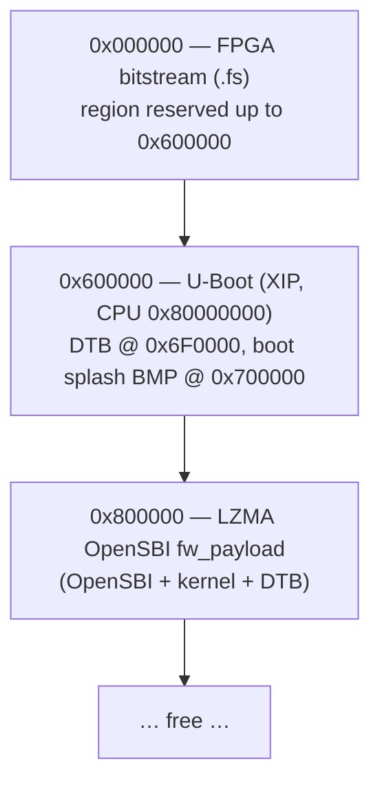
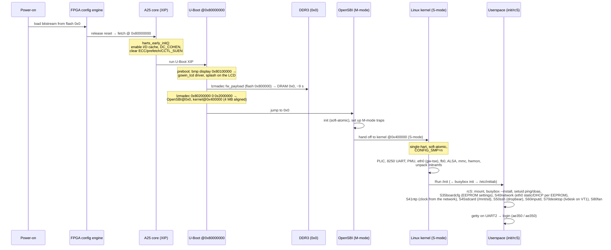
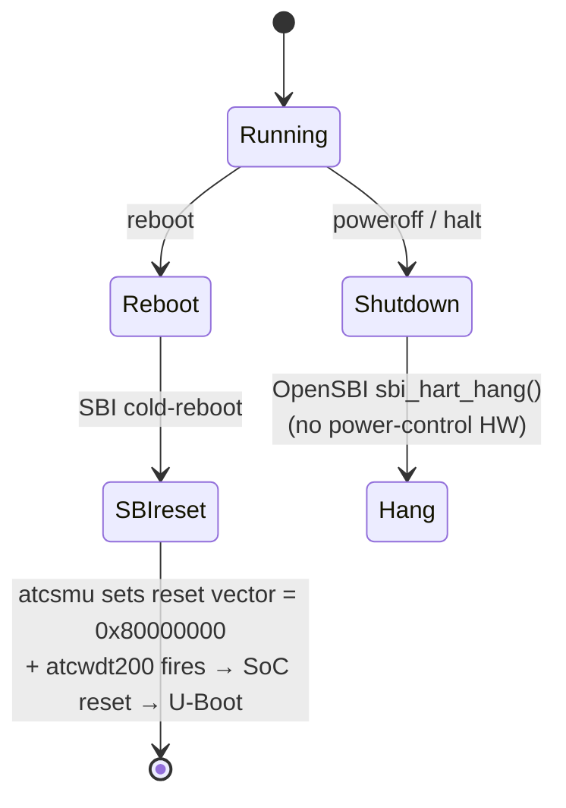

# Boot

## 1. Flash layout (SPI NOR W25Q128, 16 MB)

The same SPI NOR holds both the FPGA bitstream and all boot software (the AE350
runs XIP from it via the dedicated config pins).

| Flash offset | CPU address | Contents |
|---|---|---|
| `0x00_0000` | — (config) | FPGA bitstream; the FPGA loads this on power-up |
| `0x60_0000` | `0x8000_0000` | U-Boot XIP image (`.text` runs in place) |
| `0x6F_0000` | `0x800F_0000` | U-Boot DTB (`CONFIG_SYS_FDT_BASE`) |
| `0x70_0000` | `0x8010_0000` | boot splash BMP (`src/splash/splash.bmp`, appended by `scripts/build_uboot.sh`) |
| `0x80_0000` | — | `fw_payload_lzma.bin`, LZMA-decompressed by U-Boot into DRAM (8 MB region) |

For **bare-metal** work, the firmware `.bin` replaces U-Boot at `0x60_0000`
(CPU `0x8000_0000`); there is no payload at `0x80_0000`.

## 2. Boot sequence (Linux)

### `harts_early_init()` (U-Boot, `arch/riscv/cpu/andes/cpu.c`)

This is where the no-coherence-manager workaround starts: the cache is enabled
but **ECC, prefetch, write-around and `CCTL_SUEN` are cleared** so DDR atomics
behave (the cache SRAM has no ECC; ECC-on makes `amoswap` hang). `DC_COHEN` is
set and the code waits for `DC_COHSTA` — but on this SoC `DC_COHEN` reads back 0
(no CM), which is the root cause behind the soft-atomic stack.

## 3. Why the payload is compressed (LZMA)

The full kernel `Image` is ~26 MB and the `fw_payload` ~30 MB, while the flash region
from `0x800000` to the end of the 16 MB NOR holds 8 MB. The payload is therefore
LZMA-compressed (`scripts/flash.sh kernel`: `xz --format=lzma`, 8 MiB dictionary) to
~6.4 MB and U-Boot's `lzmadec` expands it into DRAM at boot, about 9 s on the A25
(gzip + `unzip` was used until 2026-11-02: 7.5 MB, 4 s; LZMA buys ~1.1 MB of headroom).
The dictionary is allocated from U-Boot's heap, hence `CONFIG_SYS_MALLOC_LEN=0x1000000`
in the fork's defconfig. `FW_PAYLOAD_OFFSET=0x400000` places the kernel 4 MB-aligned
inside the payload (sv32 superpage boot requirement — `0x200000` fails silently).

## 4. Reset / reboot / poweroff

- OpenSBI generic ships the **atcwdt200** reset driver + **atcsmu** HSM driver;
  the Linux DT activates them (`watchdog@f0500000`, `smu@f0100000` with an
  `atcsmu-hsm` child). `reboot` → SMU programs the per-hart reset vector to the
  flash XIP base + arms the WDT → SoC resets → re-runs U-Boot.
- `poweroff`/`halt`: the board has no power-control hardware, so OpenSBI's
  `atcwdt200` reset handler was patched to claim SHUTDOWN and do a clean
  `sbi_hart_hang()` (wfi); the kernel's `default_power_off()` disables IRQs before
  its wfi loop (otherwise the soft-lockup detector trips).
- Linux has **no** atcwdt200 watchdog driver built, so the WDT node never triggers
  an accidental auto-reset.

## 5. Console & network defaults

- Console: UART2 `serial@f0300000`, header pin **B19 @ 115200** (DT serial
  `clock-frequency=50000000`). RX (A17) is pulled up in the gateware and U-Boot's autoboot is
  keyed (type `uboot` to stop), so the board boots with the adapter unplugged or unpowered. Read with a USB-TTL adapter / logic analyzer on the
  pin — the on-board FT2232 channel is unreliable as a user UART.
- Boot args include **`no_hash_pointers`** (no HW RNG → `%pK` would otherwise print
  `(ptrval)` and break `netstat`/`ss`).
- `eth0` = `192.168.200.2/24` by default (static, `S40network`); host side `192.168.200.1`.
  The address, mode and resolvers are board settings in the EEPROM: `boardcfg set net dhcp`,
  `boardcfg set ip 10.0.0.5/24`, `boardcfg set gateway ...`, `boardcfg set dns "..."`
  (applied immediately and at every boot; see src/apps/boardcfg/README.md).
- The Dock has no RTC battery, so every boot starts with the clock at 1970. `S41ntp` runs
  busybox `ntpd`, which sets the clock at the first server answer and keeps it disciplined.
  Servers: the `ntp` board setting (`boardcfg set ntp "HOST[:PORT] ..."`, or `off`), else the
  DHCP lease's NTP servers, else `0/1/2.pool.ntp.org`. Without a route to the internet (the
  default static setup has no gateway) ntpd keeps retrying in the background, and the clock
  is set as soon as a server answers. Check with `/etc/init.d/S41ntp status` or
  `dmesg | grep ntp:`.
- SSH: `ssh ae350@192.168.200.2` (pw `ae350`), then `doas` for root. `scp`/`sftp`
  work through the static OpenSSH `sftp-server` that dropbear execs.
- The rootfs is an **initramfs**: nothing written on the board survives a reboot.
  Change `linux/rootfs/` (and `scripts/rootfs/` for the binaries), rebuild the
  kernel, reflash the payload.

## 6. Userspace services (`/etc/init.d`)

| Script | Service |
|---|---|
| `S35boardcfg` | `boardcfg -d`: restores hostname / time zone / eth0 MAC / network settings from the Dock EEPROM, then watches `/etc/board.conf` to write changes back, re-runs `S40network` when the network keys change and `S41ntp` when `ntp` changes (`src/apps/boardcfg/`) |
| `S40network` | `lo` + `eth0` from the `net`/`ip`/`gateway`/`dns` keys in `/etc/board.conf`: static (default `192.168.200.2/24`) or busybox `udhcpc` (`/usr/share/udhcpc/default.script`); records what it did in `/run/network.state`; asks `S41ntp` to retry once eth0 is up |
| `S41ntp` | busybox `ntpd -n -S /usr/share/ntpd/event`: the system clock from the `ntp` setting, the DHCP lease's servers or `pool.ntp.org`; state in `/run/ntp.state` (`S41ntp status`, shown in the desktop's Date & Time panel), a `ntp: clock set from the network` line in the kernel log when it steps the clock. ntpd runs the hook's `periodic` event every ~11 min whether synchronised or not; at stratum 16 (no server) the hook leaves the state alone (kernel #95; before, a board without internet showed "clock set … refining") |
| `S45sdcard` | mounts `/dev/mmcblk0(p1)` on `/mnt/sd` when a card is present |
| `S50ssh` | dropbear on port 22 with the baked-in host keys |
| `S60inputd` | `inputd`: keyboard/mouse events from the PC over TCP 5555 → `/dev/uinput` |
| `S70desktop` | `lvdesk`, the LVGL desktop on `/dev/fb0` (VT 1) |
| `S80fan` | fan curve for the `gowin-fan` hwmon device |

The desktop's host-side half is `src/apps/desktop/host/netinput.py` (see
`src/apps/desktop/README.md`).
