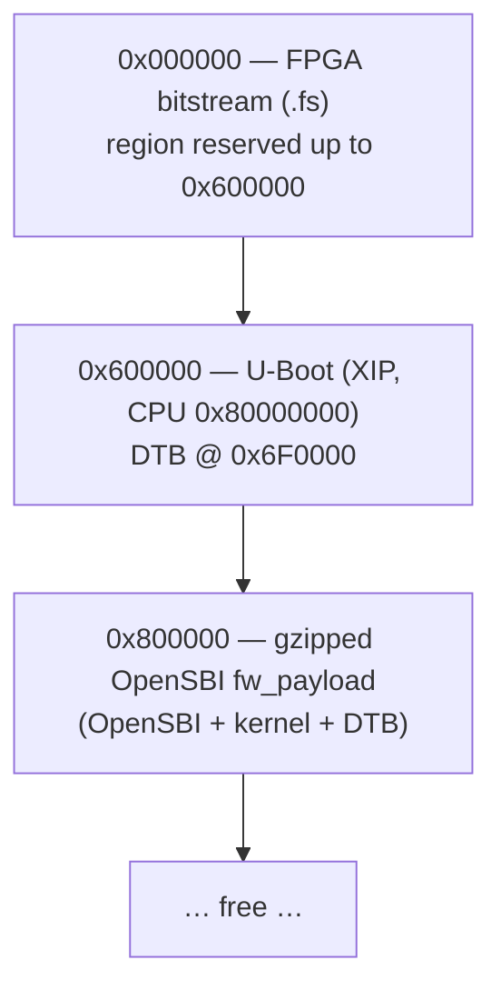
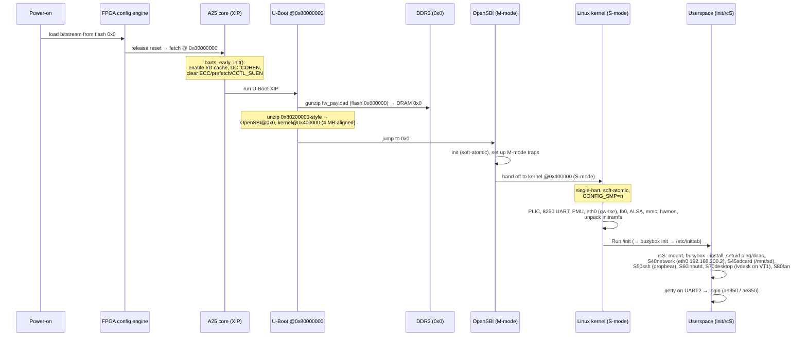
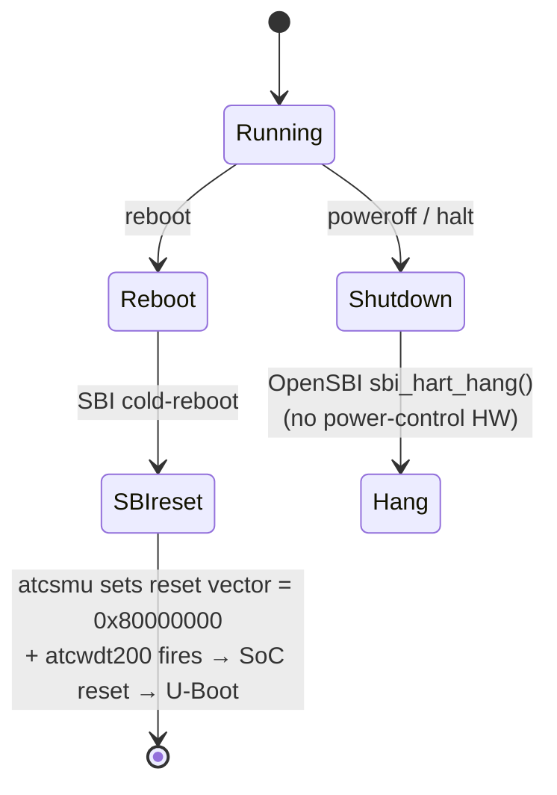

# Boot

## 1. Flash layout (SPI NOR W25Q128, 16 MB)

The same SPI NOR holds both the FPGA bitstream and all boot software (the AE350
runs XIP from it via the dedicated config pins).

| Flash offset | CPU address | Contents |
|---|---|---|
| `0x00_0000` | — (config) | FPGA bitstream; the FPGA loads this on power-up |
| `0x60_0000` | `0x8000_0000` | U-Boot XIP image (`.text` runs in place) |
| `0x6F_0000` | `0x800F_0000` | U-Boot DTB (`CONFIG_SYS_FDT_BASE`) |
| `0x80_0000` | — | `fw_payload.bin.gz`, unzipped by U-Boot into DRAM |

For **bare-metal** work, the firmware `.bin` replaces U-Boot at `0x60_0000`
(CPU `0x8000_0000`); there is no payload at `0x80_0000`.

## 2. Boot sequence (Linux)

### `harts_early_init()` (U-Boot, `arch/riscv/cpu/andes/cpu.c`)

This is where the no-coherence-manager workaround starts: the cache is enabled
but **ECC, prefetch, write-around and `CCTL_SUEN` are cleared** so DDR atomics
behave (the cache SRAM has no ECC; ECC-on makes `amoswap` hang). `DC_COHEN` is
set and the code waits for `DC_COHSTA` — but on this SoC `DC_COHEN` reads back 0
(no CM), which is the root cause behind the soft-atomic stack.

## 3. Why gzip + unzip

The full kernel `Image` is ~25 MB and the `fw_payload` ~30 MB — too large to flash
comfortably and slow to program. It is gzipped (~7 MB) and U-Boot's `unzip`
expands it into DRAM at boot. `FW_PAYLOAD_OFFSET=0x400000` places the kernel
4 MB-aligned inside the payload (sv32 superpage boot requirement — `0x200000`
fails silently).

## 4. Reset / reboot / poweroff

- OpenSBI generic ships the **atcwdt200** reset driver + **atcsmu** HSM driver;
  the Linux DT activates them (`watchdog@f0500000`, `smu@f0100000` with an
  `atcsmu-hsm` child). `reboot` → SMU programs the per-hart reset vector to the
  flash XIP base + arms the WDT → SoC resets → re-runs U-Boot.
- `poweroff`/`halt`: the board has no power-control hardware, so OpenSBI's
  `atcwdt200` reset handler was patched to claim SHUTDOWN and do a clean
  `sbi_hart_hang()` (wfi); the kernel's `default_power_off()` disables IRQs before
  its wfi loop (otherwise the soft-lockup detector trips).
- Linux has **no** atcwdt200 watchdog driver built, so the WDT node never triggers
  an accidental auto-reset.

## 5. Console & network defaults

- Console: UART2 `serial@f0300000`, header pin **B19 @ 115200** (DT serial
  `clock-frequency=50000000`). Read with a USB-TTL adapter / logic analyzer on the
  pin — the on-board FT2232 channel is unreliable as a user UART.
- Boot args include **`no_hash_pointers`** (no HW RNG → `%pK` would otherwise print
  `(ptrval)` and break `netstat`/`ss`).
- `eth0` = `192.168.200.2/24` (static, `S40network`); host side `192.168.200.1`.
- SSH: `ssh ae350@192.168.200.2` (pw `ae350`), then `doas` for root. `scp`/`sftp`
  work through the static OpenSSH `sftp-server` that dropbear execs.
- The rootfs is an **initramfs**: nothing written on the board survives a reboot.
  Change `linux/rootfs/` (and `scripts/rootfs/` for the binaries), rebuild the
  kernel, reflash the payload.

## 6. Userspace services (`/etc/init.d`)

| Script | Service |
|---|---|
| `S40network` | static `eth0`, `lo` |
| `S45sdcard` | mounts `/dev/mmcblk0(p1)` on `/mnt/sd` when a card is present |
| `S50ssh` | dropbear on port 22 with the baked-in host keys |
| `S60inputd` | `inputd`: keyboard/mouse events from the PC over TCP 5555 → `/dev/uinput` |
| `S70desktop` | `lvdesk`, the LVGL desktop on `/dev/fb0` (VT 1) |
| `S80fan` | fan curve for the `gowin-fan` hwmon device |

The desktop's host-side half is `src/apps/desktop/host/netinput.py` (see
`src/apps/desktop/README.md`).
