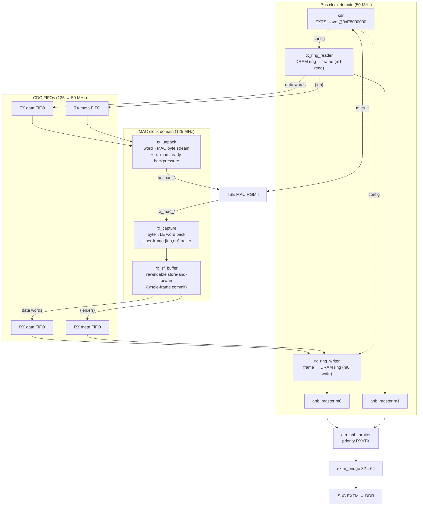
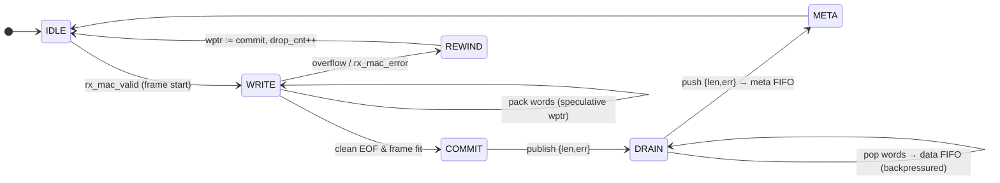
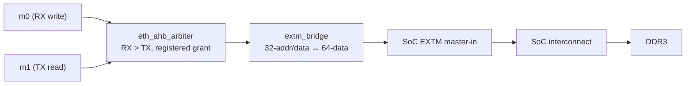

# The eth_dma engine

`src/rtl/eth_dma/` is a custom descriptor-ring DMA engine that replaces the stock
single-frame PIO bridge on the Gowin TSE MAC. It streams frames between the MAC
(125 MHz byte stream) and rings of fixed-size buffers in DRAM, reached over the
SoC's EXTM external-AHB-master port. The CPU configures it through a CSR block on
the EXTS slave port at `0xE8000000`.

## 1. Component structure



RTL files (`src/rtl/eth_dma/rtl/`):

| File | Role |
|---|---|
| `gw_eth_dma_core.v` | top: csr + rx_path (m0) + tx_path (m1) + MAC/MDIO ports |
| `csr.v` | EXTS AHB-lite slave register block (config + status + MDIO + debug) |
| `rx_capture.v` | MAC-side RX: byte→32-bit LE pack, emits `{len,err}` trailer at EOF |
| `rx_sf_buffer.v` | MAC-side store-and-forward with a **rewindable** write pointer |
| `rx_path.v` | RX integration: rx_capture → sf → 2× CDC FIFO → rx_ring_writer |
| `rx_ring_writer.v` | bus-side RX: DMA each frame into the DRAM ring, bump `rx_head`, IRQ |
| `tx_unpack.v` | MAC-side TX: len+words → MAC byte stream with `tx_mac_ready` backpressure |
| `tx_ring_reader.v` | bus-side TX: read frame from the DRAM ring via `ahb_master` |
| `tx_path.v` | TX integration: tx_ring_reader → 2× CDC FIFO → tx_unpack |
| `ahb_master.v` | AHB-lite master mover (single-beat) used by both rings |
| `eth_ahb_arbiter.v` | 2-master → 1, fixed priority RX>TX, registered grant |
| `extm_bridge.v` | 32-bit master ↔ 64-bit EXTM data adapter |
| `cdc_fifo_reset.v` | aligned multi-domain FIFO reset (built on `Reset_Synchronizer`) |

## 2. Ring buffer layout (DRAM)

Both rings are arrays of fixed **2 KB** buffers (`BUF_SHIFT=11`), `ring_len` a
power of two. Each frame occupies one buffer:

```
buffer[i] @ base + (idx << 11),  idx = head & (ring_len-1)
  word0 : header { err, len }     (RX: filled by DMA; TX: filled by CPU)
  word1 : frame data …
  …
```

Flow control is two counters per ring:

- **RX:** `rx_head` (frames the DMA has written) vs `rx_tail` (frames the CPU has
  consumed). Ring full ⇒ the frame is dropped (counted in `rx_drop`) but its words
  are still drained so the data/meta streams stay aligned.
- **TX:** `tx_tail` (frames the CPU has queued) vs `tx_head` (frames the DMA has
  sent). `tx_fetch` is a debug progress counter.

## 3. CSR map (EXTS slave @ `0xE8000000`)

| Offset | Name | Dir | Bits |
|---|---|---|---|
| `0x00` | CTRL | rw | `[0]` rx_en, `[1]` tx_en |
| `0x04` | IRQ_STATUS | rw1c | `[0]` rx, `[1]` tx |
| `0x08` | IRQ_EN | rw | `[1:0]` |
| `0x10` | RX_BASE | rw | ring base addr |
| `0x14` | RX_RING_LEN | rw | power of two |
| `0x18` | RX_TAIL | rw | frames consumed by CPU |
| `0x1C` | RX_HEAD | ro | frames written by DMA |
| `0x20` | RX_DROP | ro | dropped-frame count |
| `0x30` | TX_BASE | rw | ring base addr |
| `0x34` | TX_RING_LEN | rw | power of two |
| `0x38` | TX_TAIL | rw | frames queued by CPU |
| `0x3C` | TX_HEAD | ro | frames sent by DMA |
| `0x40` | TX_FETCH | ro | debug progress |
| `0x50` | MDIO_ADDR | rw | `[4:0]` phyad, `[9:5]` regad |
| `0x54` | MDIO_WRDATA | rw | 16-bit |
| `0x58` | MDIO_CTRL | rw | `[0]` rden, `[1]` wren |
| `0x5C` | MDIO_RDDATA | ro | `[15:0]` data, valid/busy status |
| `0x60` | ETH_MODE | rw | `[1:0]` speed (00=10/01=100/10=1000M), `[2]` full-duplex |
| `0x70`/`0x74`/`0x78` | TX_DBG / RX_DBG / EXTM_DBG | ro | bring-up debug |

## 4. RX path

```mermaid
sequenceDiagram
  participant MAC as MAC (125 MHz)
  participant CAP as rx_capture
  participant SF as rx_sf_buffer
  participant FIFO as CDC FIFOs (125→50)
  participant RW as rx_ring_writer (50 MHz)
  participant DDR as DRAM ring
  participant CPU as driver (NAPI)

  MAC->>CAP: rx_mac_data byte stream + last/error
  CAP->>SF: pack to 32-bit words; at EOF emit {len,err}
  Note over SF: speculative write;<br/>commit whole frame on clean EOF,<br/>else rewind + count drop
  SF->>FIFO: drain frame data-words first, then {len,err}
  FIFO->>RW: data stream + metadata stream
  RW->>DDR: m0 AHB: word0={err,len}, word1+=data<br/>at buf[rx_head & (len-1)]
  RW->>CPU: bump RX_HEAD + IRQ
  CPU->>DDR: invalidate cache, read frame, bump RX_TAIL
```

### Why the store-and-forward stage exists (the desync bug)

The MAC **cannot be back-pressured**. The original RX path crossed the CDC with
two independent FIFOs (data words + `{len,err}` trailers). A bus stall dropped
data words ("overflow == loss") while the trailer survived, so the two streams
desynced permanently and **every delivered frame was byte-shifted** — RX looked
dead on hardware (ARP never completed) even though the MAC received fine.

`rx_sf_buffer.v` fixes this structurally: it stages a whole frame in the MAC
domain with a **rewindable write pointer**, and only releases complete frames
(data-words-then-trailer, with back-pressure) into the CDC FIFOs. Independent
loss between the two streams is then impossible.



## 5. TX path

```mermaid
sequenceDiagram
  participant CPU as driver
  participant DDR as DRAM ring
  participant TR as tx_ring_reader (50 MHz)
  participant FIFO as CDC FIFOs (50→125)
  participant UN as tx_unpack
  participant MAC as MAC (125 MHz)

  CPU->>DDR: write frame [word0={len}][data…]; writeback cache
  CPU->>TR: bump TX_TAIL (TX_TAIL > TX_HEAD ⇒ work)
  TR->>DDR: m1 AHB read header {len} then data words
  TR->>FIFO: data stream + {len} metadata
  FIFO->>UN: data + metadata
  UN->>MAC: gate on {len} token, then tx_mac byte stream<br/>(honours tx_mac_ready, no mid-frame underrun)
  Note over UN,TR: frame_done toggle → CDC_Bit_Synchronizer → bus → TX_HEAD++
```

## 6. Clock-domain crossing

- The MAC RX (`rx_mac_clk` = `rgmii_rxclk`, 125 MHz) and TX (`tx_mac_clk`,
  125 MHz) domains cross to the 50 MHz bus domain through ready/valid
  `CDC_FIFO_Buffer`s (vendored FPGADesignElements).
- A single external `arst_n` is fanned out per domain via `Reset_Synchronizer`;
  `cdc_fifo_reset.v` guarantees the FIFO clears **de-assert together** (not just
  assert together) — otherwise the library FIFO's multi-bit pointer handshake can
  power up `X` in sim / deadlock (data in, none out).
- The SDC declares the eth clocks asynchronous to the bus clock; the CDC FIFOs are
  the only synchronizers. `rgmii_rxclk` **must** be constrained at 125 MHz —
  see [06-key-findings.md](06-key-findings.md).

## 7. Arbitration & EXTM



- `eth_ahb_arbiter` is a 2-master priority arbiter (RX over TX) with a **registered
  grant** so a transfer is never preempted mid-burst. It forwards the **full 32-bit
  address** — unlike the Gowin AHBBusArbiter IP, which only forwards a fixed 1 MB
  window at `0x80000000` (that IP was tried first and abandoned for DMA). The top
  level now instantiates its 4-master descendant `ahb_arbiter5`
  (`src/rtl/audio/rtl/`), which also carries the SD host's and the audio engine's DMA.
- `extm_bridge` adapts the 32-bit masters to the **64-bit EXTM data** bus (write
  replicates to both lanes; read selects by `HADDR[2]`). It also drives
  `EXTM_HREADY` from the arbiter's `SHREADYMUXM0` — a wiring detail whose absence
  originally deadlocked every DMA transfer.
- `ahb_master.v` v2 issues pipelined **INCR16/8/4 bursts of 64-bit beats** (the EXTM
  port charges ~16 cycles per burst start and breaks undefined-length INCR into
  singles, so fixed-length bursts are what pays). With the current `ddr_bridge`
  the link does TCP ≈65 Mbit/s RX / ≈40 TX and lossless UDP RX to 80 Mbit/s; the
  original single-beat v1 on the stock Gowin bridge was capped at ~6 MB/s by DDR
  latency — see [06-key-findings.md](06-key-findings.md).
