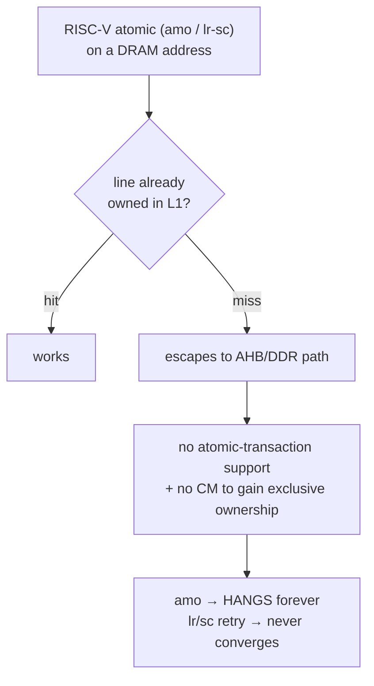

# Key findings & gotchas

The hard-won facts that shape the whole project. Each is something that cost real
debugging time and is non-obvious from the code alone.

## 1. No coherence manager → the whole stack is single-hart "soft-atomic"

**The defining constraint of this board.** The Gowin A25 IP has L1 I/D caches but
**no L2 and no coherence manager (CM)**. `mcache_ctl.DC_COHEN` is hardwired to 0.

Consequences and the fix:

- **OpenSBI** dies on its `coldboot_lottery` `amoswap` (first DRAM atomic, cold
  line). **Linux** would hang in any contended atomic. **musl** userspace spins
  forever on `a_cas` (cold-line `lr/sc`).
- Since the SoC is **single-hart**, the only concurrency is traps, so an atomic
  RMW just needs to be *uninterruptible*. Every layer was patched to do RMW as
  `csrrc mstatus/sstatus, xIE` → plain load/modify/store → restore:
  - OpenSBI: `riscv_atomic.c`, `riscv_locks.c`, `sbi_ipi.c`.
  - Linux: `arch/riscv/include/asm/{cmpxchg,atomic,bitops,futex}.h` + new
    `soft_atomic.h`; disable `ZAWRS`/`ZACAS`/`ZABHA`; **`CONFIG_SMP=n`** (SMP's
    qspinlock MCS slowpath deadlocks with soft atomics on one hart).
  - musl 1.2.5: `a_cas` rewritten non-atomic; rebuilt `libc.a` replaces the
    toolchain sysroot copy; everything links against it (busybox, doas, dropbear,
    htop, tcpdump, nstat).
- **A stock glibc/atomic binary SIGILLs/hangs** on this SoC. All userspace must be
  the soft-atomic musl build.
- Bare-metal/RTOS is unaffected (no contended atomics on cold lines).

**Verdict:** stock Linux/OpenSBI hang here; the single-hart soft-atomic stack
boots Linux 6.12 to an interactive shell with gigabit Ethernet. The real fix would
be a Gowin/Andes AE350 config *with* a coherence manager.

## 2. DDR speed: the Gowin AHB bridge was the bottleneck

Measured with the `src/rtl/ddr_perf.v` bus monitor (APB @ `0xF8000000`): Gowin's
`gw_ahb_ddr3` turned every 64-bit AHB beat into its own DDR3 command with a full
clock-domain round trip — ~39 HCLK (0.8 µs) per beat, ~160 HCLK per 32 B L1 line fill
(the A25 fills lines with WRAP4 64-bit bursts), bus 93 % busy. Hence the old ~6 MB/s.

`src/rtl/ddr_bridge/` replaces it (line buffers, stream prefetch, posted/merged writes) — see
[src/rtl/ddr_bridge/README.md](../src/rtl/ddr_bridge/README.md). The default MODE 0x10000 (overlapped
reads), with DDR3 at 400 MHz and a 100 MHz bus, is ~23x faster than stock: 148 MB/s
sequential read, ~1.4 µs per random miss, kernel to `/init` in 2.83 s. At 400 MHz the
bridge's DDR side runs at 100 MHz; closing timing there needed an issue-slot register
stage, a registered tag-queue write and a 3-phase BIST compare.

**A25 page-table walker is not cache-coherent.** Overlapped reads first made Linux
oops at fork/exec: walks of a new pgd read stale kernel entries. The walker reads page
tables straight from the bus, so lines still dirty in L1 are invisible to it, and the
slow stock bridge only hid the race. Fixed in the kernel by writing every page-table
store back with CCTL L1D_VA_WB (`PATCHES/0005`, switch `a25_ptwb`). A kernel without
0005 must run the bridge at MODE 0x100 (one read in flight, ~4x stock).

**SoC bus clocks.** Per Gowin MUG1031 the AE350's DDR (data memory), AHB and APB clocks
may each run below 200 MHz. They are asynchronous to the 800 MHz core and to each other
(AHB:APB = 1:1), but the reference design runs all three at 50 MHz "for test". The
CPU↔DDR bus clock (`DDR_CLK`) is now **100 MHz**. That took a redesign of the bridge's
AHB side: the hard macro sits at a fixed spot with ~5–7 ns routes each way, so AHB inputs
are only registered, `HREADY`/`HRDATA` come from flops, and burst beats are predicted.
Measured vs 50 MHz: +34% sequential read (148 MB/s), +43% memset, +39% memcpy; kernel to
`/init` in 2.83 s. See src/rtl/ddr_bridge/README.md.

Board DDR: 2x H5TQ4G63EFR-RDC (4 Gbit x16, 1 GB on a 32-bit bus). The stock IP ran at
200 MHz, below the DDR3 DLL-on minimum (300 MHz), with 2 Gbit timings and only 16 bits /
256 MB. The active netlist is `src/rtl/ddr3_memory_interface_1g/`: 400 MHz, x32, 15 row
bits (all 1 GB), with the correct 4 Gbit timings. **Caveat:** at 400 MHz gigabit RX sees ~2e-5 frames rejected by
the MAC CRC check (0 at 200 MHz); see §3.

## 3. RGMII RX clock must be constrained at 125 MHz

`src/rtl/ae350_demo.sdc` originally declared `rgmii_rxclk` at the Gowin example's
**20 ns (50 MHz)**, but at 1000BASE-T the PHY drives `RGMII_RXC` at **125 MHz**.
PnR therefore never optimized the RX capture path for 125 MHz, leaving it
marginal.

- **Symptom:** the bare-metal self-test `[4]` (varied frames) and `[5b]` (1500 B)
  corrupted frames >64 B *specifically through PHY internal loopback* (where RXC is
  the looped TXC), while the real link worked (the PHY recovers a cleaner RX clock
  from the cable).
- **Fix:** constrain `rgmii_rxclk` to **8 ns / 125 MHz**. RGMII-ID mode supplies
  the RX clock-to-data skew in the PHY (no fabric IODELAY needed). PnR then meets
  it with zero negative slack (max ~126.7 MHz — tight). The self-test passes
  `[1]`–`[7]`, and Linux gigabit RX becomes timing-verified.
- `RGMII_RXC` is still on **generic routing** (`PR1014` warning) → only ~1.3 %
  margin. Routing it onto a global clock buffer would harden it further (optional).
- **Logic depth, not the clock, was the real limit (fixed Oct 2026).** Adding the
  DDR bridge pushed the 125 MHz paths to −1.0 ns (build-to-build swing +0.08 …
  −2.1 ns). The failing paths were deep logic in our own RTL, now registered:
  `tx_unpack.v` drives `tx_mac_valid/data/last` from a 2-entry skid buffer, with no
  gaps inside a frame (previously a 16-bit `byte_cnt == len-1` compare and the
  FIFO RAM output went straight into the MAC's TX FSM/CRC). In `rx_sf_buffer.v`,
  the drain takes one extra `D_LEN` cycle per frame, and the
  "RAM full" / "info FIFO full" flags are registered with look-ahead (they never
  miss a full buffer). Result: worst setup slack **+1.79 ns** design-wide. On HW at
  1 Gbps: ping sweep 0–1472 B, 3×32 MB down + 3×16 MB up md5-exact, 0 errors/drops.
- **Some builds show ~2e-5 MAC-rejected RX frames** (Builds 22/23/30: 2–5 per 140k),
  others none (Builds 26/33, both with fast DDR), so it depends on placement. Every bad
  frame is CRC-rejected (TCP `InCsumErrors` 0) and TCP recovers. `RGMII_RXC` is on C23,
  a VREF pin that is not clock-capable, so generic routing is forced, and the RGMII input
  timing is unconstrained (no `set_input_delay`). That is the place to fix it.

## 4. RX data/metadata desync (fixed by the store-and-forward stage)

The RX CDC originally used two independent FIFOs (data words + `{len,err}`
trailers). The non-back-pressurable MAC + a bus stall dropped data words while the
trailer survived → permanent desync → every frame byte-shifted → RX looked dead.
Fixed by `rx_sf_buffer.v` (rewindable whole-frame staging). See
[05-eth-dma.md](05-eth-dma.md) §4. Debug entry points that nailed it:
`/proc/net/snmp`, `ip neigh` (host FAILED), and `devmem`-dumping the DRAM ring.

## 5. Dual-purpose config pins (PnR)

The AE350 drives its SPI-flash on the FPGA's dedicated MSPI/config pins, so PnR
fails (`PR2017 … dedicated pin (MSPI)`) unless `CPU`, `MSPI`, and `SSPI` are all
`true` in `impl/mega_138K_test_process_config.json`. The SoC's instruction flash
is the *same* SPI NOR that holds the bitstream.

## 6. Gowin AHBBusArbiter is unsuitable for DMA

The Gowin AHBBusArbiter IP only forwards a fixed **1 MB window at `0x80000000`**
and passes the address through unchanged — fine for peripheral registers, wrong
for DMA to arbitrary DRAM. It was replaced by the custom `eth_ahb_arbiter.v`
(full 32-bit address, registered grant). Earlier confusions also fixed: EXTM is
64-bit data (needs `extm_bridge`), and the arbiter's `SHREADYMUXM0` must drive
`EXTM_HREADY` (its absence deadlocked every transfer).

## 7. Toolchain & clock gotchas

- **Firmware UART:** the BSP `OSCFREQ` defaults to 100 MHz, but the APB is 50 MHz.
  Build firmware with **`-DREF_TEST_CLK`** or every baud comes out at half.
- **U-Boot:** RISC-V U-Boot hardcodes `-pie`; the bare-metal `*-elf` toolchains
  can't link it — use the **linux-gnu** toolchain (`LGNU`). Hard-float ilp32d needs
  an external ilp32d libgcc.
- **Kernel payload:** `FW_PAYLOAD_OFFSET=0x400000` (4 MB-aligned) — sv32 superpage
  boot requirement; `0x200000` fails silently.
- **Programmer:** the exFlash bridge reliably writes only images based at `0x0` or
  `0x600000`; a dropped write prints `ends at <start>` (== start). Reload the
  gateware after flashing.
- **Bitstream persistence:** `MODE=sram` is volatile (a power-cycle reloads the
  *flash* bitstream at `0x0`); use `MODE=flash` to persist. Reset (S3) keeps SRAM;
  power-cycle does not.
- **`%pK` / `(ptrval)`:** no HW RNG → the pointer-hash key never seeds, breaking
  `netstat`/`ss`. Boot with **`no_hash_pointers`**.
- **License:** `gw_sh` needs a floating license server; when it's down, validate
  RTL with iverilog (`src/rtl/eth_dma/tb/`).

## 8. Rootfs is RAM-only

The rootfs is an **initramfs (ramfs)** baked into the kernel `Image` — edits on the
live device (passwords, files, `setcap`) **do not persist**. Everything must be
baked into `linux/rootfs/` and the kernel reflashed. Notable consequences:

- No xattr/capability support and no `setcap` on the board, so **unprivileged
  `ping`** is done with a *separate* setuid-root busybox copy at `/bin/ping`
  (gated by `/etc/busybox.conf`) — making the *main* `/bin/busybox` setuid breaks
  boot (it drops privileges from `ifconfig`/`getty`).
- Extra tools (htop, tcpdump, nstat) are **static** cross-builds; htop's ncurses is
  built with compiled-in terminfo fallbacks so it needs no `/usr/share/terminfo`.

## Atomics on the A25: what the bus sees (2026-10-30)

`src/apps/tests/amotrace.c` arms the `ddr_perf` transaction trace around a cold-line `lr.w/sc.w`
and `amoswap.w` (the latter with the ATCWDT200 watchdog armed, since the AMO hangs the
hart; the trace RAM survives the SoC reset and is dumped after the reboot):

- An `lr.w` on a line that is not in the L1 D-cache is **not a line fill**: the core
  issues one **SINGLE 32-bit read** of the target word on the data-memory AHB. The
  following `sc.w` puts **nothing** on the bus and fails (3 of 3 attempts).
- An `amoswap.w` on a cold line issues the same single-word read and then **retries it
  every 13 bus clocks (130 ns), forever** — 307 identical reads of the target address
  filled the trace until the watchdog reset the SoC. No write is ever attempted.

This is the signature of AHB5-style exclusive accesses: the core waits for an
"exclusive OK" (HEXOKAY) that only an exclusive-access monitor in the interconnect can
give. The Gowin AE350 wrapper exposes a plain AHB-lite data-memory port (no HEXCL /
HEXOKAY / HMASTLOCK), so the signal the core waits for does not exist outside the IP and
the DDR bridge cannot supply it. Atomics therefore work only on lines the cache already
owns (handled inside the L1), and the single-hart soft-atomic builds remain the fix.

## The SoC's DMAC (ATCDMAC300) reaches only DDR (2026-10-30)

Probed with `src/apps/tests/dmactest.c` (programs the DMAC at 0xF0C00000 from Linux through
`/dev/mem`, watchdog armed; a hang needs a JTAG reload). Memory-to-memory copies through
the data-memory port work (4 KB verified). Every other target wedged the whole SoC bus so
hard that not even the watchdog reset recovered it:

| DMAC target | bus interface 0 | bus interface 1 |
|---|---|---|
| DDR → DDR | works | — |
| audio FIFO register on EXTS (write) | hang | hang |
| audio / SD host registers on EXTS (read) | hang | hang |
| external APB (ddr_perf, 0xF8000000) | hang | hang |
| SoC UART2 (internal APB, 0xF0300000) | hang | hang |
| boot flash XIP (0x80000000, AHB) | hang | hang |

The BSP's own peripheral DMA (UART/SPI/I2C) uses handshake mode with both
bus-interface bits set to 1; that was reproduced without handshake only, so a
handshake-only path cannot be fully excluded, but the XIP result (a plain AHB slave
hanging) shows the Gowin AE350 build routes the DMAC master to the data-memory port
only. The `DMA_REQ`/`DMA_ACK` pins are therefore unusable for fabric peripherals here;
DMA for fabric cores must come from fabric masters on the EXTM port (Ethernet, SD host,
LCD) as the design already does. The audio core got one the same day: a 64-bit read
engine on a fourth arbiter port (`src/rtl/audio/rtl/ahb_arbiter5.v`) that fetches the ALSA
buffer as a ring up to a driver-committed byte limit, with the driver cleaning the
cache per committed range (`src/rtl/audio/README.md`).

## Timing closure of the fabric domains (2026-10-31, Build 63)

Three lessons from taking the 50 MHz EXTS/EXTM domain from 0.098 ns to 2.8 ns of
slack and making the 100 MHz domains stop depending on placement luck:

1. **GowinSyn maps `x <= x + 1` as a LUT chain, not an ALU carry chain.** A 32-bit
   incrementer came out as 10–12 LUT levels (10.5 ns with routing); subtractions and
   additions of two variables do get the ALU chain (`COUT -> CIN`, 45 ps per bit).
   Wide statistics counters are therefore `src/rtl/pipe_counter.v`: 8-bit slices with a
   registered carry between them. Used by `ddr_perf` (33 counters) and the DDR read BIST.
2. **Long combinational cones that are consumed once per transaction should be
   staged.** The audio DMA's command size (FIFO level -> room -> three 32-bit compares
   -> `dm_valid`) was 23 logic levels; two register stages plus a short "stale" hold
   after each command made it 9 levels at no bandwidth cost.
3. **Routing to the hard SoC's pins dominates on this die.** The EXTS read-data return
   (a slave's register mux -> the top-level 6:1 mux -> `EXTS_HRDATA` pins) was 20.6 ns,
   14 ns of it wire. Register reads now take one wait state (`exts_rd_wait` in
   `src/rtl/ae350_demo.v`): the mux lands in a register, the register drives the pins. All
   EXTS slaves are zero-wait and hold their read data through the extra cycle. Writes
   are unchanged. The same applies to anything feeding the SoC's data inputs: the sdhost
   FIFO's 128:1 flop-array read mux into `EXTM_HWDATA` was the domain's second-longest
   path; it is a BSRAM now (and 8k flops smaller).

What "meets timing" means here: Gowin's placer stops improving a path once its slack is
positive, so 4 ps of slack is "met", not "nearly failed" -- but a domain with every path
at 0 ps has no room for the next netlist change. Build 62 -> 63 (first iteration)
showed this: fixing the audio cone moved the placement and three previously-passing
domains failed on their own marginal paths (perf counters, EXTS read return, BIST).
The SDC now carries `report_timing` lines for `ae350_ahb_clk` and `ddr3_sysclk` as well as
`ae350_ddr_clk`, so every build lists its worst paths per domain.

## One clock for the DDR path (2026-11-01, Build 64)

The SoC's data-memory clock `DDR_CLK` and the DDR3 IP's user clock were both 100 MHz but
unrelated: one from the AE350 PLL, the other from a divider inside the DDR3 PHY, so the
bridge crossed them with gray-coded FIFOs and 2-FF synchronizers in each direction. Gowin's
MUG1031 only requires `DDR_CLK` to be below 200 MHz and asynchronous to the core clock,
so Build 64 feeds the IP's `clk_out` straight into the macro's `DDR_CLK` input. The tool
propagates the clock through the macro and reports `DDR_HCLK` within ±0.06 ns of the
fabric copy, so the FIFO pointer handoffs became ordinary timed paths (`SYNC_CLK=1`, two
cycles saved per crossing) and the whole DDR path is one SDC clock. The SoC leaves reset
only after DDR3 calibration, so the clock is long stable by then. Average HREADY wait per
data-memory read transfer during `ddr_memtest`: 19.6–20.0 → 17.9–18.5 HCLK. The
userspace miss-latency number is too noisy (time-seeded chase, ±10 % run to run) to
show a 5 % change on its own; the bus counters are the right instrument.

## Fewer 50 MHz clocks, and two traps on the way (2026-11-01, Build 65)

Three generated 50 MHz clocks remained after Build 64: the AE350 PLL's AHB and APB
outputs and the DDR3 PLL's reference output. Build 65 removes one. The DDR3 IP's 50 MHz
reference input (`clk`) now comes straight from the board oscillator, which is what
IPUG281 recommends ("generally PCB crystal input"); it only clocks the IP's reset
synchroniser and calibration logic, and the DDR3 calibrates and runs as before.

**The APB clock cannot share the AHB clock's net.** Driving both SoC clock pins from
`AHB_CLK` (allowed by the 1:1 rule, and what Gowin's own `ae350_ahb_master` example does)
built, met timing and booted, but audio playback stalled after a handful of interrupts in
both DMA and PIO mode. The audio core kept asserting its level interrupt, the PLIC's
pending bit for source 11 stayed clear, and a write of `11` to the hart's claim/complete
register revived the source every time. With a completion written every 100 ms during a
stream the WAV played bit-exact (240000 frames, CRC match). So the kernel's completion
writes stop taking effect on that source after a few interrupts: an interaction inside the
hard macro between its AHB-to-APB bridge (the PLIC sits behind it) and two clock pins fed
from one net. The SD host and Ethernet sources, whose lines are low again by the time the
handler completes, never showed it. Moving `APB_CLK` back to its own PLL output, with
everything else unchanged, restored audio (324 interrupts for the test set, all bit-exact).
`APB_CLK` therefore keeps `CLKOUT3`; the SDC comment and `src/rtl/ae350_demo.v` say why.

**Global clock allocation is a lottery, and the RGMII RX clock lost it.** The GW5AST has
8 PRIMARY and 8 LW global clock wires and this design uses all 16. Removing a PLL output
freed a PRIMARY wire, and PnR gave it to `RGMII_RXC_d`, which had always been on an LW. A
PRIMARY wire adds 1.8 ns of insertion delay on this path: the RXD capture window moved
(setup slack 1.65 → 3.45 ns, hold slack 1.24 → 0.22 ns; both "met"), the MAC's
`RGMII_Input_Delay` no longer centred the sample, and gigabit receive went from 0 bad
frames in 35 000 to half of all frames bad and 16 MB downloads timing out. `CLOCK_LOC
"RGMII_RXC_d" LOCAL_CLOCK` is worse again (plain routing, and ddr3_sysclk broke with it).
The fix in `src/rtl/ae350_demo.cst`: the eight nets that belong on PRIMARY wires are pinned
with `CLOCK_LOC ... BUFG = CLK`, and the RX clock is pinned to the first LW wire with
`BUFG[8]` (BUFG[0-7] are PRIMARY, BUFG[8-15] LW -- found by trying; a reset nominated for
a PRIMARY wire is silently ignored). With that the RGMII capture slacks are back to Build
64's and twelve 16 MB downloads gave 1 bad frame in 141 701, the MAC's known residual rate.

Also in Build 65: the bridge's five 32-bit statistics counters (`pc_hit0/dem/pf/wr/
tagmis`) are `pipe_counter` instances. As plain `+ 1` they were 13-level LUT chains and the
only paths in the 100 MHz domain below zero after the clock changes moved the placement.
