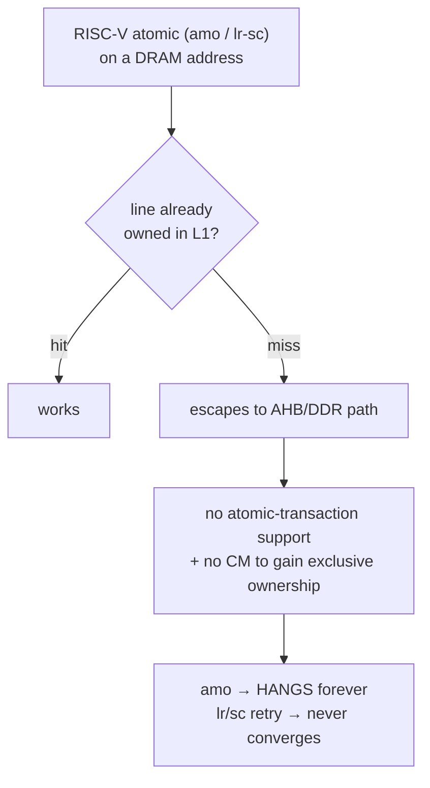

# Key findings & gotchas

The hard-won facts that shape the whole project. Each is something that cost real
debugging time and is non-obvious from the code alone.

## 1. No coherence manager → the whole stack is single-hart "soft-atomic"

**The defining constraint of this board.** The Gowin A25 IP has L1 I/D caches but
**no L2 and no coherence manager (CM)**. `mcache_ctl.DC_COHEN` is hardwired to 0.

Consequences and the fix:

- **OpenSBI** dies on its `coldboot_lottery` `amoswap` (first DRAM atomic, cold
  line). **Linux** would hang in any contended atomic. **musl** userspace spins
  forever on `a_cas` (cold-line `lr/sc`).
- Since the SoC is **single-hart**, the only concurrency is traps, so an atomic
  RMW just needs to be *uninterruptible*. Every layer was patched to do RMW as
  `csrrc mstatus/sstatus, xIE` → plain load/modify/store → restore:
  - OpenSBI: `riscv_atomic.c`, `riscv_locks.c`, `sbi_ipi.c`.
  - Linux: `arch/riscv/include/asm/{cmpxchg,atomic,bitops,futex}.h` + new
    `soft_atomic.h`; disable `ZAWRS`/`ZACAS`/`ZABHA`; **`CONFIG_SMP=n`** (SMP's
    qspinlock MCS slowpath deadlocks with soft atomics on one hart).
  - musl 1.2.5: `a_cas` rewritten non-atomic; rebuilt `libc.a` replaces the
    toolchain sysroot copy; everything links against it (busybox, doas, dropbear,
    htop, tcpdump, nstat).
- **A stock glibc/atomic binary SIGILLs/hangs** on this SoC. All userspace must be
  the soft-atomic musl build.
- Bare-metal/RTOS is unaffected (no contended atomics on cold lines).

**Verdict:** stock Linux/OpenSBI hang here; the single-hart soft-atomic stack
boots Linux 6.12 to an interactive shell with gigabit Ethernet. The real fix would
be a Gowin/Andes AE350 config *with* a coherence manager.

## 2. DDR bandwidth is the throughput ceiling (~6 MB/s)

Measured on hardware:

- Core 800 MHz, L1 D-cache on. **L1-hot working set ≈ 700 MB/s.**
- **DDR cache-miss ≈ 6 MB/s** — a single 32 B cache-line fill costs **~5 µs
  (~4000 core cycles)**, ~100× too slow.
- Re-enabling cache prefetch made no difference. The bare-metal DMA loopback also
  tops out ~2.4 MB/s — so the ceiling is the **A25↔DDR3 path** (gateware DDR3
  controller / EXTM-AHB bridge latency), not software.

**Consequence:** every memory-heavy workload crawls — `nc` TCP ~1 Mbit/s, md5 of
50 MB ~120 s. Networking is worst because the stack touches DDR per packet. This is
*not* the ethernet driver, the cache maintenance, the kernel HZ, or the clocks —
all were investigated and ruled out. Raising it requires fixing the DDR3 path in
the gateware (burst/pipelined line fills), a regenerate-IP / bus-integration
effort.

## 3. RGMII RX clock must be constrained at 125 MHz

`src/ae350_demo.sdc` originally declared `rgmii_rxclk` at the Gowin example's
**20 ns (50 MHz)**, but at 1000BASE-T the PHY drives `RGMII_RXC` at **125 MHz**.
PnR therefore never optimized the RX capture path for 125 MHz, leaving it
marginal.

- **Symptom:** the bare-metal self-test `[4]` (varied frames) and `[5b]` (1500 B)
  corrupted frames >64 B *specifically through PHY internal loopback* (where RXC is
  the looped TXC), while the real link worked (the PHY recovers a cleaner RX clock
  from the cable).
- **Fix:** constrain `rgmii_rxclk` to **8 ns / 125 MHz**. RGMII-ID mode supplies
  the RX clock-to-data skew in the PHY (no fabric IODELAY needed). PnR then meets
  it with zero negative slack (max ~126.7 MHz — tight). The self-test passes
  `[1]`–`[7]`, and Linux gigabit RX becomes timing-verified.
- `RGMII_RXC` is still on **generic routing** (`PR1014` warning) → only ~1.3 %
  margin. Routing it onto a global clock buffer would harden it further (optional).

## 4. RX data/metadata desync (fixed by the store-and-forward stage)

The RX CDC originally used two independent FIFOs (data words + `{len,err}`
trailers). The non-back-pressurable MAC + a bus stall dropped data words while the
trailer survived → permanent desync → every frame byte-shifted → RX looked dead.
Fixed by `rx_sf_buffer.v` (rewindable whole-frame staging). See
[05-eth-dma.md](05-eth-dma.md) §4. Debug entry points that nailed it:
`/proc/net/snmp`, `ip neigh` (host FAILED), and `devmem`-dumping the DRAM ring.

## 5. Dual-purpose config pins (PnR)

The AE350 drives its SPI-flash on the FPGA's dedicated MSPI/config pins, so PnR
fails (`PR2017 … dedicated pin (MSPI)`) unless `CPU`, `MSPI`, and `SSPI` are all
`true` in `impl/mega_138K_test_process_config.json`. The SoC's instruction flash
is the *same* SPI NOR that holds the bitstream.

## 6. Gowin AHBBusArbiter is unsuitable for DMA

The Gowin AHBBusArbiter IP only forwards a fixed **1 MB window at `0x80000000`**
and passes the address through unchanged — fine for peripheral registers, wrong
for DMA to arbitrary DRAM. It was replaced by the custom `eth_ahb_arbiter.v`
(full 32-bit address, registered grant). Earlier confusions also fixed: EXTM is
64-bit data (needs `extm_bridge`), and the arbiter's `SHREADYMUXM0` must drive
`EXTM_HREADY` (its absence deadlocked every transfer).

## 7. Toolchain & clock gotchas

- **Firmware UART:** the BSP `OSCFREQ` defaults to 100 MHz, but the APB is 50 MHz.
  Build firmware with **`-DREF_TEST_CLK`** or every baud comes out at half.
- **U-Boot:** RISC-V U-Boot hardcodes `-pie`; the bare-metal `*-elf` toolchains
  can't link it — use the **linux-gnu** toolchain (`LGNU`). Hard-float ilp32d needs
  an external ilp32d libgcc.
- **Kernel payload:** `FW_PAYLOAD_OFFSET=0x400000` (4 MB-aligned) — sv32 superpage
  boot requirement; `0x200000` fails silently.
- **Programmer:** the exFlash bridge reliably writes only images based at `0x0` or
  `0x600000`; a dropped write prints `ends at <start>` (== start). Reload the
  gateware after flashing.
- **Bitstream persistence:** `MODE=sram` is volatile (a power-cycle reloads the
  *flash* bitstream at `0x0`); use `MODE=flash` to persist. Reset (S3) keeps SRAM;
  power-cycle does not.
- **`%pK` / `(ptrval)`:** no HW RNG → the pointer-hash key never seeds, breaking
  `netstat`/`ss`. Boot with **`no_hash_pointers`**.
- **License:** `gw_sh` needs a floating license server; when it's down, validate
  RTL with iverilog (`eth_dma/tb/`).

## 8. Rootfs is RAM-only

The rootfs is an **initramfs (ramfs)** baked into the kernel `Image` — edits on the
live device (passwords, files, `setcap`) **do not persist**. Everything must be
baked into `linux/rootfs/` and the kernel reflashed. Notable consequences:

- No xattr/capability support and no `setcap` on the board, so **unprivileged
  `ping`** is done with a *separate* setuid-root busybox copy at `/bin/ping`
  (gated by `/etc/busybox.conf`) — making the *main* `/bin/busybox` setuid breaks
  boot (it drops privileges from `ifconfig`/`getty`).
- Extra tools (htop, tcpdump, nstat) are **static** cross-builds; htop's ncurses is
  built with compiled-in terminfo fallbacks so it needs no `/usr/share/terminfo`.
