# Fabric cores

The gateware adds a set of cores around the hard AE350 SoC. They follow one pattern:
- registers on the SoC's external AHB slave port (EXTS, `0xE80xxxxx`);
- DMA engines that master the external AHB master port (EXTM) through one arbiter;
- the LCD core reads DDR through its own port on the DDR bridge.

This page describes each core: what it is for, its architecture with a block diagram,
and its register map.
- The README next to each core's RTL adds the testbench and measurement detail.
- The Ethernet DMA engine has its own document, [05-eth-dma.md](05-eth-dma.md); §12
  here only summarises it.
- The LCD core and the JPEG decoder get the most space, because together they make
  video playback work on a CPU without an L2 cache.

## 1. Overview

| Core | RTL | Registers | Bus master | IRQ (PLIC) | Linux side | Tests | § |
|---|---|---|---|---|---|---|---|
| LCD video | `src/rtl/video/` | EXTS `0xE800_1000` | DDR bridge video port (read only) | — | `gowin-lcdfb` fbdev (`PATCHES/0006`); U-Boot `gowin_lcd` | `tb/run_tb.sh` (15 configs), `fbtest`, `yuvtest`, `scaletest` | 3 |
| JPEG decoder (IDCT) | `src/rtl/idct/` | EXTS `0xE804_0000` | EXTM m4 | 13 | `gowin-idct` misc (`PATCHES/0013`) | `tb/run_tb.sh`, `tb/run_jpeg_tb.sh`, `idcttest`, `vidplay -C` | 4 |
| Audio (PT8211) | `src/rtl/audio/` | EXTS `0xE800_2000` | EXTM m3 | 11 | ALSA `gowin-pt8211` (`PATCHES/0007`) | `tb/run_tb.sh`, `wavplay` | 6 |
| microSD host | `src/rtl/sdhost/` | EXTS `0xE802_0000` | EXTM m2 | 12 | `gowin-sdhost` mmc_host (`PATCHES/0011`) | `tb/run_tb.sh`, boardtest `cores.sd` | 7 |
| Sensors (ADC) | `src/rtl/sensor/` | EXTS `0xE800_4000` | — | — | hwmon `gowin-adc` (`PATCHES/0008`) | `tb/run_tb.sh`, boardtest `cores.sensors` | 8 |
| Fan | `src/rtl/fan/` | EXTS `0xE800_8000` | — | — | hwmon `gowin-fan` (`PATCHES/0009`), `S80fan` | `tb/run_tb.sh`, boardtest `cores.fan` | 9 |
| Board GPIO / EEPROM | `src/rtl/gpio/` | EXTS `0xE801_0000` | — | — | mainline `gpio-mmio` + `i2c-gpio` + `i2c-mux-gpio` + `at24` | `tb/run_tb.sh`, boardtest `kernel.eeprom` | 10 |
| DDR bridge | `src/rtl/ddr_bridge/` | MODE in ddr_perf | DDR3 IP user port | — | — | `tb/run_all.sh` (regression, mutants, formal), boardtest `cores.ddr` | 11 |
| DDR perf counters | `src/rtl/ddr_perf.v` | ext. APB `0xF800_0000` | — | — | `gowin-ddr-perf` sysfs (`PATCHES/0016`), `scripts/ddr_perf.py` | bridge `tb/run_all.sh`, boardtest `cores.ddr_perf` | 11 |
| Ethernet DMA | `src/rtl/eth_dma/` | EXTS `0xE800_0000` | EXTM m0 (RX write), m1 (TX read) | 4 | `gw-tse` netdev | module benches in `tb/`, firmware self-test, boardtest `net` | 12 |

Interrupts arrive on the SoC's `EXT_INT[n]`, which the PLIC numbers `n + 10` for n ≥ 1;
`EXT_INT[0]` (Ethernet) is source 4.

**Register conventions:**
- All registers are 32-bit words.
- A core decodes only its offset bits (`HADDR[7:2]`; the gpio core `HADDR[5:2]`), so
  its register block repeats through its address window.
- The slaves answer with zero wait states; the top level adds one to every read (§2).
- In the tables, *ro* is read-only and *W1C* is write 1 to clear; unlisted offsets are
  reserved.
- Every core has an ID register holding an ASCII tag.
- Newer features are announced by capability bits (video CAPS, idct STATUS[9:8], audio
  CAP), so a driver can run on an older bitstream.

## 2. Bus integration

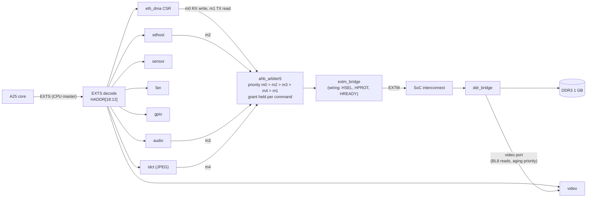

- **EXTS decode.** One address bit per core (`HADDR[12]` video, `[13]` audio, `[14]`
  sensor, `[15]` fan, `[16]` gpio, `[17]` sdhost, `[18]` idct; none of them = eth_dma).
  The read mux is registered before the SoC's pins, so every EXTS read takes one wait
  state and writes take none (timing closure, see [06-key-findings.md](06-key-findings.md)).
- **EXTM arbiter.** Five 64-bit or 32-bit AHB masters share the port.
  - The grant is registered and held for a master's whole command, so a burst is never
    split.
  - The Ethernet RX writer has top priority because it cannot be back-pressured; the TX
    reader has the lowest because a frame can wait.
  - The TX reader is the one 32-bit master: the arbiter copies its write data to both
    64-bit lanes and picks its read lane by `HADDR[2]`.
  - The SoC's own DMAC cannot reach fabric cores at all, which is why every core brings
    its own DMA.
- **Shared DMA master.** Every EXTM master except the Ethernet TX reader is an instance
  of `src/rtl/eth_dma/rtl/ahb_master.v`. Its writes go out as pipelined bursts: the
  longest of INCR16, INCR8, INCR4 or SINGLE that fits without crossing a 1 KB
  boundary. Its reads are single beats, 2 cycles each. Command addresses are
  beat-aligned.
- **Video port.** The LCD core does not use EXTM: reading the framebuffer that way cost the
  CPU ~37 % of its memory bandwidth. It has a read-only port on the DDR bridge whose
  requests take the next DDR command slot after waiting 8 DDR clocks (§11).

## 3. LCD video core

`src/rtl/video/` drives the Sipeed 5" 800×480 RGB panel (DE mode, RGB666, pixel clock
33.3 MHz, 52.5 frames/s). It scans a framebuffer in DDR3 out to the panel, line by line,
and over its life has grown from a plain RGB565 scan-out into a small display engine:

| Build | Feature |
|---|---|
| 49 | RGB565 scan-out over the DDR bridge's video port, frame CRC register |
| 68 | YUV 4:2:0 planar mode: decoders hand frames to the panel with no CPU colour conversion |
| 71 | Nearest-neighbour scaler and an ARGB8888 OSD layer |

### 3.1 Pipeline

| module | clock | does |
|---|---|---|
| `video_csr.v` | bus, 50 MHz | registers; the copies of bases, strides, scaler and OSD settings that are latched at frame end (§3.4) |
| `video_fetch.v` | DDR, 100 MHz | takes a line request, computes the plane addresses (three DSP multiplies: line × stride), issues BL8 reads on the bridge's video port, writes the returns into the line RAMs, signals done |
| line RAMs (`video_core.v`) | write DDR, read pixel | four simple dual-port dual-clock RAMs: Y / RGB 128 × 256, U and V 64 × 256 each, OSD 256 × 256 bit; each holds two lines (32 block RAMs) |
| `video_out.v` | pixel, 33.3 MHz | timing generator, line requests, the scaler's two DDAs, the 14-stage pixel pipeline, the OSD blend, the frame CRC |

The two sides talk through toggles synchronised with 3 flops (request and done), and
the bus-side settings reach the pixel clock either as frame-latched copies or as
quasi-static registers.

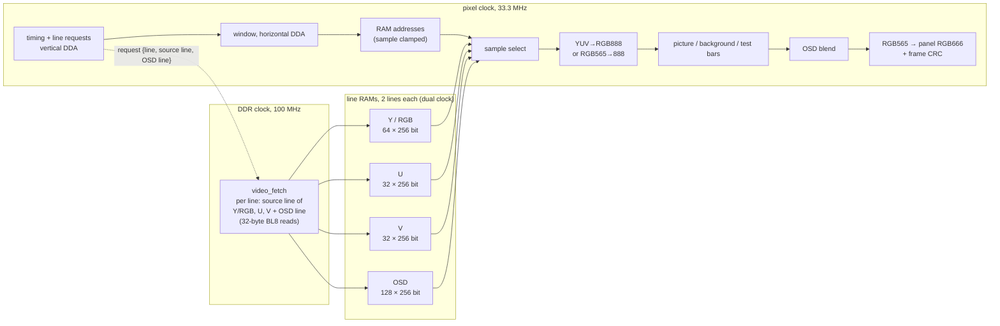

- **Line fetch.** Early in each line period (h = 11) the pixel side asks for the line it
  will show next. The request carries the panel line (it tags the RAM half), the source
  line the scaler wants and the OSD line. `video_fetch` reads what that line needs
  (RGB565: `src_w × 2` bytes; YUV: the Y line and the U/V line of `src_line / 2`; then
  `osd_w × 4` bytes of OSD) into the free half and toggles back. A line whose half does
  not carry its tag at the first pixel counts as an underrun and shows the stale half: a
  late fetch costs one line, never the frame alignment. Lines that show neither picture
  nor OSD are not fetched at all.
- **Four RAMs, four read ports.** Up to Build 70 the three YUV planes shared one 256-bit
  RAM, read once per 16-pixel group, which only works 1:1. Since Build 71 each plane has
  its own double-buffered RAM, so every pixel reads exactly the words holding its own
  samples, at any scale factor (32 block RAMs instead of 8).
- **Conversion.** Fixed-point BT.601, limited range (×256 coefficients 298/409/100/208/516)
  or full JPEG range (256/359/88/183/454); chroma samples repeated, no interpolation.
- **Frame CRC.** CRC-32 of every frame's RGB565 pixels as sent. Tests compare it with
  a model, which checks the whole display path without a camera.

### 3.2 Scaler (CTRL[4])

The source picture (`SRC_SIZE`, planes at `FB_BASE`…) is shown in a window
(`DST_POS`/`DST_SIZE`) of the active area, with the `BG` colour around it.

- Window line k shows source line `floor((k·STEP_Y + STEP_Y/2) / 65536)`; window pixel k
  shows source pixel `floor((k·STEP_X + STEP_X/2) / 65536)`; both are clamped to the
  source. Sampling at pixel centres makes a step of 1.0 the identity.
- The steps are 16.16 (`src × 65536 / dst`, < 64.0), computed by the driver. The vertical
  DDA runs once per line in the next-line pipeline; the horizontal one per pixel.
- YUV sources up to 2048 pixels wide, RGB565 up to 1024. Downscaling also saves DDR
  bandwidth: only the needed source lines are fetched.
- Off, the bus side forces the window to the whole active area and both steps to 1.0,
  which reproduces Build 70 bit for bit: the nine original testbench configurations pass
  unchanged.

### 3.3 OSD layer (CTRL[5])

An ARGB8888 layer (little-endian `0xAARRGGBB` words, straight alpha) in its own window,
one OSD pixel per panel pixel, fetched per line after the picture. It is blended in
RGB888 just before the RGB565 pack:

```
out = (osd · a' + picture · (256 − a')) >> 8,   a' = A + A[7]   (0..256)
```

so A = 0 leaves the picture bit-exact and A = 255 shows the OSD pixel. The layer works
over YUV and RGB pictures and over the background. vidplay's 64-line bar adds 6400
BL8 reads per frame, ~11 MB/s, about 28 % on top of the ~23 000 reads of an 800×450 YUV
picture. Measured on the board, that costs the CPU no time.

### 3.4 Frame-exact changes

Framebuffer bases, strides, scaler and OSD settings are latched on the bus side when a
frame ends. The pixel clock takes them over at the end of line 0, before the first
active line is requested when `vstart ≥ 2` (the panel uses 8). Every frame therefore
shows one buffer, one scale and one OSD position: buffer flips never tear. The
testbench moves the OSD in mid-frame and checks that no frame mixes the two positions.

### 3.5 Registers (`0xE800_1000`)

| Offset | Name | Bits |
|---|---|---|
| `0x00` | CTRL | [0] enable scan-out, [1] test pattern (colour bars, no fetch), [2] YUV 4:2:0 planar, [3] full-range YUV (else BT.601 limited), [4] scaler, [5] OSD |
| `0x08` | FB_BASE | framebuffer (RGB565) or Y plane address; bits [4:0] forced to 0 |
| `0x0C` | STRIDE | bytes per line (the Y line in YUV mode), multiple of 32 |
| `0x10` | HTIM | [15:0] active pixels (≤ 1024; the hardware ignores bits [1:0], the core's README asks for a multiple of 16, 32 in YUV mode), [31:16] total pixels per line (≤ 4095) |
| `0x14` | HSTART | first active pixel (DE start) |
| `0x18` | VTIM | [15:0] active lines, [31:16] total lines (≤ 4095) |
| `0x1C` | VSTART | first active line (≥ 2 for frame-exact changes) |
| `0x20` | FRAMES | ro: frames scanned out |
| `0x24` | UNDERRUN | ro: active lines whose fetch was late |
| `0x28` | CRC | ro: zlib CRC-32 of the last frame's active pixels as sent (RGB565, low byte first, row by row) |
| `0x2C` | ID | ro: `0x56494430` "VID0" |
| `0x30`, `0x34` | FB_BASE_U, FB_BASE_V | U and V plane addresses, 32-byte aligned |
| `0x38` | STRIDE_C | bytes per chroma line, multiple of 32 |
| `0x3C` | SRC_SIZE | scaler: [15:0] source width (YUV ≤ 2048, RGB ≤ 1024), [31:16] height |
| `0x40` | DST_POS | [15:0] x, [31:16] y of the picture window in the active area |
| `0x44` | DST_SIZE | [15:0] width, [31:16] height of the window |
| `0x48`, `0x4C` | STEP_X, STEP_Y | source pixels per window pixel and source lines per window line, 6.16 fixed point (< 64.0) |
| `0x50` | BG | RGB565 colour around the window |
| `0x54` | OSD_BASE | first OSD pixel (ARGB8888), 32-byte aligned |
| `0x58` | OSD_STRIDE | bytes per OSD line, multiple of 32 |
| `0x5C` | OSD_POS | [15:0] x, [31:16] y of the OSD window |
| `0x60` | OSD_SIZE | [15:0] width (≤ 1024), [31:16] height |
| `0x64` | CAPS | ro: [0] YUV, [1] scaler, [2] OSD; `0x7` since Build 71, 0 before |

**Reset values:**
- the panel's timing: 800 × 480 active, 1192 pixels per line, HSTART 182, 533 lines,
  VSTART 8 (52.5 Hz at 33.3 MHz);
- STRIDE 1600, STRIDE_C 416, OSD_STRIDE 3200.

The timing registers are not synchronised to the pixel clock: change them only while
CTRL is 0. Enable, test and YUV mode take effect at the next frame start. The bases,
strides, scaler and OSD settings are latched at frame end (§3.4).

### 3.6 Software

`gowin-lcdfb` (fbdev, `PATCHES/0006`) owns the RGB565 framebuffer, which fbcon and the
LVGL desktop draw into through the CPU cache. It writes changed bytes back for the
core: damage callbacks for drawing, deferred I/O for mmap. It also owns:

| Resource | ioctl | |
|---|---|---|
| 6 YUV buffers, mmap()ed after the framebuffer (up to 1280×768 sources each, kernel #93+) | `YUV_INFO`, `YUV_SHOW`, `YUV_DMA` | show a buffer (cache write-back + flip at the next frame); hand its DMA address to the IDCT core |
| the scaler | `SCALE` | source size and window; the driver computes the steps |
| 2 OSD buffers, panel-sized ARGB8888 | `OSD` | show one in a window (written back from the cache) or hide it |
| capabilities | `CAPS` | YUV / scaler / OSD, OSD buffer layout |

`RGB`, and closing the device file, return to the RGB565 desktop with the scaler and OSD
off. U-Boot's `gowin_lcd` driver uses the same core for the boot splash.

### 3.7 Verification

- `tb/run_tb.sh` runs 15 configurations against the real DDR bridge and a DDR3 model,
  pixel-exact against a model. They cover RGB565 and YUV in both ranges, DDR
  back-pressure and a starved fetch, a buffer flip, upscale, 2.5× downscale, odd factors
  (150→61), windows with background, the OSD alone and over scaled pictures, and an OSD
  moved mid-frame.
- On the board `scaletest` compares eight scenes by frame CRC, from 1:1 to 852×480 →
  800×450 and a full-screen OSD. All match with no underruns. `yuvtest` and `fbtest`
  check the YUV and RGB modes the same way.
- Build 71 timing: pixel clock 95.8 MHz achievable (33.3 needed), DDR clock domain
  100.08 MHz (100 needed).

## 4. Hardware JPEG decoder (`idct/`)

### 4.1 Why it exists

The A25 has a 32 KB L1 and no L2; a dependent cache miss costs ~1.4 µs. H.264 decoding
was memory-latency bound at ~12 fps for 480×270, so the player moved to MJPEG
(intra-only, no reference frames), which decoded 800×480 in ~40 ms per frame. The profile
of that 40 ms said 55 % was FFmpeg's `idct_put`, and most of that was not arithmetic:
each 8×8 block writes eight scattered 8-byte rows into a cold frame, one write-allocate
miss per row, ~18 ms per frame. A DSP-intrinsic IDCT was bit-exact and no faster in the
real decode, and staging bands in software only moved the misses. So the gateware took
over first the IDCT and the frame assembly (Build 69), then the entropy decoding (Build 70).

### 4.2 Data flow

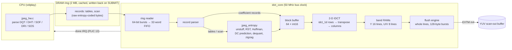

1. vidplay parses a frame's JPEG headers. It writes the quantisation and Huffman tables
   that changed, then one scan record with the entropy-coded bytes exactly as in the file,
   and three flush-only records. A SUBMIT ioctl writes the range back from the cache and
   moves the core's TAIL pointer.
2. The core reads the ring in bursts. The entropy decoder turns the scan into
   dequantised 8×8 blocks in MCU order (Y0 Y1 Y2 Y3 Cb Cr for 4:2:0), each with its plane
   and position.
3. Each block goes through the 2-D IDCT into the band RAMs. When a block belongs to a
   new band, the previous band is flushed to DRAM as whole lines of the YUV plane.
   That turns 8 scattered row writes per block into sequential bursts.
4. When everything up to TAIL is in DRAM the core raises its done interrupt, and the
   player's WAIT ioctl returns. The frame is then already in a scan-out buffer, and
   showing it is one `YUV_SHOW` with `NOSYNC`, since the CPU cache holds nothing of it.

The RTL:

| module | does |
|---|---|
| `idct_core.v` | registers, interrupts; the ring reader (commands of ≤ 16 beats into a 32-word FIFO, issued only while the FIFO holds ≤ 16 words, never across the ring's end); the record parser; the block engine; the flush engine with its 4-word prefetch FIFO |
| `jpeg_entropy.v` | the Huffman tables (a 1024 × 8 symbol RAM plus per-length limits and offsets), the quantisation tables (256 × 8), the bit buffer with byte unstuffing and RST handling, the DC predictors, the dequantising multiply, zigzag order |
| `idct_1d.v` | one 8-point FFmpeg `simple_idct` transform per clock (22 multipliers), latency 4 |
| `idct_ram.v` | the band RAMs (Y 4096 × 64, U and V 1024 × 64 bit): one write port, one registered read port |

The flush engine has priority over ring reads on the core's DMA master. One plane line
is one write command, so a whole line holds the EXTM grant.

### 4.3 Records

64-bit words; header `[39:36]` is the record type.

| Type | Payload | Use |
|---|---|---|
| 0 | `n` int16 coefficients, header holds plane / x / y / flush flags (`[35]` = flush-only) | blocks from FFmpeg's `idct_put` (Build 69 path) and frame-end flushes |
| 1 | DHT counts + values for slot 0..3 (DC 0, DC 1, AC 0, AC 1) | Huffman table |
| 2 | 64 bytes in zigzag order for table 0..3 | quantisation table |
| 3 | parameter word (MCU columns/rows, restart interval, table selectors) + the scan's bytes | a whole frame |

Tables persist in the core across frames, so a stream with fixed tables sends them once.
A frame costs the CPU a header parse and one ~10–20 KB copy into the ring.

### 4.4 Entropy decoder (`rtl/jpeg_entropy.v`, Build 70)

- **Bit-exact semantics.** The decoder reproduces FFmpeg's `mjpegdec.c`, so its output
  matches the software decoder bit for bit:
  - the DC predictor works in dequantised units and starts at 1024, at the scan start
    and after every RST marker;
  - a DC result is clipped to 16 bits and an AC product truncated to 16 bits;
  - `FF 00` is a data byte, `FF D0..D7` a restart, `FF FF` fill; any other marker ends
    the data, and reads past the end return zeros.
- **Canonical Huffman decoding without code tables.** Per code length the core keeps a
  left-aligned limit and an index offset. The code length is the smallest length whose
  limit the next 16 bits are below.
- **Pipelining.** One symbol per four clocks (code length, symbol address, symbol, extra
  bits), with the dequantising multiply and the block write in a two-stage pipeline
  behind it. Decoding of the next block overlaps the IDCT of the current one.
- **Robustness.** Corrupt data sets STATUS.bad and skips the rest of the record: no code
  matches, a DC size above 16, or a coefficient past position 63. Every block ends
  within 64 symbols, so no stream can hang the core.
- **Size.** 2.8k LUT/ALU, 2.1k registers, 2 block RAMs, 1 DSP. The whole core is 11.9k
  LUT/ALU and 24 DSPs (the 22-multiplier 1-D IDCT).

### 4.5 IDCT and band assembly (`rtl/idct_core.v`, `rtl/idct_1d.v`, Build 69)

- `idct_1d` is FFmpeg's `simple_idct` integer algorithm (`W1..W7`, the row pass with its
  DC shortcut and shift 11, the column pass with shift 20 and clamp to 0..255): one
  transform per clock, latency 4.
- The engine takes ~35 clocks per block (8 rows, 8 columns, pipeline latency, 8 band
  writes) and latches the block's plane and position at start, because the parser moves on
  while it works.
- Band RAMs hold one MCU row per plane (Y 16 × 2048, U/V 8 × 1024 pixels since Build 72, so
  720p fits; 1024 / 512 before, STATUS[9] tells them apart). The flush engine
  writes them as whole lines through a prefetch FIFO, with one line command per plane line.

### 4.6 Registers (`0xE804_0000`)

| Offset | Name | Bits |
|---|---|---|
| `0x00` | CTRL | [0] enable, [1] reset (self-clearing: pointers, parser, engine, bands), [2] done interrupt enable, [3] band interrupt enable |
| `0x04` | STATUS | [0] ro busy; W1C: [1] done, [2] band flushed, [3] bad record (n > 64, plane 3, unknown type, corrupt JPEG data); ro: [8] = 1 JPEG records supported (Build 70+), [9] = 1 lines up to 2048 pixels (Build 72+; 1024 before) |
| `0x08` | RING_BASE | ring address, 8-byte aligned |
| `0x0C` | RING_MASK | ring size − 1 (a power of two ≥ 64 bytes; bits [2:0] forced to 1) |
| `0x10` | TAIL | byte offset past the last record (8-byte aligned); the core consumes records up to it |
| `0x14` | HEAD | ro: byte offset consumed so far |
| `0x18`, `0x1C`, `0x20` | Y_BASE, U_BASE, V_BASE | plane addresses, 8-byte aligned |
| `0x24` | STRIDES | [15:0] luma, [31:16] chroma stride in bytes (multiples of 8) |
| `0x28` | SIZE | [15:0] width (multiple of 16, ≤ 2048), [31:16] height (luma lines; chroma = ⌈h/2⌉) |
| `0x2C` | BLOCKS | ro: blocks transformed |
| `0x30` | BANDS | ro: bands flushed |
| `0x34` | ID | ro: `0x49444354` "IDCT" |

- **Interrupt.** A level: `(STATUS.done & CTRL[2]) | (STATUS.band & CTRL[3])`.
- **Done** is set once per TAIL write, when the core has consumed everything up to TAIL
  and gone idle; busy drops in the same cycle.
- **Reset values:** RING_MASK `0x3F`, strides 800 / 416, SIZE 800 × 480.

### 4.7 Software and results

`gowin-idct` (`/dev/gowin-idct`, `PATCHES/0013`) owns the ring and handles the
`INFO`, `SETUP`, `SUBMIT`, `WAIT`, `STATUS`, `RESET` and `RING` ioctls. Plane addresses
come from gowin-lcdfb's `YUV_DMA`. STATUS bit 8 advertises the JPEG records, so a player
can tell a Build 69 core from a Build 70 one.

| 800×480 MJPEG, 25 fps with audio | CPU decode per frame | System CPU load |
|---|---|---|
| FFmpeg on the CPU (Build 68) | 40–42.6 ms, packets skipped | — |
| FFmpeg + hardware IDCT (Build 69) | 26.4–29.5 ms | 85 % |
| Gateware JPEG decoding (Build 70) | 1.2 ms | 31 % |

The core alone needs ~12 ms per 800×480 frame on the real bus, enough for ~80 fps.
Correctness:
- `tb/run_jpeg_tb.sh` decodes real JPEG files bit-exactly against `jpeg_ref.py`, a
  literal port of FFmpeg's decode that is itself checked against the host's ffmpeg. The
  files cover libjpeg standard and optimised tables, restart markers, q 100 and q 5,
  sizes that are not multiples of 16, an ffmpeg MJPEG frame, a full 800×450 frame, and
  damaged frames followed by a good one.
- On the board `vidplay -C` compared 1950 frames of four clips with FFmpeg's own CPU
  decode: all identical.

## 5. The video path end to end

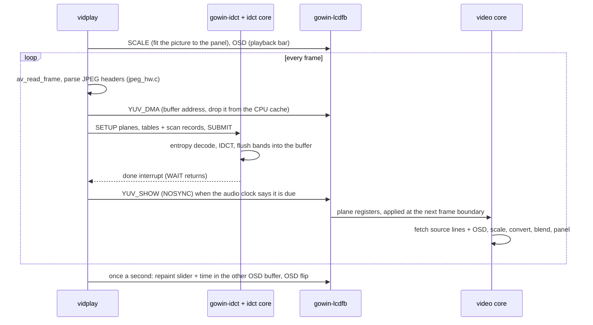

The audio runs beside it: FFmpeg decodes AAC or MP3, and the PT8211 core's DMA engine
plays the ALSA ring. The audio clock is the master clock: a late frame is caught up by
skipping packets, never by decoding frames only to drop them. The player is described
in [08-applications.md](08-applications.md).

## 6. Audio (`audio/`)

The Dock's PT8211 stereo DAC (BCK `E22`, WS `F24`, DIN `G24`) and the XPT4809 amplifier
behind it (enable `PA_EN` on `H17`) drive the headphone jack and the speaker. The core
plays 16-bit stereo at any sample rate. It is fed either by the CPU through a register
or by its own DMA engine from the ALSA ring, and it counts and checksums what it sends,
so a playback can be checked bit for bit.

### 6.1 Architecture

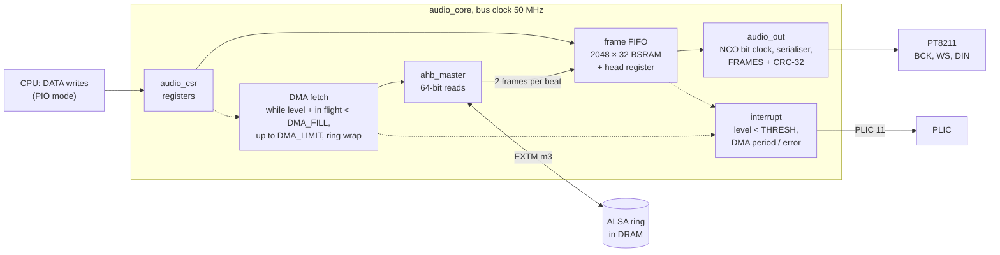

| module | does |
|---|---|
| `audio_csr.v` | registers; forces the DMA addresses and sizes to 8-byte alignment |
| `audio_core.v` | the frame FIFO, the DMA fetch, the interrupt; instantiates the others |
| `audio_out.v` | NCO bit clock, PT8211 serialiser, frame counter and CRC |
| `ahb_arbiter5.v` | the EXTM arbiter for all five DMA masters (§2), kept in this directory |

- **One clock.** Everything runs on the 50 MHz bus clock.
  - The bit clock is bit 31 of a 32-bit NCO that adds RATE every bus clock. With 32
    bit clocks per frame, fs = RATE × 50 MHz / 2³⁷. The reset value 131 941 395 gives
    48 kHz.
  - The DAC pins are ordinary registered outputs, and no clock crosses domains.
- **FIFO.** 2048 frames of `{R[15:0], L[15:0]}` (S16_LE as in memory) in block RAM.
  - A registered head word gives first-word fall-through: 2 cycles from write to head.
  - The RAM has no initialisation loop, because GowinSyn refuses more than 2000
    iterations.
  - A full FIFO drops a DATA write and counts OVERRUN.
- **PIO mode.** The CPU writes frames to DATA. The level interrupt fires while the
  level is below THRESH.
- **DMA mode (CTRL[6]).** The engine reads the ring at DMA_ADDR / DMA_SIZE whenever
  the FIFO level plus the frames already requested is below DMA_FILL[15:0].
  - A command is up to DMA_FILL[23:16] 64-bit beats, two frames per beat.
  - It never fetches past DMA_LIMIT. LIMIT and FETCH are free-running byte counts, and
    the engine runs while LIMIT − FETCH > 0 as a signed number.
  - It never crosses the ring's end. An odd frame count re-reads the split beat for its
    second half.
  - DMA_IRQ[0] is set every DMA_PERIOD bytes fetched, DMA_IRQ[1] on a bus error.
  - After each command the sizing logic holds for 3 cycles, so its 23-level cone could
    be registered ([06-key-findings.md](06-key-findings.md), Build 63). That costs ~3
    of ~70 cycles per command.
  - DATA writes are ignored in DMA mode.
- **Output.** PT8211 format: LSB-justified, 32 bit clocks per frame, MSB first, word
  select low = left. CTRL[3] swaps the channels.
  - A frame start that finds the FIFO empty sends zeros and counts UNDERRUN.
  - With CTRL[4] (stop when empty) it clears CTRL[0] instead. That is the driver's
    drain at the end of a stream.
- **Checking.** FRAMES counts the frames sent since the last FIFO reset. CRC is zlib's
  CRC-32 of their bytes (L lo, L hi, R lo, R hi), computed 16 bits per clock.
- **Interrupt** (a level): `CTRL[1] & ((level < THRESH) | (CTRL[6] & DMA_IRQ != 0))`.

### 6.2 Registers (`0xE800_2000`)

| Offset | Name | Bits |
|---|---|---|
| `0x00` | CTRL | [0] enable, [1] interrupt enable, [2] FIFO reset (self-clearing), [3] swap channels, [4] stop when empty (a frame start that finds the FIFO empty clears [0] instead of counting an underrun), [5] amplifier enable = the `PA_EN` pin (reset 1), [6] DMA engine on |
| `0x04` | STATUS | ro: [15:0] FIFO level (frames), [16] level < THRESH, [17] FIFO full |
| `0x08` | DATA | write-only: one frame `{R[15:0], L[15:0]}`; dropped and counted when full |
| `0x0C` | THRESH | level interrupt while level < THRESH |
| `0x10` | RATE | NCO increment; fs = RATE × 50 MHz / 2³⁷ (reset: 48 kHz) |
| `0x14` | UNDERRUN | ro: zero frames sent because the FIFO was empty while enabled |
| `0x18` | OVERRUN | ro: DATA writes dropped because the FIFO was full |
| `0x1C` | FRAMES | ro: frames sent since the last FIFO reset |
| `0x20` | CRC | ro: zlib CRC-32 of those frames' bytes |
| `0x24` | DEPTH | ro: FIFO capacity, 2048 |
| `0x28` | CAP | ro: [0] DMA engine present |
| `0x2C` | ID | ro: `0x41554430` "AUD0" |
| `0x30` | DMA_ADDR | ring bus address (8-byte aligned) |
| `0x34` | DMA_SIZE | ring size in bytes (multiple of 8) |
| `0x38` | DMA_PERIOD | DMA_IRQ[0] every this many bytes fetched (0 = never) |
| `0x3C` | DMA_LIMIT | bytes committed by the driver, free-running |
| `0x40` | DMA_FETCH | ro: bytes fetched, the same free-running count; a FIFO reset clears both and the ring offset |
| `0x44` | DMA_IRQ | W1C: [0] period boundary fetched, [1] bus error |
| `0x48` | DMA_FILL | [15:0] keep level + in flight ≥ this many frames (reset 512), [23:16] maximum beats per command (reset 32) |

### 6.3 Software and verification

ALSA `gowin-pt8211` is card 0, in DMA mode by default; `pio=1` selects the old
interrupt-fill scheme.

In DMA mode the ALSA buffer is one contiguous streaming mapping:
- the `.ack` callback writes the new samples back from the cache and advances
  DMA_LIMIT;
- the DRAIN trigger sets stop-when-empty.

A 5 s stream at 48 kHz takes 59 interrupts in DMA mode (232 in PIO mode), and the CPU
load is ~4 % either way, `wavplay` included. `wavplay`, the desktop's Audio panel and
`vidplay` use it.

**Verification:**
- `tb/run_tb.sh` (iverilog, with a PT8211 receiver model) checks:
  - the rate within 0.1 % at 48 and 44.1 kHz;
  - frame order, FRAMES and CRC against a model;
  - underrun, overrun, the interrupt, the channel swap and the FIFO reset;
  - in DMA mode: the full ring, the limit, the wrap, the end of stream and odd limits.
- On the board, boardtest `cores.audio` plays four WAV files and compares FRAMES and
  CRC with the files: all bit-exact.

The SoC's DMAC hangs on fabric accesses, hence the core's own engine. Nobody has yet
listened critically to the analogue output.

## 7. microSD host (`sdhost/`)

A native 4-bit SD host for the Dock's slot J19:
- CLK `D23`, CMD `D24`, DAT0..3 `H23 J23 A25 B25`, card detect `J15`;
- pull-ups on CMD, DAT and detect.

It replaced an SPI-mode core (`PATCHES/0010`, removed 2026-11-01); Gowin's own SD IPs
never answered on this board.

### 7.1 Architecture

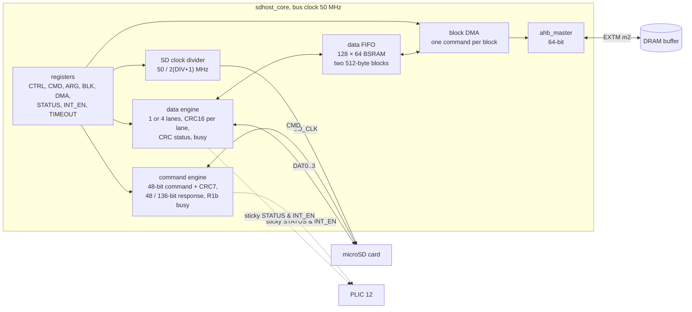

- **One file, one clock.** All of `sdhost_core.v` runs on the bus clock.
  - The SD clock is a register toggled on it: 50 / (2 (DIV + 1)) MHz, 397 kHz at reset
    for card identification, 25 MHz in use.
  - Outputs change on the SD clock's falling edge.
  - Inputs are sampled one bus clock (20 ns) after the rising edge by default, or at
    the edge with CTRL[16]. At 25 MHz the card's output delay, the Dock's 22 Ω series
    resistors and the FPGA's input path exceed the 40 ns period when sampled on the
    edge.
  - The card-detect pin goes through a 3-flop synchroniser.
- **Command engine.** Writing CMD starts a command.
  - It sends the 48-bit command with its CRC7 (x⁷ + x³ + 1).
  - It receives a 48- or 136-bit response, optionally checking the CRC7 and the index.
  - It times out after 80 clocks, and for R1b waits while the card holds DAT0 busy.
- **Data engine.** BLKCNT blocks of BLKSIZE bytes (a multiple of 8, at most 512) on 1
  or 4 lanes, with a CRC16 (x¹⁶ + x¹² + x⁵ + 1) per lane.
  - Reads check the start bit, the CRC and the end bit.
  - Writes send the data and CRC, then check the card's CRC-status token and wait for
    busy to clear.
  - TIMEOUT bounds the wait for a start bit or the end of busy.
- **FIFO and DMA.**
  - The FIFO is a synchronous-read block RAM addressed by the pointer after the
    current pop, so the head word is always present. It was a flop array until its
    128:1 read mux into the EXTM write data became a critical path (Build 63).
  - **Card reads:** the DMA writes a block to `DMA + n × BLKSIZE` as soon as the whole
    block is in the FIFO, in INCR16 bursts.
  - **Card writes:** the DMA prefetches while another block fits, and the data engine
    starts a block only when all of it is in the FIFO. Reads from DRAM are single
    beats.
  - A push into a full FIFO or a pop from an empty one sets STATUS[18].

### 7.2 Registers (`0xE802_0000`)

| Offset | Name | Bits |
|---|---|---|
| `0x00` | CTRL | [0] SD clock enable, [1] 4-bit bus, [2] soft reset (self-clearing: aborts the engines, flushes the FIFO), [15:8] DIV (reset 62), [16] sample inputs at the SD rising edge (reset 0 = one bus clock after it) |
| `0x04` | ARG | command argument |
| `0x08` | CMD | [5:0] index, [7:6] response (0 none, 1 48-bit, 2 136-bit), [8] check response CRC7, [9] check response index, [10] R1b busy wait, [11] data present, [12] data direction (1 = write); writing starts the command |
| `0x0C`–`0x18` | RESP0..3 | ro: 48-bit response: RESP0 = bits [39:8]; 136-bit: RESP0 = bits [127:96] … RESP3 = bits [31:0] |
| `0x1C` | BLK | [11:0] block size in bytes (multiple of 8, ≤ 512), [31:16] block count |
| `0x20` | DMA | DMA buffer address (8-byte aligned) |
| `0x24` | STATUS | ro: [0] command busy, [1] data busy, [2] card inserted, [3] DAT0 level, [4] CMD level; W1C sticky: [8] command done, [9] data done, [10] response timeout, [11] response CRC error, [12] response index error, [13] data timeout, [14] data CRC error, [15] data end-bit error, [16] write CRC-status error, [17] DMA bus error, [18] FIFO overrun / underrun |
| `0x28` | INT_EN | interrupt enable mask for STATUS[18:8]; IRQ = any enabled sticky bit |
| `0x2C` | TIMEOUT | [23:0] data start-bit / busy timeout in SD clocks |
| `0x30` | ID | ro: `0x53444843` "SDHC" |
| `0x34` | DBG | ro: engine states |

### 7.3 Software and verification

`gowin-sdhost` is a plain `mmc_host` with a 64 KB bounce buffer: no scatter-gather.
- On the first fast read it tunes the clock and the sampling point ("tuned: 25000 kHz,
  late sampling" in dmesg).
- The card is `/dev/mmcblk0`, mounted at `/mnt/sd` by `S45sdcard`.
- On a class-10 card: 6.4 MB/s read and 4.7 MB/s write (boardtest, 2026-11-05). The
  bounce copy and the per-request overhead bind, not the 12.5 MB/s of the wire.
- A card left in SPI mode by an earlier SPI-mode design needs a power cycle.

**Verification:**
- `tb/run_tb.sh` (iverilog, an AHB memory with random waits and `sd_card_model.v`)
  covers:
  - Linux's init sequence;
  - 4-bit multi-block write and read, CMD17, 1-bit transfers and the SCR read;
  - an injected CRC error, a response timeout, recovery and the interrupt mask.
- boardtest `cores.sd` reads and writes 32 MB and compares md5 sums.

## 8. Sensors (`sensor/`)

The GW5AST-138B has two hard delta-sigma ADC cores with no pins. ADCLRC measures the
die temperature; ADCULC measures supply rails selected by an internal bus mux. The core
scans them continuously, so software only reads registers. The board has no current
sense, so power cannot be measured.

### 8.1 Architecture

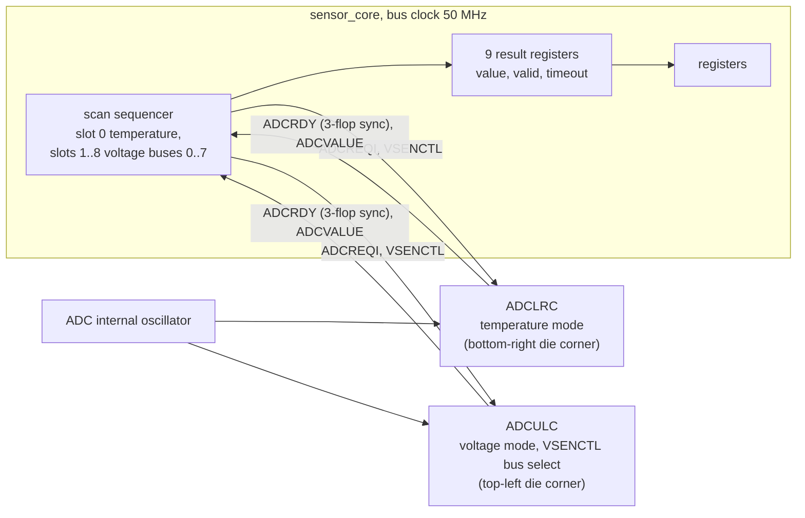

| module | does |
|---|---|
| `sensor_adc.v` | instantiates the two ADC primitives directly (the IP generator is GUI-only): ADCLRC in temperature mode, ADCULC in voltage mode with `VSEN_CTL_SEL = 1` so `VSENCTL` picks the bus at run time; the `BUF_*_EN` parameters connect the measured rails |
| `sensor_core.v` | registers, the scan sequencer, the results |

- **Scan.** Slot 0 is the temperature; slots 1..8 are voltage buses 0..7. The scan
  repeats while CTRL.run is set. Per slot:
  1. Hold the request low for 4096 bus clocks (82 µs), so the input mux settles.
  2. Raise `ADCREQI`.
  3. `ADCRDY`, through a 3-flop synchroniser, must fall within 4096 clocks and rise
     within 2²³ clocks (~170 ms). Otherwise the slot gets its timeout bit and
     TIMEOUTS counts it, and the scan moves on.
  4. The value is latched 8 clocks after `ADCRDY` rises.

  A full scan of nine slots takes ~60 ms.
- **Clocking.** The ADCs run on their internal oscillator (`CLK_SEL = 0`); the
  sequencer only sees `ADCRDY`. Both cores run with `DIV_CTL = 2` and
  `SAMPLE_CNT_SEL = 4`.
- **Values.**
  - Temperature: TEMP[13:0], signed, / 4 = °C (± 2 °C).
  - Voltage: VOLT[n][13:0] / 2048 = volts at the ADC bus; times the bus divider = the
    rail.
  - TCAL / VCAL hold the cores' calibration (resets 730 / −1180 and 653 / 0).

| bus (slot) | rail | divider | enable | measured |
|---|---|---|---|---|
| 0 (1) | VCC, core 0.9 V | /2 | `BUF_VCC_EN` | 0.915 V |
| 1 (2) | VCCM | /2 | `BUF_VCCM_EN` | 1.02 V |
| 2 (3) | VDDA_Q0, SerDes 0.9 V | /2 | `BUF_SERDES_Q0_EN[0]` | 0.94 V |
| 3 (4) | — | | | reads 0 |
| 4 (5) | VDDX_MIPI 1.8 V | /4 | `BUF_MIPI_M0_EN[2]` | 1.86 V |
| 5 (6) | VCCX 1.8 V | /4 | `BUF_BK6_EN[4]` | 1.86 V |
| 6 (7) | reserved | | | reads 0 |
| 7 (8) | VCCIO7, the DDR3 bank 1.5 V | /8 | `BUF_BK7_EN[5]` | 1.55 V |

Only the first two enables are documented by Gowin (UG299); the others were found by
probing on the board, since a bus with nothing enabled reads 0.

### 8.2 Registers (`0xE800_4000`)

| Offset | Name | Bits |
|---|---|---|
| `0x00` | CTRL | [0] run, scan continuously (reset 1), [1] ADC enable, `ADCEN` of both cores (reset 1) |
| `0x04` | STATUS | ro: [3:0] slot being measured, [8] busy (a conversion in flight), [31:16] bus clock in MHz (for the driver) |
| `0x08` | SCANS | ro: completed scans of all 9 slots |
| `0x0C` | TIMEOUTS | ro: conversions that timed out |
| `0x10` | TEMP | ro: slot 0: [13:0] signed raw (/ 4 = °C), [30] valid (measured at least once), [31] last conversion timed out |
| `0x14` | TCAL | [9:0] FSCAL (730), [27:16] OFFSET, signed (−1180): the temperature core's calibration |
| `0x18` | VCAL | the same for the voltage core (653 / 0) |
| `0x1C` | ID | ro: `0x53454E53` "SENS" |
| `0x20` + 4n | VOLT[n] | ro: voltage bus n (slot n + 1), same format as TEMP; [13:0] / 2048 = volts at the bus |

### 8.3 Software and verification

hwmon `gowin-adc` exposes:
- `temp1_input`, in m°C = raw × 250;
- `in0..7` with labels, in mV = raw × divider × 1000 / 2048.

The desktop's System panel and `S80fan` read them.

**Verification:**
- `tb/run_tb.sh` (iverilog, behavioural ADC models; Gowin's simulation library has
  empty bodies) checks scan order, values, run / stop, timeout flagging and recovery,
  and the calibration registers.
- boardtest `cores.sensors` checks the die temperature (10–85 °C) and each rail
  (within ± 10 %).

## 9. Fan (`fan/`)

PWM (`T17`) and tacho (`T18`) for the Dock's 4-pin fan header M1, bank 2.

### 9.1 Architecture

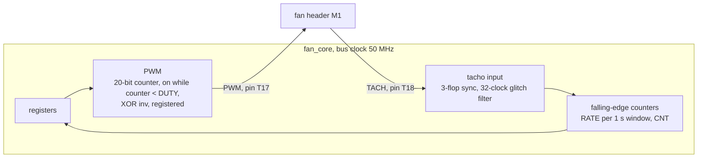

- **PWM.** A 20-bit counter on the bus clock wraps at PERIOD: 2000 at reset, so 25 kHz
  in 20 ns steps. The output is on while the counter is below DUTY.
  - The output is registered and XOR-ed with CTRL[1].
  - With CTRL[0] clear, the pin is held at the "off" level.
- **Board revisions.** Dock rev 4071d drives the fan's PWM pin directly. Rev 4071f
  switches the fan's 5 V through a P-MOSFET, which needs the inverted signal (DT
  `gowin,pwm-inverted`).
- **Tacho.** A 3-flop synchroniser, then a level must hold for 32 clocks (0.64 µs)
  before it counts. Falling edges are counted:
  - RATE holds the count of the last full second, saturating at 16 bits;
  - CNT runs free.

### 9.2 Registers (`0xE800_8000`)

| Offset | Name | Bits |
|---|---|---|
| `0x00` | CTRL | [0] enable (0 = pin held at the "off" level), [1] invert the output; reset `0x1` |
| `0x04` | PERIOD | [19:0] PWM period in bus clocks; reset 2000 (25 kHz); 0 is taken as 1 |
| `0x08` | DUTY | [19:0] on-time in bus clocks (≥ PERIOD = always on); reset 2000 (100 %) |
| `0x0C` | RATE | ro: [15:0] tacho falling edges in the last second, [31] tacho level |
| `0x10` | CNT | ro: free-running tacho edge count |
| `0x14` | ID | ro: `0x46414E20` "FAN " |
| `0x18` | STATUS | ro: [19:0] PWM counter, [30] pin level, [31] one-second tick (debug) |

### 9.3 Software and verification

hwmon `gowin-fan` exposes:
- `pwm1` (0..255 → DUTY = round(PERIOD × pwm / 255); the DT sets the frequency);
- `fan1_input` (RATE × 60 / pulses per revolution).

`S80fan` applies a temperature curve: PWM 64 up to 35 °C, rising to 255 at 60 °C. The
desktop's status bar shows the rpm, or "FAN STOPPED".

On this board only the readout works:
- The stock fan is 3-pin (no PWM input), so it runs at full speed (~5800 rpm).
- On rev 4071f a 3.3 V pin cannot switch the MOSFET off; R265 must be populated.

**Verification:**
- `tb/run_tb.sh` measures duty, period and inversion on the pin, glitch rejection, the
  edge count and the one-second rate.
- boardtest `cores.fan` reports the rpm.

## 10. Board GPIO (`gpio/`)

Six board-control lines:
- the Dock's `SYS_TWI` I²C bus (`K25` / `K26`, 2.2 kΩ pull-ups);
- the shared select lines (`N19` / `P19` / `P26`) of its two 8-way 74HC4051 analog
  muxes, one for SCL and one for SDA;
- the write protect (`V14`) of the 1 KB ZD24C08A EEPROM on mux channel 2 (I²C
  `0x50`..`0x53`).

Everything above the register is mainline Linux.

### 10.1 Architecture

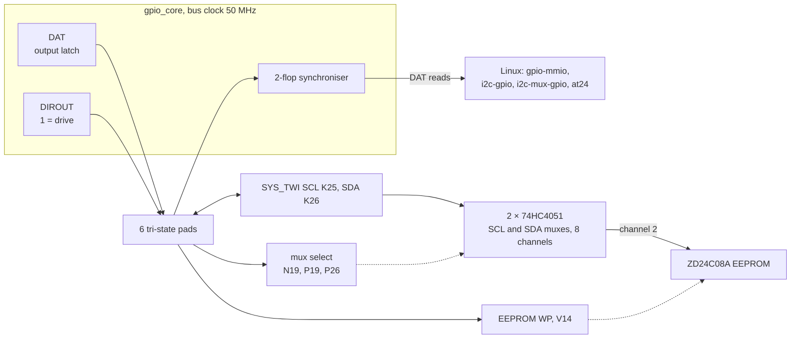

| line | pin | function |
|---:|---|---|
| 0 | K25 | SYS_TWI SCL |
| 1 | K26 | SYS_TWI SDA |
| 2–4 | N19, P19, P26 | 74HC4051 select SEL0..2 |
| 5 | V14 | EEPROM write protect (high = protected) |

| mux channel | 0 | 1 | 2 | 3 | 4 | 5 | 6 | 7 |
|---|---|---|---|---|---|---|---|---|
| device | SFP0 | SFP1 | **EEPROM** | DVI-A DDC | DVI-B DDC | DVP camera | MIPI RX0 | MIPI RX1 |

- **Open drain** is done the gpiolib way. A "1" on SCL / SDA is direction = input, and
  the pull-ups lift the line. A "0" is direction = output with DAT = 0. `i2c-gpio`
  bit-bangs the bus at ~100 kHz.
- **The mux's wiring.** The SDA mux has its select pins in the opposite order to the
  SCL mux. The Dock compensates by swapping Y1 / Y4 and Y3 / Y6, so the table above is
  what software sees.
- **Channels 3 and 4** also carry the Dock's two MS5351 clock generators on rev 4071f.
  The DT declares them as empty buses for later use.

### 10.2 Registers (`0xE801_0000`)

| Offset | Name | Bits |
|---|---|---|
| `0x00` | DAT | write: output latch; read: pin levels through the 2-flop synchroniser |
| `0x04` | DIROUT | 1 = drive the pin from DAT, 0 = high-Z; reset 0 (all inputs) |
| `0x08` | ID | ro: `0x4750494F` "GPIO" |
| `0x0C` | NGPIO | ro: 6 |

### 10.3 Software and verification

The Linux stack has no board driver. It is built entirely from mainline drivers:
- `gpio-mmio` (`wd,mbl-gpio`);
- `i2c-gpio`;
- `i2c-mux-gpio` (idle on the EEPROM channel);
- `at24`, with `wp-gpios`.

The EEPROM appears as `/sys/bus/nvmem/devices/board-eeprom0/nvmem`:
- The kernel reads the eth0 MAC address from its nvmem cell at `0x110`.
- `boardcfg` keeps the board's settings there ([08-applications.md](08-applications.md)).

**Verification:**
- `tb/run_tb.sh` checks the registers, the tri-state pads against pull-ups, and a
  bit-banged I²C address byte ACKed by a slave model.
- boardtest `kernel.eeprom` reads the MAC address back.

## 11. DDR bridge and bus counters (`ddr_bridge/`, `ddr_perf.v`)

The SoC's data memory is the 1 GB DDR3, reached through the SoC's `DDR_H*` AHB port.
Gowin's stock bridge capped the CPU at ~6 MB/s.
- **`ahb_ddr3_bridge`** replaces it and reads 152 MB/s sequentially.
- **`ddr_perf`** counts what crosses that port, traces it, and holds the bridge's MODE
  register.

The full design notes are in `src/rtl/ddr_bridge/README.md`.

### 11.1 Bridge architecture

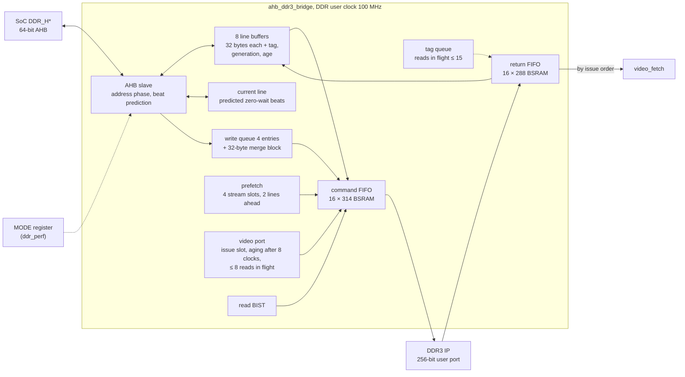

- **Lines.** A line is 32 bytes: one BL8 burst on the 32-bit DDR3, one 256-bit word on
  the IP's user port, one A25 cache line.
- **Reads.** The wait depends on where the line is:
  - A WRAP4 cache-line fill (critical word first) and line-aligned INCR4 get
    *predicted* beats with zero wait states.
  - A hit in the current line costs 1 wait state, a hit in a line buffer 2.
  - A miss allocates a buffer, pushes a command, and waits for the DDR3 round trip
    (~28 user clocks).
- **Prefetch.** Four stream slots follow sequential misses and fetch 2 lines ahead.
- **Writes** are posted with zero wait states into a 4-entry queue.
  - They are merged into a 32-byte block with a byte mask and leave as one masked BL8
    write.
  - Every write invalidates the buffered copies of its line.
  - A generation tag discards read data that was in flight when its line was written.
  - A read waits until every earlier write is on its way to the DDR3. The formal proof
    checks this order.
- **Overlapped reads.** Reads to different DRAM rows may overlap (MODE[16], the
  default). Up to 15 are in flight, tracked by the tag queue. The A25's page-table walker does not see dirty L1 lines, so this
  needs the kernel's page-table writeback (`PATCHES/0005`). MODE 0x100 is the safe
  setting without it.
- **Video port.**
  - A read-only BL8 port for the LCD core, beside the AHB side; it bypasses the line
    buffers.
  - It issues when the bridge's issue slot is free.
  - A request that has waited 8 clocks goes ahead of the bridge's next command, with at
    most 8 video reads in flight.
  - Returns are routed by an issue-order FIFO.
- **One clock.** The SoC's data-memory clock is the DDR3 IP's user clock (Build 64),
  so the command and return FIFOs are plain synchronous FIFOs (`SYNC_CLK = 1`).
- **Read BIST.** It issues reads through the IP on its own and checks what returns:
  data, order, stray beats. The results appear as ddr_perf counters 44–51.

Measured (`ddr_memtest`, 2026-11-05):

| bridge | sequential read | memcpy |
|---|---|---|
| this bridge | 152 MB/s | 74 MB/s |
| Gowin's stock bridge | 6.3 MB/s | 2.2 MB/s |

**MODE register** (`0xF800_0020`, reset `0x10000`):

| Bit | Effect when set |
|---|---|
| 0, 1 | no prefetch |
| 2 | no write merging |
| 5 | no read within G clocks of a write |
| 6 | one DDR command at a time (the stock bridge's spacing) |
| 7 | no write within G of a write |
| 8 | one DDR read in flight (for a kernel without `PATCHES/0005`) |
| 9 | no write while a read is in flight |
| 10, 11 | no read / write within G of a read |
| 15:12 | G = n × 4 clocks (0 → 32) |
| **16** | **overlapping reads to different rows (default)**; otherwise same-row only |
| 17 | same-cycle ready handshake (~15 % more memcpy) |
| 19 | no predicted beats (every read beat ≥ 1 wait) |
| 20 | overlapping reads only within one line |
| 18, 21 | no effect since the 32-bit bus |
| 24 | read BIST start (toggle); [26:25] pattern, [31:28] iterations = 2^(n+8) |

### 11.2 Bus counters (`ddr_perf`)

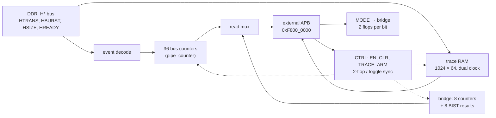

- **Clocking.**
  - The counters and the trace run on the DDR clock and watch the `DDR_H*` port's
    signals; the APB side runs on its own 50 MHz clock.
  - CTRL crosses into the DDR clock through 2-flop synchronisers; CLR is a toggle.
  - The counters are read without synchronisation, so they are only consistent while
    counting is stopped (EN = 0). The Linux driver stops, reads and restarts every
    second and on every read.
- **Pipelined counters.** GowinSyn builds a 32-bit `+1` as a 10–13-level LUT chain, so
  the counters are `src/rtl/pipe_counter.v`:
  - 8-bit slices with a registered carry between them;
  - exact once counting has paused for 4 clocks.
- **Trace.** While EN and TRACE_ARM are set, every accepted address phase is written to
  a 1024-entry RAM until it is full. Each entry holds the address, a 16-bit time stamp,
  the previous transfer's wait states, and the transfer's direction, burst and size.
- **APB timing.** One wait state: the address and data are registered in the setup
  phase, and PRDATA comes from a register.

| Offset | Name | Bits |
|---|---|---|
| `0x000` | ID | ro: `{0xDD3B, CONFIG[15:0]}` |
| `0x004` | CTRL | [0] EN (count), [1] CLR (write 1: clear the counters), [2] TRACE_ARM |
| `0x008` | STATUS | ro: [15:0] trace entries captured, [16] trace full |
| `0x00C` | TRACE_IDX | trace entry to read |
| `0x010` | TRACE_LO | ro: the entry's HADDR |
| `0x014` | TRACE_HI | ro: `{ts[15:0], prev_wait[7:0], hwrite, hburst[2:0], hsize[1:0], seq, prev_valid}` |
| `0x018` | CONFIG | ro: build-time parameter: `0x00020190` = bridge 2, DDR3 400 MHz |
| `0x020` | MODE | the bridge's MODE (§11.1), reset `0x10000` |
| `0x100` + 4i | counter i | ro, 32-bit |

| Counters | Content |
|---|---|
| 0–11 | cycles, rd_bursts, wr_bursts, rd_beats, wr_beats, rd_wait, wr_wait, rd_first_wait, rd_wait_max, wr_wait_max, busy (HTRANS = BUSY), bus_active |
| 12–19, 20–27 | read / write NONSEQ transfers by HBURST (SINGLE, INCR, WRAP4, INCR4, WRAP8, INCR8, WRAP16, INCR16) |
| 28–31, 32–35 | read / write NONSEQ transfers by HSIZE (8, 16, 32, 64 bit) |
| 36–43 | from the bridge: br_hit0, br_demand, br_prefetch, br_wr_push, mc_rd_cmds, br_tag_mismatch, mc_wr_cmds, mc_rd_valid |
| 44–51 | read BIST: status, errors, reorders, first mismatch {pattern, j, k, iter}, its word address, data received, data expected, stray valids |

**Software.**
- `gowin-ddr-perf` (`PATCHES/0016`) owns CTRL. It keeps 64-bit totals in
  `/sys/bus/platform/devices/f8000000.ddr-perf/`:
  - `counters`: all 44 from one sample;
  - `statistics/`, `clear`, `trace_arm`, `trace_count`, `trace`;
  - `mode`, read-only.
- `scripts/ddr_perf.py` measures a command's bus traffic through it, or through
  `devmem` on older kernels.

**Verification:**
- The bridge's `tb/run_all.sh` runs:
  - a random regression against a byte-accurate reference memory;
  - 36 directed cases;
  - 13 mutants, each of which the tests must catch;
  - the `ddr_perf` unit test;
  - a formal proof of the AHB side (Yosys + ABC).
- On the board, boardtest `cores.ddr` (`ddr_memtest`, 64 MB of patterns) and
  `cores.ddr_perf` (the counter sums agree, the cycle count matches 100 MHz, the trace
  fills).

## 12. Ethernet DMA (`eth_dma/`, summary)

The engine moves frames between the Gowin Triple-Speed MAC (RGMII to the RTL8211F PHY)
and descriptor rings in DRAM. [05-eth-dma.md](05-eth-dma.md) describes it in full: RX
and TX sequences, the clock crossings, the ring formats, the self-test.

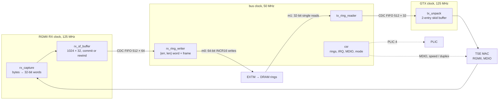

- **RX.** The MAC cannot be back-pressured, so frames go through a store-and-forward
  buffer first.
  - A frame commits only on a clean end with every word stored; otherwise the write
    pointer rewinds and RX_DROP counts it.
  - A complete frame crosses into the bus clock and is written to the next ring buffer
    in one command: a `{15'b0, err, len[15:0]}` word, then the frame.
  - The ring buffers are 2 KB each (`base + index << 11`), the ring length a power of
    two.
- **TX.** The reader fetches one frame at a time (a length word, then the data) once
  the CPU advances TX_TAIL. It pushes the frame across, and the MAC side sends it from
  a skid buffer with no gaps inside the frame.
- **MDIO** is inside the MAC; the CSRs drive it.

| Offset | Name | Bits |
|---|---|---|
| `0x00` | CTRL | [0] RX enable, [1] TX enable |
| `0x04` | IRQ_STAT | W1C: [0] RX done, [1] TX done |
| `0x08` | IRQ_EN | enables for IRQ_STAT; IRQ = any enabled bit |
| `0x10` | RX_BASE | physical base of the RX ring buffers |
| `0x14` | RX_LEN | [15:0] number of buffers (power of two) |
| `0x18` | RX_TAIL | [15:0] frames consumed by the CPU |
| `0x1C` | RX_HEAD | ro: [15:0] frames written by the DMA |
| `0x20` | RX_DROP | ro: [15:0] frames dropped (ring full or staging) |
| `0x30` | TX_BASE | physical base of the TX ring buffers |
| `0x34` | TX_LEN | [15:0] number of buffers |
| `0x38` | TX_TAIL | [15:0] frames queued by the CPU |
| `0x3C` | TX_HEAD | ro: [15:0] frames transmitted |
| `0x40` | TX_FETCH | ro: [15:0] frames fetched |
| `0x50` | MDIO_ADDR | [4:0] PHY address, [9:5] register |
| `0x54` | MDIO_WD | [15:0] write data |
| `0x58` | MDIO_CTRL | write: [0] read pulse, [1] write pulse |
| `0x5C` | MDIO_ST | ro: [15:0] read data, [16] read valid, [17] busy |
| `0x60` | ETH_MODE | [2:0] speed / duplex, driven to the MAC |
| `0x64` | RX_FRAMES | ro: frames the MAC delivered, counted at line rate |
| `0x68` | RX_BAD | ro: of those, frames the MAC flagged bad (CRC, PHY error) |
| `0x70`–`0x78` | debug | ro: TX, RX and EXTM state words (`0x78` = `{hresp, hreadyout, htrans[1], hsel}`) |
