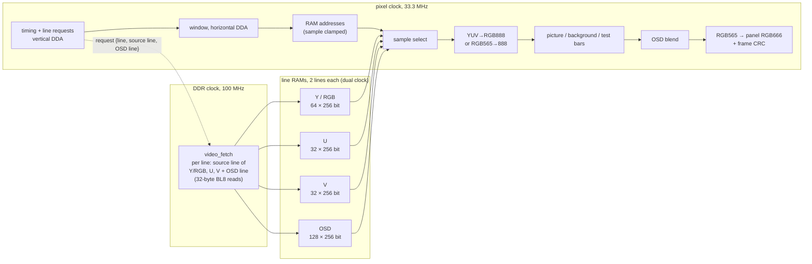
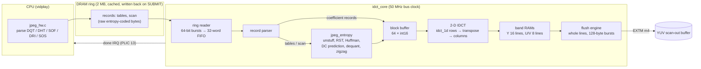
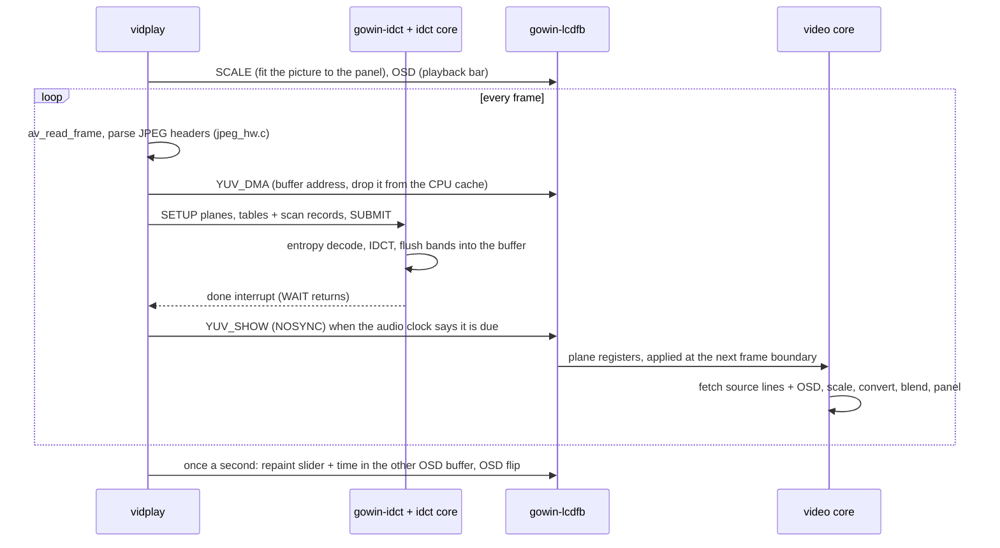

# Fabric cores

Besides the DDR bridge and the Ethernet DMA engine ([05-eth-dma.md](05-eth-dma.md)), the
gateware adds a set of peripheral cores around the hard AE350 SoC. They all follow the
same pattern:
- registers on the SoC's external AHB slave port (EXTS, `0xE80xxxxx`);
- DMA engines that master the external AHB master port (EXTM) through one arbiter;
- the LCD core reads DDR through its own port on the bridge.

Each core has a README next to its RTL with the full register map; this page explains
what each one is for and how they fit together. The video core and the hardware JPEG
decoder are described in detail because together they make video playback work on a
CPU without an L2 cache.

## 1. Overview

| Core | RTL | Registers (EXTS) | Bus master | IRQ (PLIC) | Linux side | Tests |
|---|---|---|---|---|---|---|
| Ethernet DMA | `src/rtl/eth_dma/` | `0xE800_0000` | EXTM m0 (RX write), m1 (TX read) | 4 | `gw_tse` netdev | [05-eth-dma.md](05-eth-dma.md) |
| LCD video | `src/rtl/video/` | `0xE800_1000` | DDR bridge video port (read only) | — | `gowin-lcdfb` fbdev (`PATCHES/0006`); U-Boot `gowin_lcd` | `tb/run_tb.sh` (15 configs), `fbtest`, `yuvtest`, `scaletest` |
| Audio (PT8211) | `src/rtl/audio/` | `0xE800_2000` | EXTM m3 | 11 | ALSA `gowin-pt8211` (`PATCHES/0007`) | `tb/run_tb.sh`, `wavplay` |
| Sensors (ADC) | `src/rtl/sensor/` | `0xE800_4000` | — | — | hwmon `gowin-adc` (`PATCHES/0008`) | `sensors`, desktop System panel |
| Fan | `src/rtl/fan/` | `0xE800_8000` | — | — | hwmon `gowin-fan` (`PATCHES/0009`), `S80fan` | desktop status bar |
| Board GPIO / EEPROM | `src/rtl/gpio/` | `0xE801_0000` | — | — | mainline `gpio-mmio` + `i2c-gpio` + `i2c-mux-gpio` + `at24` | `boardcfg` |
| microSD host | `src/rtl/sdhost/` | `0xE802_0000` | EXTM m2 | 12 | `gowin-sdhost` mmc_host (`PATCHES/0011`) | `tb/`, `dd` |
| JPEG decoder (IDCT) | `src/rtl/idct/` | `0xE804_0000` | EXTM m4 | 13 | `gowin-idct` misc (`PATCHES/0013`) | `tb/run_tb.sh`, `tb/run_jpeg_tb.sh`, `idcttest`, `vidplay -C` |
| DDR perf counters | `src/rtl/ddr_perf.v` | ext. APB `0xF800_0000` | — | — | `/dev/mem` (`scripts/ddr_perf.py`) | bridge `tb/run_all.sh` |

Interrupts arrive on the SoC's `EXT_INT[n]`, which the PLIC numbers `n + 10` for n ≥ 1;
`EXT_INT[0]` (Ethernet) is source 4.

## 2. Bus integration


- **EXTS decode.** One address bit per core (`HADDR[12]` video, `[13]` audio, `[14]`
  sensor, `[15]` fan, `[16]` gpio, `[17]` sdhost, `[18]` idct; none of them = eth_dma).
  The read mux is registered before the SoC's pins, so every EXTS read takes one wait
  state and writes take none (timing closure, see [06-key-findings.md](06-key-findings.md)).
- **EXTM arbiter.** Five 64-bit or 32-bit AHB masters share the port. The grant is
  registered and held for a master's whole command, so a burst is never split. The
  Ethernet RX writer has top priority because it cannot be back-pressured; the TX reader
  has the lowest because a frame can wait. The SoC's own DMAC cannot reach fabric
  cores at all, which is why every core brings its own DMA.
- **Video port.** The LCD core does not use EXTM: reading the framebuffer that way cost the
  CPU ~37 % of its memory bandwidth. It has a read-only port on the DDR bridge whose
  requests take the next DDR command slot after waiting 8 DDR clocks.

## 3. LCD video core

`src/rtl/video/` drives the Sipeed 5" 800×480 RGB panel (DE mode, RGB666, pixel clock
33.3 MHz, ~55 frames/s). It scans a framebuffer in DDR3 out to the panel, line by line,
and over its life has grown from a plain RGB565 scan-out into a small display engine:

| Build | Feature |
|---|---|
| 49 | RGB565 scan-out over the DDR bridge's video port, frame CRC register |
| 68 | YUV 4:2:0 planar mode: decoders hand frames to the panel with no CPU colour conversion |
| 71 | Nearest-neighbour scaler and an ARGB8888 OSD layer |

### 3.1 Pipeline



- **Line fetch.** Early in each line period (h = 11) the pixel side asks for the line it
  will show next. The request carries the panel line (it tags the RAM half), the source
  line the scaler wants and the OSD line. `video_fetch` reads what that line needs
  (RGB565: `src_w × 2` bytes; YUV: the Y line and the U/V line of `src_line / 2`; then
  `osd_w × 4` bytes of OSD) into the free half and toggles back. A line whose half does
  not carry its tag at the first pixel counts as an underrun and shows the stale half: a
  late fetch costs one line, never the frame alignment. Lines that show neither picture
  nor OSD are not fetched at all.
- **Four RAMs, four read ports.** Up to Build 70 the three YUV planes shared one 256-bit
  RAM, read once per 16-pixel group, which only works 1:1. Since Build 71 each plane has
  its own double-buffered RAM, so every pixel reads exactly the words holding its own
  samples, at any scale factor (32 block RAMs instead of 8).
- **Conversion.** Fixed-point BT.601, limited range (×256 coefficients 298/409/100/208/516)
  or full JPEG range (256/359/88/183/454); chroma samples repeated, no interpolation.
- **Frame CRC.** CRC-32 of every frame's RGB565 pixels as sent. Tests compare it with
  a model, which checks the whole display path without a camera.

### 3.2 Scaler (CTRL[4])

The source picture (`SRC_SIZE`, planes at `FB_BASE`…) is shown in a window
(`DST_POS`/`DST_SIZE`) of the active area, with the `BG` colour around it.

- Window line k shows source line `floor((k·STEP_Y + STEP_Y/2) / 65536)`; window pixel k
  shows source pixel `floor((k·STEP_X + STEP_X/2) / 65536)`; both are clamped to the
  source. Sampling at pixel centres makes a step of 1.0 the identity.
- The steps are 16.16 (`src × 65536 / dst`, < 64.0), computed by the driver. The vertical
  DDA runs once per line in the next-line pipeline; the horizontal one per pixel.
- YUV sources up to 2048 pixels wide, RGB565 up to 1024. Downscaling also saves DDR
  bandwidth: only the needed source lines are fetched.
- Off, the bus side forces the window to the whole active area and both steps to 1.0,
  which reproduces Build 70 bit for bit: the nine original testbench configurations pass
  unchanged.

### 3.3 OSD layer (CTRL[5])

An ARGB8888 layer (little-endian `0xAARRGGBB` words, straight alpha) in its own window,
one OSD pixel per panel pixel, fetched per line after the picture. It is blended in
RGB888 just before the RGB565 pack:

```
out = (osd · a' + picture · (256 − a')) >> 8,   a' = A + A[7]   (0..256)
```

so A = 0 leaves the picture bit-exact and A = 255 shows the OSD pixel. The layer works
over YUV and RGB pictures and over the background. vidplay's 64-line bar adds 6400
BL8 reads per frame, ~11 MB/s, about 28 % on top of the ~23 000 reads of an 800×450 YUV
picture. Measured on the board, that costs the CPU no time.

### 3.4 Frame-exact changes

Framebuffer bases, strides, scaler and OSD settings are latched on the bus side when a
frame ends. The pixel clock takes them over at the end of line 0, before the first
active line is requested when `vstart ≥ 2` (the panel uses 8). Every frame therefore
shows one buffer, one scale and one OSD position: buffer flips never tear. The
testbench moves the OSD in mid-frame and checks that no frame mixes the two positions.

### 3.5 Registers (`0xE800_1000`, summary)

| Offset | Name | |
|---|---|---|
| `0x00` | CTRL | [0] enable, [1] test bars, [2] YUV 4:2:0, [3] full range, [4] scaler, [5] OSD |
| `0x08`–`0x1C` | FB_BASE, STRIDE, HTIM, HSTART, VTIM, VSTART | framebuffer (Y plane) and panel timing |
| `0x20`–`0x2C` | FRAMES, UNDERRUN, CRC, ID | status; ID = `0x56494430` "VID0" |
| `0x30`–`0x38` | FB_BASE_U, FB_BASE_V, STRIDE_C | chroma planes |
| `0x3C`–`0x50` | SRC_SIZE, DST_POS, DST_SIZE, STEP_X, STEP_Y, BG | scaler |
| `0x54`–`0x60` | OSD_BASE, OSD_STRIDE, OSD_POS, OSD_SIZE | OSD |
| `0x64` | CAPS | [0] YUV, [1] scaler, [2] OSD (0 on older cores) |

The full map is in `src/rtl/video/README.md`.

### 3.6 Software

`gowin-lcdfb` (fbdev, `PATCHES/0006`) owns the RGB565 framebuffer, which fbcon and the
LVGL desktop draw into through the CPU cache. It writes changed bytes back for the
core: damage callbacks for drawing, deferred I/O for mmap. It also owns:

| Resource | ioctl | |
|---|---|---|
| 6 YUV buffers, mmap()ed after the framebuffer (up to 1024×768 sources each) | `YUV_INFO`, `YUV_SHOW`, `YUV_DMA` | show a buffer (cache write-back + flip at the next frame); hand its DMA address to the IDCT core |
| the scaler | `SCALE` | source size and window; the driver computes the steps |
| 2 OSD buffers, panel-sized ARGB8888 | `OSD` | show one in a window (written back from the cache) or hide it |
| capabilities | `CAPS` | YUV / scaler / OSD, OSD buffer layout |

`RGB`, and closing the device file, return to the RGB565 desktop with the scaler and OSD
off. U-Boot's `gowin_lcd` driver uses the same core for the boot splash.

### 3.7 Verification

- `tb/run_tb.sh` runs 15 configurations against the real DDR bridge and a DDR3 model,
  pixel-exact against a model. They cover RGB565 and YUV in both ranges, DDR
  back-pressure and a starved fetch, a buffer flip, upscale, 2.5× downscale, odd factors
  (150→61), windows with background, the OSD alone and over scaled pictures, and an OSD
  moved mid-frame.
- On the board `scaletest` compares eight scenes by frame CRC, from 1:1 to 852×480 →
  800×450 and a full-screen OSD. All match with no underruns. `yuvtest` and `fbtest`
  check the YUV and RGB modes the same way.
- Build 71 timing: pixel clock 95.8 MHz achievable (33.3 needed), DDR clock domain
  100.08 MHz (100 needed).

## 4. Hardware JPEG decoder (`idct/`)

### 4.1 Why it exists

The A25 has a 32 KB L1 and no L2; a dependent cache miss costs ~1.4 µs. H.264 decoding
was memory-latency bound at ~12 fps for 480×270, so the player moved to MJPEG
(intra-only, no reference frames), which decoded 800×480 in ~40 ms per frame. The profile
of that 40 ms said 55 % was FFmpeg's `idct_put`, and most of that was not arithmetic:
each 8×8 block writes eight scattered 8-byte rows into a cold frame, one write-allocate
miss per row, ~18 ms per frame. A DSP-intrinsic IDCT was bit-exact and no faster in the
real decode, and staging bands in software only moved the misses. So the gateware took
over first the IDCT and the frame assembly (Build 69), then the entropy decoding (Build 70).

### 4.2 Data flow



1. vidplay parses a frame's JPEG headers. It writes the quantisation and Huffman tables
   that changed, then one scan record with the entropy-coded bytes exactly as in the file,
   and three flush-only records. A SUBMIT ioctl writes the range back from the cache and
   moves the core's TAIL pointer.
2. The core reads the ring in bursts. The entropy decoder turns the scan into
   dequantised 8×8 blocks in MCU order (Y0 Y1 Y2 Y3 Cb Cr for 4:2:0), each with its plane
   and position.
3. Each block goes through the 2-D IDCT into the band RAMs. When a block belongs to a
   new band, the previous band is flushed to DRAM as whole lines of the YUV plane.
   That turns 8 scattered row writes per block into sequential bursts.
4. When everything up to TAIL is in DRAM the core raises its done interrupt, and the
   player's WAIT ioctl returns. The frame is then already in a scan-out buffer, and
   showing it is one `YUV_SHOW` with `NOSYNC`, since the CPU cache holds nothing of it.

### 4.3 Records

64-bit words; header `[39:36]` is the record type.

| Type | Payload | Use |
|---|---|---|
| 0 | `n` int16 coefficients, header holds plane / x / y / flush flags (`[35]` = flush-only) | blocks from FFmpeg's `idct_put` (Build 69 path) and frame-end flushes |
| 1 | DHT counts + values for slot 0..3 (DC 0, DC 1, AC 0, AC 1) | Huffman table |
| 2 | 64 bytes in zigzag order for table 0..3 | quantisation table |
| 3 | parameter word (MCU columns/rows, restart interval, table selectors) + the scan's bytes | a whole frame |

Tables persist in the core across frames, so a stream with fixed tables sends them once.
A frame costs the CPU a header parse and one ~10–20 KB copy into the ring.

### 4.4 Entropy decoder (`rtl/jpeg_entropy.v`, Build 70)

- **Bit-exact semantics.** The decoder reproduces FFmpeg's `mjpegdec.c`, so its output
  matches the software decoder bit for bit:
  - the DC predictor works in dequantised units and starts at 1024, at the scan start
    and after every RST marker;
  - a DC result is clipped to 16 bits and an AC product truncated to 16 bits;
  - `FF 00` is a data byte, `FF D0..D7` a restart, `FF FF` fill; any other marker ends
    the data, and reads past the end return zeros.
- **Canonical Huffman decoding without code tables.** Per code length the core keeps a
  left-aligned limit and an index offset. The code length is the smallest length whose
  limit the next 16 bits are below.
- **Pipelining.** One symbol per four clocks (code length, symbol address, symbol, extra
  bits), with the dequantising multiply and the block write in a two-stage pipeline
  behind it. Decoding of the next block overlaps the IDCT of the current one.
- **Robustness.** Corrupt data sets STATUS.bad and skips the rest of the record: no code
  matches, a DC size above 16, or a coefficient past position 63. Every block ends
  within 64 symbols, so no stream can hang the core.
- **Size.** 2.8k LUT/ALU, 2.1k registers, 2 block RAMs, 1 DSP. The whole core is 11.9k
  LUT/ALU and 24 DSPs (the 22-multiplier 1-D IDCT).

### 4.5 IDCT and band assembly (`rtl/idct_core.v`, `rtl/idct_1d.v`, Build 69)

- `idct_1d` is FFmpeg's `simple_idct` integer algorithm (`W1..W7`, the row pass with its
  DC shortcut and shift 11, the column pass with shift 20 and clamp to 0..255): one
  transform per clock, latency 4.
- The engine takes ~35 clocks per block (8 rows, 8 columns, pipeline latency, 8 band
  writes) and latches the block's plane and position at start, because the parser moves on
  while it works.
- Band RAMs hold one MCU row per plane (Y 16 × 1024, U/V 8 × 512 pixels). The flush engine
  writes them as whole lines through a prefetch FIFO, with one line command per plane line.

### 4.6 Software and results

`gowin-idct` (`/dev/gowin-idct`, `PATCHES/0013`) owns the ring and handles the
`INFO`, `SETUP`, `SUBMIT`, `WAIT`, `STATUS`, `RESET` and `RING` ioctls. Plane addresses
come from gowin-lcdfb's `YUV_DMA`. STATUS bit 8 advertises the JPEG records, so a player
can tell a Build 69 core from a Build 70 one.

| 800×480 MJPEG, 25 fps with audio | CPU decode per frame | System CPU load |
|---|---|---|
| FFmpeg on the CPU (Build 68) | 40–42.6 ms, packets skipped | — |
| FFmpeg + hardware IDCT (Build 69) | 26.4–29.5 ms | 85 % |
| Gateware JPEG decoding (Build 70) | 1.2 ms | 31 % |

The core alone needs ~12 ms per 800×480 frame on the real bus, enough for ~80 fps.
Correctness:
- `tb/run_jpeg_tb.sh` decodes real JPEG files bit-exactly against `jpeg_ref.py`, a
  literal port of FFmpeg's decode that is itself checked against the host's ffmpeg. The
  files cover libjpeg standard and optimised tables, restart markers, q 100 and q 5,
  sizes that are not multiples of 16, an ffmpeg MJPEG frame, a full 800×450 frame, and
  damaged frames followed by a good one.
- On the board `vidplay -C` compared 1950 frames of four clips with FFmpeg's own CPU
  decode: all identical.

## 5. The video path end to end



The audio runs beside it: FFmpeg decodes AAC or MP3, and the PT8211 core's DMA engine
plays the ALSA ring. The audio clock is the master clock: a late frame is caught up by
skipping packets, never by decoding frames only to drop them. The player is described
in [08-applications.md](08-applications.md).

## 6. Audio (`audio/`)

PT8211 stereo DAC on the Dock (BCK `E22`, WS `F24`, DIN `G24`, amplifier enable `PA_EN`
`H17`):
- **Core.** A 2048-frame FIFO in block RAM, an NCO bit clock for any sample rate, and a
  frame counter and CRC so a playback can be checked bit-exactly.
- **DMA.** A 64-bit fetch engine (EXTM m3) reads the ALSA buffer as a ring up to a
  driver-committed byte limit. A threshold interrupt (PLIC 11) serves the old PIO mode.
- **Driver.** ALSA `gowin-pt8211` is card 0: DMA mode by default, `pio=1` for the
  interrupt-fill scheme.

The SoC's DMAC hangs on fabric accesses, hence the core's own engine. `wavplay` and
the desktop's Audio panel use it, and so does vidplay.

## 7. microSD host (`sdhost/`)

A native 4-bit SD host for slot J19 (CLK `D23`, CMD `D24`, DAT0..3 `H23 J23 A25 B25`,
detect `J15`):
- **Core.** CRC7/CRC16 engines and a 64-bit DMA master (EXTM m2) behind a 128×64-bit FIFO;
  interrupt on PLIC 12.
- **Driver.** `gowin-sdhost` is a plain `mmc_host` with a 64 KB bounce buffer. It tunes the
  clock and the sampling phase on the first fast read; 25 MHz needs late sampling.
- **Use.** `/dev/mmcblk0`, mounted at `/mnt/sd` by `S45sdcard`. About 6 MB/s read and
  3 MB/s write.

## 8. Sensors (`sensor/`), fan (`fan/`), board GPIO (`gpio/`)

- **Sensors.** The GW5AST-138B's two hard delta-sigma ADC cores (no pins, internal
  oscillator) behind a free-running scan sequencer. ADCLRC measures the die temperature
  and ADCULC eight supply rails; hwmon `gowin-adc` exposes `temp1_input` and `in0..7`.
  The board has no current sense, so power cannot be measured.
- **Fan.** PWM (`T17`) and tacho (`T18`) for header M1. Dock rev 4071d drives the fan's
  PWM pin; rev 4071f switches its 5 V through a P-MOSFET, which needs an inverted signal
  (DT `gowin,pwm-inverted`). hwmon `gowin-fan` exposes `pwm1` and `fan1_input`, and
  `S80fan` applies a temperature curve. The desktop's status bar shows the rpm, or
  "FAN STOPPED".
- **Board GPIO.** A six-line data/direction register for the Dock's `SYS_TWI` I2C bus
  (`K25`/`K26`), its 74HC4051 mux select (`N19`/`P19`/`P26`) and the write protect (`V14`)
  of the 1 KB ZD24C08A EEPROM on mux channel 2. Everything above the register is
  mainline: `gpio-mmio`, `i2c-gpio`, `i2c-mux-gpio`, `at24`/nvmem. The kernel reads the
  eth0 MAC from it at boot, and `boardcfg` keeps the board's settings there
  ([08-applications.md](08-applications.md)).
