# Applications

Everything the board runs in userspace is a static rv32 musl binary. The libc is the
soft-atomic musl of `PATCHES/0012`, and every binary is checked for `amo`/`lr`/`sc` at
link time. The programs are built either from this repository (`src/apps/`) or from a
recipe in `scripts/rootfs/` (third-party packages). They are installed into
`linux/rootfs/`, and the kernel build bakes that tree into its initramfs. Nothing
written on the board survives a reboot, except what `boardcfg` keeps in the EEPROM and
what is on the SD card.

| Program | Source | Started by | Purpose |
|---|---|---|---|
| `lvdesk` | `src/apps/desktop/lvdesk/` | `S70desktop` (VT 1) | the LVGL desktop on the 5" panel |
| `inputd` | `src/apps/desktop/inputd.c` | `S60inputd` | keyboard / mouse from the PC over TCP, frame grabs |
| `netinput.py` | `src/apps/desktop/host/` | on the PC | the PC side of the input bridge, live view, snapshots |
| `vidplay` | `src/apps/vidplay/` | the desktop's Files panel, or a shell | MJPEG video + AAC/MP3 audio player |
| `wavplay` | `src/apps/tests/wavplay.c` | the desktop's Audio panel, or a shell | WAV player with a bit-exactness check |
| `boardcfg` | `src/apps/boardcfg/` | `S35boardcfg` | settings kept in the Dock EEPROM |
| boot splash | `src/splash/` + U-Boot fork | U-Boot `preboot` | picture on the panel during boot |
| test tools | `src/apps/tests/` | copied over by hand | hardware checks and probes (section 7) |
| busybox, dropbear, sftp-server, doas, htop, tcpdump | `scripts/rootfs/build_*.sh` | `rcS`, `S40network` (udhcpc), `S41ntp` (ntpd), `S50ssh` | the base system (see [02-build.md](02-build.md)) |

The services and their order are in [03-boot.md](03-boot.md#6-userspace-services-etcinitd).

## 1. The desktop (`lvdesk`)

The board has no USB host, PS/2 or touch input, so the desktop is driven from the PC.
`src/apps/desktop/host/netinput.py` opens an 800×480 window: pointer, clicks, wheel and
keys typed into it go to the board over TCP, and `--view` shows the panel's content in the
same window. On the board, `inputd` feeds them into two uinput devices that `lvdesk`
reads like a real mouse and keyboard.

```
src/apps/desktop/host/netinput.py              # input only (board at 192.168.200.2)
src/apps/desktop/host/netinput.py --view       # + live view of the panel
src/apps/desktop/host/netinput.py --snapshot lcd.ppm
```

`lvdesk` is LVGL 9.6 on `/dev/fb0` (RGB565, software rendering, partial redraws). A
supervisor loop in `S70desktop` restarts it if it exits, and an exclusive lock keeps a
second copy from starting. Keyboard shortcuts: Ctrl+Alt+H goes to the home screen,
Ctrl+Alt+Q restarts the desktop, Tab / Shift+Tab move the focus, and the arrow keys and Esc work inside widgets. The screenshots
below were taken from the board's framebuffer through `inputd`.

**Status bar** (every screen):
- the current panel, or "AE350";
- the wired-link icon and IP address ("no link" when the cable is out);
- CPU load and the die temperature from the FPGA's ADC;
- fan speed (red "FAN STOPPED" when the tacho gives no pulses);
- free memory, and the date and time to the minute (`4 Nov  11:57`).

### Home

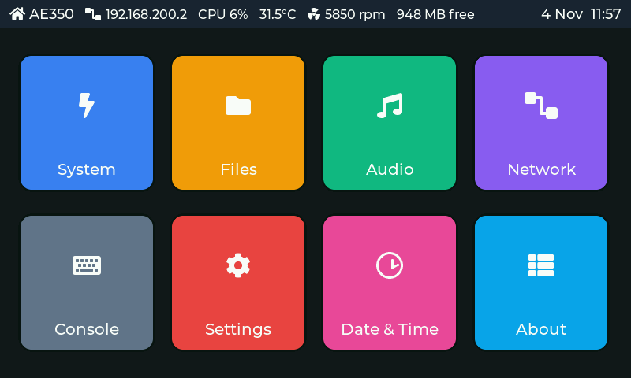

Eight tiles open the panels; every panel has a Back button.

### System

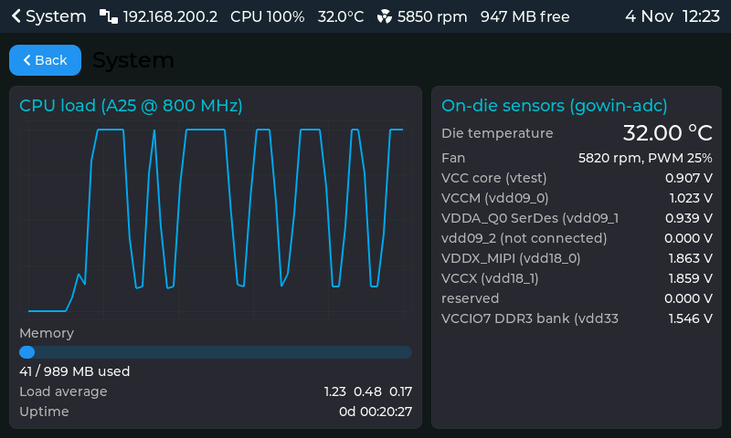

- **Chart:** CPU load of the A25 over the last minute. Here a test script alternates busy
  loops and pauses.
- **Usage:** memory, load average and uptime.
- **On-die sensors:** what `gowin-adc` reads from the FPGA's two hard ADCs: die
  temperature, the core, VCCM, SerDes, MIPI, VCCX and DDR3 bank supply rails, and the fan
  speed with its PWM duty.

### Files

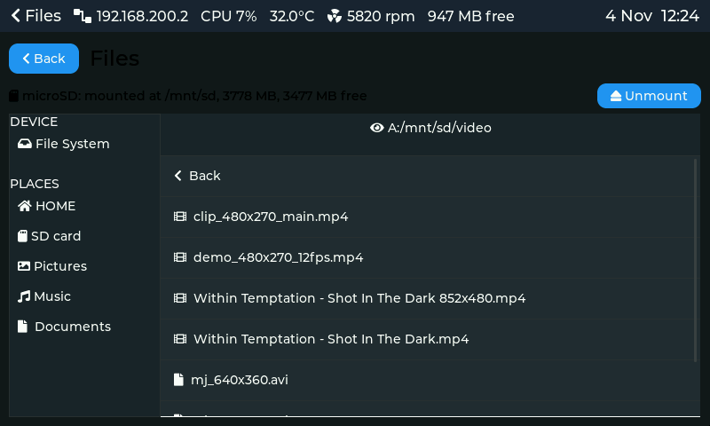

- **Browser:** a file browser over the whole filesystem, with quick places for home, the
  SD card, pictures, music and documents.
- **Clicking a file:** a text file opens a preview, `.wav` plays through `wavplay`, and
  `.avi`, `.mp4`, `.mkv`, `.mp3` and `.m4a` play through `vidplay`.
- **During playback:** the player owns the panel, and any key or click on the PC side
  stops it.
- **SD card:** the status row shows the card with its size and free space, and a
  Mount/Unmount button.

### Audio

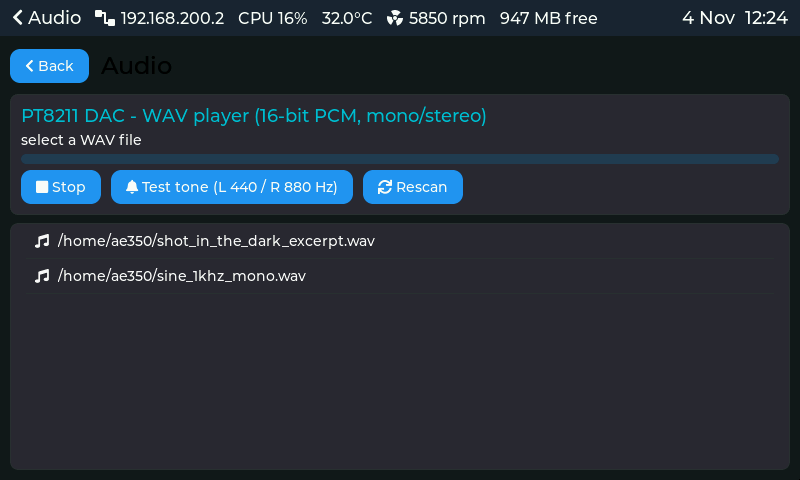

- **Playlist:** the WAV files (16-bit PCM, mono or stereo, any rate) found in `/home/ae350`
  and `/tmp`; clicking one plays it on the PT8211 DAC through `wavplay`.
- **Controls:** a progress bar and Stop. Test tone generates and plays a stereo
  440 Hz / 880 Hz file, which checks left and right. Rescan rereads the folders.

### Network

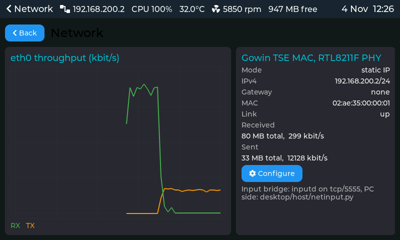

- **Chart:** eth0 receive and transmit rates. In this capture a TCP stream from the PC
  (green) is followed by one from the board (orange).
- **Details:** the mode (static or DHCP), address with prefix, gateway, MAC, link state,
  and byte counters.

**Configure** opens the dialog below. It edits what is kept in the board EEPROM: static
or DHCP, address/prefix, gateway, DNS servers, hostname and MAC. Empty fields fall back to
the defaults. The values are validated as `boardcfg` does and saved with `boardcfg set`.
The `boardcfg` daemon then writes the EEPROM and reconfigures eth0 within a second, so an
ssh session on the old address is dropped, as the dialog warns.

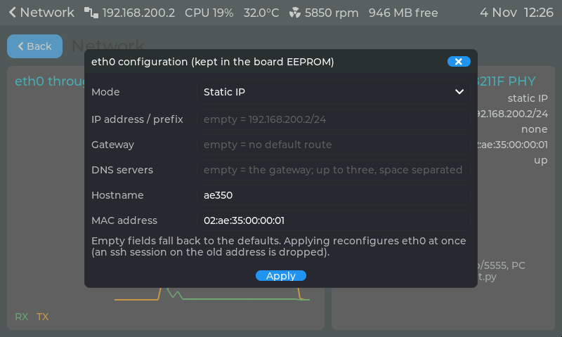

### Console

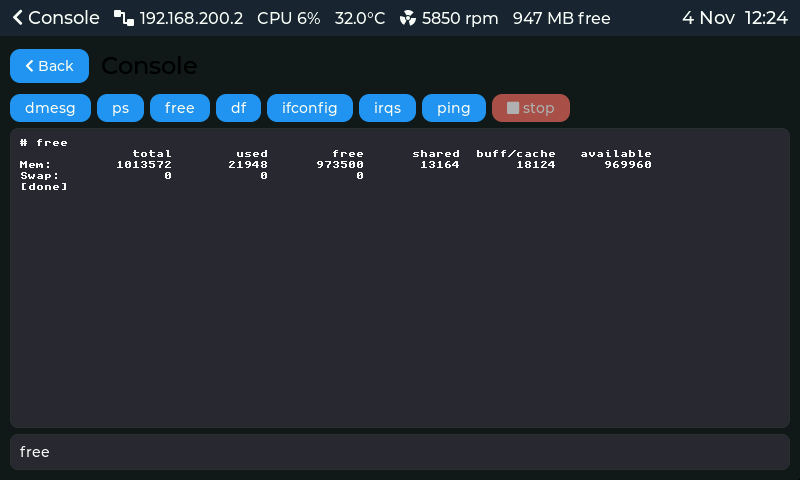

- **Command line:** runs a shell command as root and streams its output from a
  pseudo-terminal. Stop ends long-running commands such as `ping`.
- **Quick buttons:** `dmesg`, `ps`, `free`, `df`, `ifconfig`, `irqs` and `ping`.

### Settings

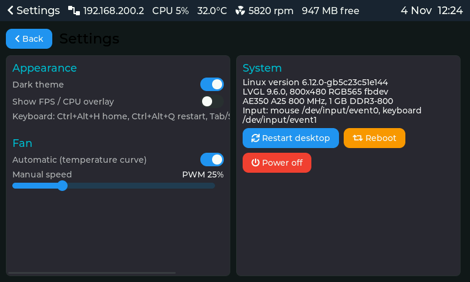

- **Appearance:** dark or light theme, and an LVGL FPS/CPU overlay.
- **Fan:** automatic, following `S80fan`'s temperature curve, or a manual PWM duty with
  a slider.
- **System:** kernel and LVGL versions and the input devices, plus Restart desktop, Reboot
  and Power off, each with confirmation.

### Date & Time

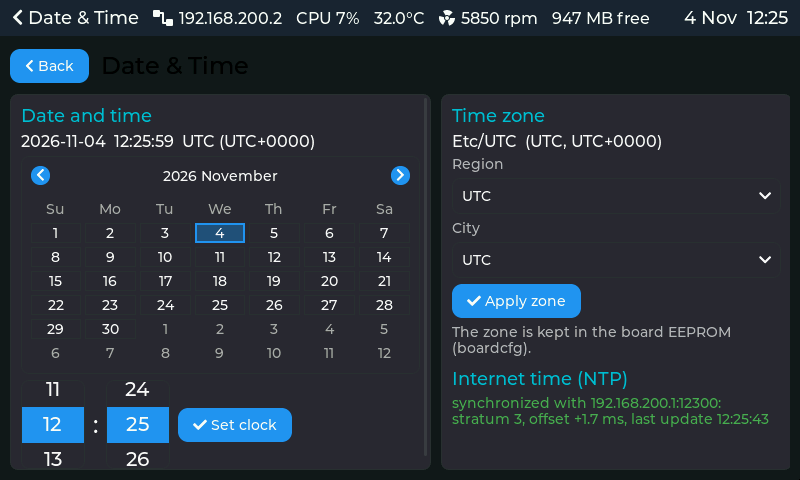

- **Clock:** a calendar and hour/minute rollers set the system clock.
- **Time zone:** region and city lists from the tzdata subset in `/usr/share/zoneinfo`.
  Applying a zone saves it through `boardcfg set tz`, so it survives a reboot.
- **Internet time (NTP):** the Dock has no RTC battery, so the clock starts at 1970 after
  every boot. `S41ntp` runs busybox `ntpd`, which sets the clock at the first server answer
  and keeps it disciplined (see [03-boot.md](03-boot.md#5-console--network-defaults)). The
  panel shows its state, read from `/run/ntp.state` every second:
  - green "synchronized with *server*": stratum, offset and the time of ntpd's last report;
  - green "clock set from *server*, refining": just after the first step;
  - orange "waiting for *servers*": no answer yet, for example no route to the internet;
  - grey "off": `boardcfg set ntp off`, the clock is set here by hand.

  Setting the clock by hand while ntpd is synchronised only lasts until its next poll.

### About

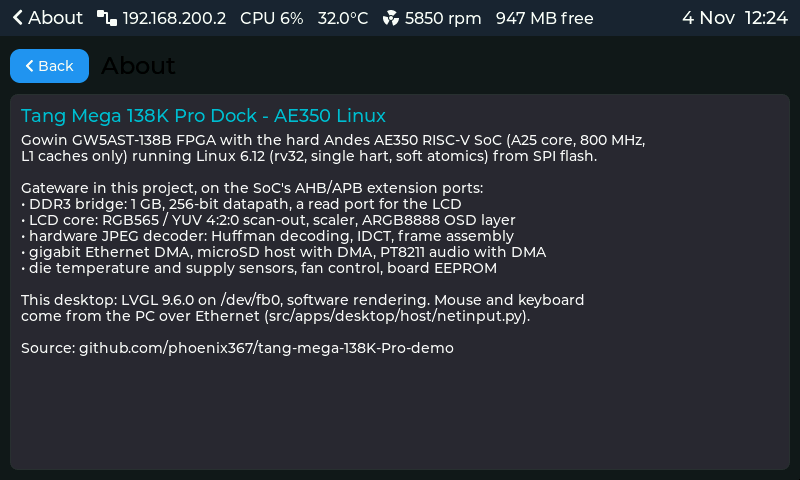

The board and the software stack in brief:
- the FPGA, the AE350 SoC and the kernel;
- the gateware cores of this project, from the DDR3 bridge to the JPEG decoder;
- the LVGL version, and where the input comes from;
- the repository.

## 2. `vidplay` — video player

`vidplay [-D pcm] [-n] [-b] [-v] [-1] [-O] [-P prof] [-C frames] file` plays a file on
the panel and the PT8211 DAC. It is built on a trimmed static FFmpeg 7.1.1
(`scripts/rootfs/build_ffmpeg.sh`): demuxers AVI, MOV/MP4, Matroska, MP3, WAV and
decoders MJPEG, AAC, MP3, PCM. MJPEG is the video codec for this SoC because each frame
is intra-only. H.264 was tried and dropped: with no L2 cache it is memory-latency bound
at ~12 fps for 480×270.


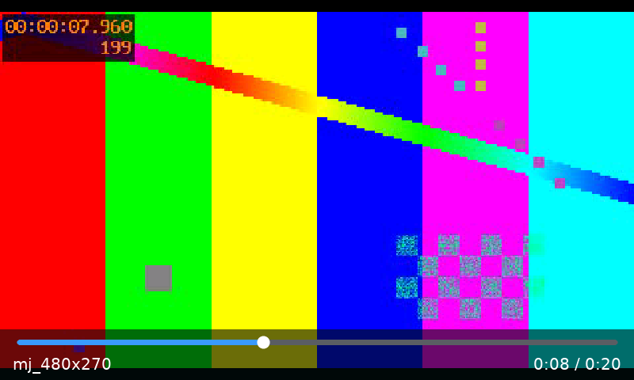

These two pictures are not photographs of the panel, which cannot be captured from
the board: the scan-out of YUV buffers and the OSD layer never pass through the RGB
framebuffer. They are computed from the hardware's own arithmetic:
- the frame decoded by FFmpeg's C code (`-idct simple`, which the board's gateware
  decode matches bit for bit);
- the LCD core's nearest-neighbour sampling, with the driver's 16.16 steps;
- its full-range fixed-point YUV→RGB;
- vidplay's real `osd.c` drawing code, blended with the core's formula;
- RGB565, as the panel receives it.

`scaletest` checks that same arithmetic against the board's frame CRC.

**How a frame gets to the panel.** vidplay picks the fastest path the gateware and
kernel offer:

| Decode | Needs | CPU per 800×480 frame |
|---|---|---|
| the gateware decodes the JPEG (`jpeg_hw.c`): vidplay parses the headers and hands tables + scan to the IDCT core | Build 70 + kernel #78 | 1.2 ms |
| FFmpeg's decoder with the IDCT and frame assembly in the gateware (`idct_hw.c`) | Build 69 + kernel #78 | 26–30 ms |
| FFmpeg on the CPU (with an Andes-DSP IDCT, `idct_dsp.c`) | — | ~40 ms |

| Display | Needs | |
|---|---|---|
| frames decoded straight into gowin-lcdfb's YUV scan-out buffers, the LCD core converts | Build 68 + kernel #77 | no conversion, no copy; a flip per frame at the frame boundary |
| fitted to the panel by the core's scaler, aspect kept, black bars | Build 71 + kernel #85 | 480×270 and 640×360 fill 800×450; 852×480 shrinks to it; `-1` keeps 1:1 centred |
| converted to RGB565 by the CPU and written with `pwrite()` | anything | the fallback, ~50 ms per 800×480 frame |

The first packet that does not fit the gateware's JPEG subset hands the stream to FFmpeg
for the rest of the file. The subset is baseline 8-bit 4:2:0, ≤ 1024 wide.

**Playback bar.** A 64-line strip at the bottom of the panel on the LCD core's OSD layer,
always shown (`-O` hides it):
- a semi-transparent near-black panel;
- an opaque slider with a grey track, the played part in blue and a white knob;
- the title and `position / duration` in opaque white, with anti-aliased edges.

It is drawn at most once a second into one of two OSD buffers and flipped, so it never
tears. The core blends it in hardware; the cost is ~1.5 % CPU.

**Audio and sync.** Audio is decoded by FFmpeg, resampled to 16-bit stereo and written to
the PT8211 with raw ALSA ioctls (period 2048, ring 16 384 frames). The audio clock is the
master. A video frame is shown when its timestamp is due. When playback is behind, an
intra-only stream skips whole packets without decoding them; other codecs skip
non-reference frames.

**Measured** (25 fps clips with audio):

| Clip | Path | Decode CPU per frame | Shown |
|---|---|---|---|
| MJPEG 800×480 + MP3 | gateware JPEG | 1.2 ms | 25 fps, nothing skipped |
| MJPEG 852×480 + AAC (music video, 5 min) | gateware JPEG + scaler | 1.5 ms | 7641 of 7641 frames |
| MJPEG 480×270 + MP3 | gateware JPEG + 1.67× upscale | 1.1 ms | 25 fps |

**Options and checks.**
- `-n`: no audio, video paced by the wall clock.
- `-b`: benchmark, decode as fast as possible without display or audio.
- `-v`: per-second statistics.
- `-P file`: PC-sampling profile, resolved with `nm` on the unstripped `vidplay.prof`.
- `-C N`: decodes the first N frames both with the gateware and with FFmpeg's own C
  code, and compares them inside the picture (`JPEGCHECK ... 0 differ`).
- Environment switches, for A/B tests:
  - `VIDPLAY_NOHWJPEG=1`: FFmpeg's decoder instead of the gateware JPEG path;
  - `VIDPLAY_NOHWIDCT=1`: no hardware IDCT either;
  - `VIDPLAY_NOYUV=1`: the RGB conversion path;
  - `VIDPLAY_OSDFREEZE=1`: draw the bar once, then never update it.

**Encoding for the panel:**

```
ffmpeg -i in.mp4 -vf scale=800:450 -c:v mjpeg -q:v 8 -pix_fmt yuvj420p -r 25 \
       -c:a aac -b:a 128k out.mp4
```

Sizes other than the panel's are fine: the core scales anything up to 1024×768.

## 3. `wavplay`

`wavplay [-D /dev/snd/pcmC0D0p] file.wav` plays a 16-bit mono or stereo WAV through the
kernel's ALSA PCM ioctls (no alsa-lib) and then verifies the playback. It reads the
audio core's frame counter and CRC through `/dev/mem` and compares them with the file's
data chunk:

```
WAVPLAY f.wav: frames N/N, crc XXXXXXXX/XXXXXXXX -> MATCH, ...
```

MATCH means every sample the DAC received was the file's, in order, with nothing lost or
repeated. The desktop's Audio and Files panels use it.

## 4. `boardcfg` — settings in the EEPROM

`/usr/sbin/boardcfg` keeps the board's settings in the Dock's 1 KB I2C EEPROM, so they
survive the RAM rootfs:

```
boardcfg                       show /etc/board.conf
boardcfg set KEY VALUE         change; the daemon writes the EEPROM and applies it
boardcfg get | unset KEY
boardcfg show -e               decode the EEPROM
boardcfg -d                    restore at boot, then watch /etc/board.conf (S35boardcfg)
```

| Key | Effect |
|---|---|
| `mac` | eth0 address; the kernel also reads it at boot through a DT nvmem cell |
| `hostname`, `tz` | host name; time zone from `/usr/share/zoneinfo` |
| `net`, `ip`, `gateway`, `dns` | `static` (default `192.168.200.2/24`) or `dhcp`; `S40network` applies them, and the daemon re-runs it when they change |
| `ntp` | time servers for `S41ntp` (`"HOST[:PORT] ..."`, up to four) or `off`; unset = the DHCP lease's servers, else `pool.ntp.org` |
| anything else | stored verbatim (`serial`, ...) |

EEPROM layout: a header at 0x100, the MAC at 0x110, and key=value text from 0x120.
Writes are verified by reading back only the changed bytes, because the I2C bus is
bit-banged and costs ~1 ms of CPU per byte. The desktop's Network dialog and Date & Time
panel save through it. Details are in `src/apps/boardcfg/README.md`.

## 5. Input bridge (`inputd` + `netinput.py`)

- **`inputd`.** It listens on TCP 5555 and creates two uinput devices, a mouse with
  absolute and relative motion, buttons and a wheel, and a keyboard. It copies 8-byte
  event records from the client into them.
- **Frame requests.** A special record asks for a frame. The answer is the raw
  framebuffer, or only the rows that changed since the client's last frame,
  run-length encoded: an idle screen costs 12 bytes, the status bar's once-a-second
  update ~8 KB, a full
  screen 60–100 KB.
- **`netinput.py`.** Tk only, no root and no python-evdev. Tk's X11 keycodes are Linux
  key codes + 8, so no key map is needed.

`inputd` accepts any client on the LAN: it is a bench tool, not a service for an
untrusted network.

## 6. Boot splash

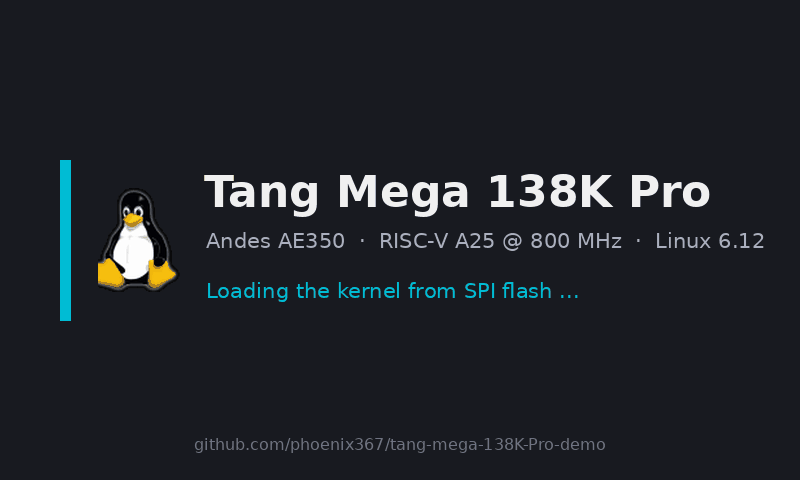

U-Boot's `gowin_lcd` driver initialises the LCD core and shows `src/splash/splash.bmp`
from about a second after power-on until the kernel's framebuffer driver takes over:
- **Image:** an 8-bit BMP made by `src/splash/make_splash.py`, with the kernel's own Tux.
- **Storage:** appended to the U-Boot image in flash at `0x700000`.
- **Kernel side:** the Linux device tree reserves its framebuffer at `0x0e000000`, so the
  picture stays up through the LZMA decompression and the kernel start.

`make_splash.py` also prints the frame CRC the core must report while the splash is shown.

## 7. Test and diagnostic tools (`src/apps/tests/`)

Built with `make -C src/apps/tests` and copied to the board with scp; they are not in the
rootfs. Most check a gateware block end to end against a model, without looking at the
panel or the speaker.

| Tool | Checks |
|---|---|
| `fbtest` | the RGB565 framebuffer path: draws bars / gradient / noise through mmap or write(), compares the core's frame CRC with the CPU's |
| `yuvtest [-l]` | the YUV 4:2:0 scan-out mode, full or limited range, by frame CRC |
| `scaletest` | the scaler and OSD layer: eight scenes by frame CRC |
| `idcttest [-x -y -s]` | the IDCT core: random blocks of a panel-sized frame against FFmpeg's integer IDCT in C, optionally at an offset |
| `wavplay` | audio bit-exactness (section 3) |
| `ddr_memtest` | DDR3 correctness, latency and bandwidth through the bridge |
| `memthroughput`, `compute_bench` | the L1-vs-DDR cliff; integer / FP throughput of the core |
| `dsp_probe`, `ext_probe` | which Andes extensions the A25 executes (DSP: yes, though `misa` does not say so) |
| `atomic_test`, `amo_probe`, `amotrace`, `cctl_probe` | the atomics investigation behind the soft-atomic stack, and cache-control CSR access ([06-key-findings.md](06-key-findings.md)) |
| `dmactest` | why the SoC's DMAC cannot reach fabric cores |

`vidplay -C N` is the corresponding check for the JPEG decoder (section 2), and
`scripts/ddr_perf.py` reads the bridge's bus counters.
