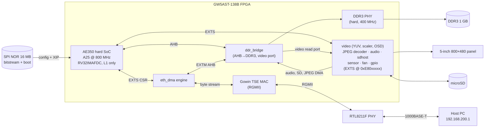

# mega_138K_test — Documentation

A **GOWIN EDA FPGA project** for the **Tang Mega 138K Pro Dock** (GW5AST-138B,
`-007`) that brings up the Andes **AE350 RISC-V SoC** (A25 core), adds custom fabric
peripherals (a fast DDR3 bridge, an **Ethernet DMA engine**, an LCD core with YUV
scan-out, scaler and OSD, a **hardware JPEG decoder**, audio, microSD, sensors, fan, the
board EEPROM), and boots **RV32 Linux** to a busybox userspace with a gigabit network
link, an LVGL desktop on the 5" panel and a video player whose frames the gateware
decodes.

This is not a typical software repo: the build flow is Gowin's `gw_sh` / IDE for
the gateware, plus separate cross-builds for the firmware, U-Boot, OpenSBI and the
Linux kernel (board forks checked out as the `external/` submodules) and the rootfs
(`scripts/rootfs/`).

## What runs on the board

## Document map

| Doc | Contents |
|---|---|
| [01-architecture.md](01-architecture.md) | Hardware architecture: requirements and results, block diagram, clocks / CDC / reset, memory budget and arbitration, datapath arithmetic, interfaces and address map, verification, implementation and timing, open issues |
| [02-build.md](02-build.md) | Building the gateware, firmware, U-Boot, OpenSBI, kernel, rootfs tools |
| [03-boot.md](03-boot.md) | Power-on → FPGA config → U-Boot → OpenSBI → Linux → userspace; flash layout |
| [04-firmware.md](04-firmware.md) | Bare-metal AE350 firmware + the eth_dma self-test suite |
| [05-eth-dma.md](05-eth-dma.md) | The Ethernet DMA RTL engine: components, RX/TX sequences, CDC, rings, CSRs |
| [06-key-findings.md](06-key-findings.md) | Soft-atomics (no coherence manager), DDR bandwidth, RGMII RX clock, RX desync, timing closure, video decoding on the A25, gotchas |
| [07-cores.md](07-cores.md) | The fabric cores: bus integration, the LCD video core (RGB, YUV, scaler, OSD), the hardware JPEG decoder, the video path end to end, audio, SD, sensors, fan, GPIO |
| [08-applications.md](08-applications.md) | The userspace programs: the desktop panel by panel (screenshots), vidplay, wavplay, boardcfg, the input bridge, the boot splash, the test tools |

Per-block references live next to the RTL: `src/rtl/ddr_bridge/README.md` (bridge
protocol, perf counters, MODE register), `video/`, `idct/`, `audio/`, `sdhost/`, `sensor/`,
`fan/`, `gpio/` and `ddr3_memory_interface_1g/` READMEs (register maps, pins, Linux drivers,
testbenches). The applications have theirs too: `src/apps/desktop/README.md` (LVGL desktop
+ network input), `src/apps/vidplay/README.md` (player, decode paths, measurements),
`src/apps/boardcfg/README.md`, `src/apps/tests/README.md`, plus `src/splash/README.md`
and `src/firmware/README.md`. The top-level `BUILD.md` / `BOOT.md` are the command-level
recipes, `CACHE_ISSUES.md` the original atomics investigation, `ETH_DMA_DESIGN.md` the
DMA engine's design notes, `PATCHES/README.md` the patch-by-patch rationale.
`doc/tools/` regenerates the images: `shot.py` drives the desktop through the input bridge
and grabs panels, and `render_panel.py` + `osd_preview.c` compute what the LCD core shows
during video playback (that scan-out cannot be grabbed from the board).

## TL;DR facts

- **Device:** Gowin Arora-V `gw5ast138b-007`, FPG676. `GOWIN_PATH=/mnt/data/Gowin_V1.9.12.02_SP2_linux`.
- **Core:** Andes A25, `marchid=0x80000a25`, RV32IMAFDC+N/S/U, **single hart**, 32 KB I + 32 KB D L1, **no L2, no coherence manager**.
- **Clocks:** 50 MHz in → core 800 MHz, AHB/APB/PLMT 50 MHz, SoC data-memory bus 100 MHz (the DDR3 IP's user clock), RTC 10 MHz, DDR3 400 MHz (DDR3-800), RGMII TX 125 MHz, LCD pixel 33.3 MHz.
- **The defining constraint:** no coherence manager ⇒ hardware atomics (`amo`/`lr-sc`) hang on a DDR cache miss ⇒ the **entire stack is built single-hart "soft-atomic"** (kernel + OpenSBI + musl). See [06-key-findings.md](06-key-findings.md).
- **Memory:** 1 GB DDR3 through the custom `src/rtl/ddr_bridge/` (256-bit datapath, one BL8 = one cache line, overlapped reads); ~23× the stock Gowin bridge, which capped everything at ~6 MB/s. The A25's page-table walker is not cache-coherent, hence kernel patch 0005.
- **Networking:** custom `eth_dma` descriptor-ring DMA (64-bit INCR16 bursts) on the SoC's EXTM/EXTS external-AHB ports + the Gowin TSE MAC. 1 Gbps link; TCP ≈65 Mbit/s RX / ≈40 TX, UDP RX lossless to 80 Mbit/s.
- **Peripherals on EXTS:** LCD core `0xE8001000`, audio `0xE8002000` (PLIC 11), ADC sensors `0xE8004000`, fan `0xE8008000`, board GPIO (Dock I2C bus / EEPROM) `0xE8010000`, SD host `0xE8020000` (PLIC 12), JPEG decoder `0xE8040000` (PLIC 13); eth_dma `0xE8000000` (PLIC 4); DDR perf counters on the external APB `0xF8000000`. Five DMA masters share EXTM through `ahb_arbiter5`. See [07-cores.md](07-cores.md).
- **Video:** the LCD core scans RGB565 or YUV 4:2:0 straight from DDR3, scales the picture into a window (nearest neighbour) and blends an ARGB8888 OSD layer. The JPEG decoder core does Huffman decoding, dequantisation, IDCT and frame assembly, bit-exact with FFmpeg. `vidplay` plays MJPEG + AAC/MP3 at 25 fps with ~1 ms of CPU per 800×480 frame.
- **Rootfs:** static musl binaries only (busybox, dropbear, doas, htop, tcpdump, the LVGL desktop, vidplay on a trimmed FFmpeg, boardcfg); every one rebuilt by `scripts/rootfs/` or `src/apps/`. See [08-applications.md](08-applications.md).
