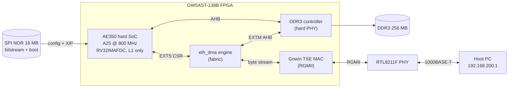

# mega_138K_test — Documentation

A **GOWIN EDA FPGA project** for the **Tang Mega 138K Pro Dock** (GW5AST-138B,
`-007`) that brings up the Andes **AE350 RISC-V SoC** (A25 core), adds a custom
**Ethernet DMA engine** in fabric, and boots **RV32 Linux** to an interactive
busybox userspace with working gigabit networking.

This is not a typical software repo: the build flow is Gowin's `gw_sh` / IDE for
the gateware, plus separate cross-builds for the firmware, U-Boot, OpenSBI, the
Linux kernel and the rootfs.

## What runs on the board

## Document map

| Doc | Contents |
|---|---|
| [01-architecture.md](01-architecture.md) | System architecture, component diagram, address map, clock tree |
| [02-build.md](02-build.md) | Building the gateware, firmware, U-Boot, OpenSBI, kernel, rootfs tools |
| [03-boot.md](03-boot.md) | Power-on → FPGA config → U-Boot → OpenSBI → Linux → userspace; flash layout |
| [04-firmware.md](04-firmware.md) | Bare-metal AE350 firmware + the eth_dma self-test suite |
| [05-eth-dma.md](05-eth-dma.md) | The Ethernet DMA RTL engine: components, RX/TX sequences, CDC, rings, CSRs |
| [06-key-findings.md](06-key-findings.md) | Soft-atomics (no coherence manager), DDR bandwidth, RGMII RX clock, RX desync, gotchas |

## TL;DR facts

- **Device:** Gowin Arora-V `gw5ast138b-007`, FPG676. `GOWIN_PATH=/mnt/data/Gowin_V1.9.12.02_SP2_linux`.
- **Core:** Andes A25, `marchid=0x80000a25`, RV32IMAFDC+N/S/U, **single hart**, 32 KB I + 32 KB D L1, **no L2, no coherence manager**.
- **Clocks:** 50 MHz in → core 800 MHz, AHB/APB/PLMT 50 MHz, RTC 10 MHz, DDR3 200 MHz, RGMII TX 125 MHz.
- **The defining constraint:** no coherence manager ⇒ hardware atomics (`amo`/`lr-sc`) hang on a DDR cache miss ⇒ the **entire stack is built single-hart "soft-atomic"** (kernel + OpenSBI + musl). See [06-key-findings.md](06-key-findings.md).
- **Networking:** custom `eth_dma` descriptor-ring DMA on the SoC's EXTM/EXTS external-AHB ports + the Gowin TSE MAC. 1 Gbps link, ping clean.
- **Throughput ceiling:** ~6 MB/s DDR (≈5 µs per cache-line miss) — a gateware memory-path limit, not the CPU or drivers.
